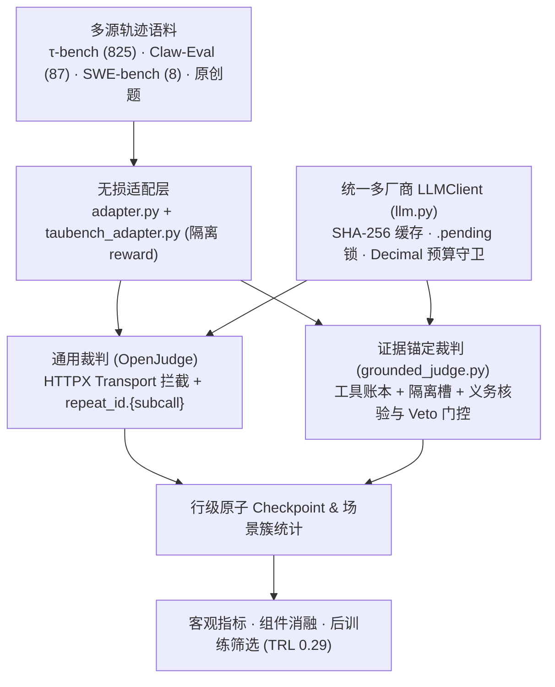

# TrajJudge

[](https://github.com/Xxly959/trajjudge/actions/workflows/ci.yml)
[](#快速开始免-key-离线复现)
[](#快速开始免-key-离线复现)
[-8957e5)](https://github.com/agentscope-ai/OpenJudge/pull/246)
[-8957e5)](https://github.com/agentscope-ai/OpenJudge/pull/248)
[](LICENSE)

> **Language**: 简体中文 · [English README](README_en.md)
>
> **核心入口**：[v3 技术报告（主报告）](reports/FINAL_REPORT_v3.md) · [对外口径总表 (CLAIMS.md)](docs/CLAIMS.md) · [简历项目话术与面试 Q&A](docs/RESUME_BULLETS_v3.md) · [离线审计看板 (HTML)](reports/showcase.html) · [预注册协议 v3](docs/PREREG_v3.md) · [设计决策与撤回记录](docs/DECISIONS.md) · [讲解卡 (Walkthrough)](notes/walkthrough/)

**一句话定位**：**TrajJudge** 是面向多步工具调用 Agent 的**轨迹元评测与质量审计框架**——在数据库可执行验证的 τ-bench 基准（`n=200` 主队列 + `n=100` 预注册独立验证集）上系统诊断通用 LLM-as-a-Judge 失效边界，以「结构化证据账本 + 工具输出隔离槽 + Python Veto 门控」构建高召回可审计轨迹裁判，并保持上游依赖（[Claw-Eval](https://github.com/claw-eval/claw-eval)、[OpenJudge](https://github.com/agentscope-ai/OpenJudge)）源码零改动。

> **核心定位（统一解释）**：结构化架构没有凭空提升模型的辨别能力。它的价值在于：① 让通用裁判从基本失效变为可用（相对 `Comprehensive` 显著提升）；② 把判定点推到高召回区，并提供可调阈值；③ 每个判定都附带证据索引和越权标记，可以审计。

### 四条核心实证发现（全部数字唯一溯源至 [docs/CLAIMS.md](docs/CLAIMS.md)）

1. **主队列配对 `ΔAUC`、判定点移动与两厂商对称复现（`n=200` / `131` 场景）**：在 τ-bench 均衡主队列（100 失败 / 100 通过，DeepSeek-V3.2 与 GPT-4o 各 100 条）上，`EvidenceGroundedGrader (glm-5.3-flash)` 排序显著优于 `OpenJudge Comprehensive`（`ROC-AUC 0.755` vs `0.628`；场景簇配对 **`ΔAUC = +0.156 [+0.053, +0.260], p=0.001`**；ITT 全量 `n=200` **`+0.121 [+0.023, +0.214], p=0.012`**）。相对 `OpenJudge Accuracy`（Flash `0.686` / Pro `0.703`），主要差别在于**判定点更偏向高召回**（多抓约 `37 pp` 失败，多误杀约 `18 pp`）并提供 `46` 档连续可调阈值：仅 GLM-Flash complete-case 下有排序提升迹象（`ΔAUC = +0.064 [+0.008, +0.123], p=0.024`，ITT `+0.045 [-0.021, +0.106]` 不显著）；在官方 `deepseek-flash`（`200/200`）上默认失败召回提升 `+31.6 pp`（`16/98 → 47/98`, McNemar `p=7.92e-09`）而**同模型 `ΔAUC = 0.000`**，印证判定点移动解释；升级 `Accuracy` 至 Pro 召回无显著变化（`27/99 → 21/100, p=0.167`）。
2. **预注册独立验证集（`n=100`）与工作点阈值迁移（[PREREG_v3 §9](docs/PREREG_v3.md)）**：在事前冻结的 `100` 条无交集验证集（因池约束 `96%` 为 `retail`）上，**主假设（`Grounded > Comprehensive` `ΔAUC > 0`）未复现**（complete `ΔAUC = -0.034 [-0.273, +0.201], n=69`；ITT `+0.014 [-0.138, +0.169], n=100`），尽管默认阈值 `Comprehensive` 仍仅抓 `2/39 (5.1%)` vs `Grounded 15/44 (34.1%)`。根因诊断为**域分布漂移**（主队列 `airline` AUC `0.853` → 验证集仅 `4%`；同域 `retail` AUC 稳定 `0.677→0.638`，无 D31 过拟合）与 **D33 推理预算混杂**（验证集 `Comprehensive` 思考链触发率从 `59.6%` 升至 `95.7%`，拉高 complete-case 但引发 `7` 条截断把 ITT 压回 `0.598`）。将主队列冻结阈值直接迁移后误杀稳住（`8.6%→2.3%`, `25.8%→22.7%`）而召回下滑，实证跨领域必须**分域校准工作点**，且 3 分制 `Accuracy` 无法平滑调至 `≥80%` 召回档。
3. **共同样本消融、越权检测与探索性发现**：在 60 条分层子集（注：该子集本身偏容易，主实验同批轨迹 AUC 亦为 `0.910`）上，complete-case 配对显示**证据账本（`ΔAUC +0.157, p=0.012`）与隔离槽（`+0.105, p=0.015`）贡献显著**，Veto 方向为正（`+0.041`）但 CI 跨 0（详见 ITT 敏感性）；3 套等价提示词 `ROC-AUC` SD 仅 `0.0092`；`unauthorized_side_effect` 精确率在 GLM-Flash (`27/32 = 84.4%`) / GLM-Pro (`30/40 = 75.0%`) / DeepSeek-Flash (`20/27 = 74.1%`) 保持稳定。探索性发现（`exploratory`）：两厂商自评检查未见明显偏倚（无 CI）；银标在 `92` 条 DB 通过轨迹中筛出 `13` 条疑似盲区（**待人工复核确认**）；P1-5 15 模板注入（`12` 轨迹/`8` 场景，中转审计 `5/675` 路由至 `nemotron`）仅作方向性探索；P2-A Best-of-4 仅 `25/50` 混合任务有区分力，保留为负结果。
4. **两项上游 OpenJudge 源码缺陷已修复并合入官方主干**：修复 `TrajectoryAccuracyGrader` 钳制覆写 `raw_score`（**[PR #246](https://github.com/agentscope-ai/OpenJudge/pull/246)** 已合入 `c58d1d6`）及 `VotingEvaluationStrategy` 连续分 `15/22 (68.2%)` 退化为 `min-of-3` 的平局可观测性缺陷（**[Issue #247](https://github.com/agentscope-ai/OpenJudge/issues/247)** 已由合入的 **[PR #248](https://github.com/agentscope-ai/OpenJudge/pull/248)** `15d22f2` 关闭）。


---

## 快速开始（免 Key 离线复现）

全部回归单测在 **Socket 断网** 环境下运行，无需 API Key 或 Docker 即可校验核心逻辑、防泄漏守卫与全部 8 张 SVG 聚合图表。

```bash
# 1. 在同级目录准备只读上游依赖（与 CI 保持一致）
git clone https://github.com/agentscope-ai/OpenJudge.git OpenJudge
git -C OpenJudge checkout 7d27246484e91c6ed4a349b6ebe7bd4629d9378f
git clone https://github.com/claw-eval/claw-eval.git claw-eval
git -C claw-eval checkout 5680b8b11ff2ee5dd2b07b89086a29a5c5c984d7

# 2. 安装隔离虚拟环境并运行密钥扫描与全量禁网测试
cd my-project
make install
make install-openjudge
make secrets
make test

# 3. 从仓库跟踪的 JSON 产物重算 8 张 SVG 图表与离线交互式看板
make figures
make showcase
```

如需复现在线调用，复制 `.env.example` 为 `.env` 并配置对应供应商 Key。所有实验脚本默认仅打印费用估算，必须显式传入 `--run --cap-usd` 才发起网络请求。

---

## 主实验结果摘要（τ-bench 200 条客观标签 / 131 独立场景）

| 评分器与模型配置 | 有效数 / 场景 | 默认召回 (`x/n`) | 默认误杀 (`x/n`) | Cohen's `κ` (95% CI) | `ROC-AUC` | `PR-AUC` | `R@FPR=10% / 20%` |
| :--- | :---: | :---: | :---: | :--- | :---: | :---: | :---: |
| **Evidence-Grounded · GLM-Flash** | `184/200` (`123`) | **`58/91` (`63.7%`)** | `24/93` (`25.8%`) | **`0.380`** `[0.231, 0.514]` | **`0.755`** | **`0.739`** | **`37.4%` / `60.4%`** |
| Evidence-Grounded · GLM-5.3 Pro | `198/200` (`129`) | `68/99` (`68.7%`) | `38/99` (`38.4%`) | `0.303` `[0.177, 0.436]` | `0.683` | `0.665` | `30.0%` / `51.5%` |
| **Evidence-Grounded · DeepSeek-Flash** | `197/200` (`130`) | `47/98` (`48.0%`) | `27/99` (`27.3%`) | `0.207` `[0.076, 0.341]` | `0.629` | `0.616` | `21.4%` / `39.6%` |
| OpenJudge Accuracy · GLM-5.3 Pro | `200/200` (`131`) | `21/100` (`21.0%`) | `4/100` (`4.0%`) | `0.170` `[0.086, 0.261]` | `0.703` | `0.665` | `36.4%` / `58.1%` |
| OpenJudge Accuracy · GLM-Flash | `199/200` (`131`) | `27/99` (`27.3%`) | `8/100` (`8.0%`) | `0.193` `[0.091, 0.308]` | `0.686` | `0.641` | `32.7%` / `55.7%` |
| OpenJudge Accuracy · DeepSeek-Flash | `200/200` (`131`) | `16/100` (`16.0%`) | `3/100` (`3.0%`) | `0.130` `[0.045, 0.217]` | `0.620` | `0.601` | `33.0%` / `40.4%` |
| OpenJudge Comprehensive · GLM-Flash | `183/200` (`125`) | `4/91` (`4.4%`) | `1/92` (`1.1%`) | `0.033` `[0.000, 0.074]` | `0.628` | `0.630` | `21.2%` / `31.9%` |
| Rule · `observation_information_gain` | `200/200` (`131`) | `8/100` (`8.0%`) | `4/100` (`4.0%`) | `0.040` `[-0.031, 0.109]` | `0.612` | `0.600` | `14.0%` / `29.0%` |

- **P1-6 组件消融共同样本配对比较（60 条分层子集，该子集本身偏容易、主实验同批 AUC 亦为 `0.910`）**：证据账本（`ΔAUC +0.157, p=0.012`）与隔离槽（`+0.105, p=0.015`）complete-case 显著，Veto 方向为正（`+0.041`）但 CI 跨 0；3 套等价提示词 `ROC-AUC` 均值 `0.900`（SD `0.0092`）。
- **探索性与负结果**：P1-5 Held-Out 注入（`exploratory`，`10/134=7.5%` vs `7/55=12.7%`，CI 重叠）；P2-A Best-of-4（仅 `25/50` 混合任务有区分力，`45.5%` vs 随机 `42.0%`，零效应负结果）；P1-3 银标在 `92` 条 DB 通过轨迹中筛出 `13` 条疑似盲区（待人工复核确认）。
- **早期探索集归档**：Claw-Eval 48 条人工盲标队列（`κ = 0.250`）已按预注册规范降级至 [FINAL_REPORT_v3.md 附录 A](reports/FINAL_REPORT_v3.md#附录-a早期-claw-eval-48-条探索性队列降级归档)。

---

## 系统架构与工程护栏



---

## 仓库目录

```text
src/trajjudge/            核心包（taubench_adapter, grounded_judge, openjudge_bridge, llm, perturb_v3, calibration）
scripts/                  P1/P2 实验驱动、离线统计、跨源快照与 8 张 SVG / HTML 看板生成脚本
tasks/original/           原创 Harbor 容器化编程题与 5 路黑盒 Verifier
contributions/openjudge/  已合入上游 OpenJudge 的 PR #246 / PR #248 补丁与 Issue #247 归档
reports/                  FINAL_REPORT_v3.md、8 张 SVG 图表、showcase.html 与全部聚合 JSON 产物
docs/                     CLAIMS.md 口径总表、RESUME_BULLETS_v3、PREREG_v3、DECISIONS 与 archive/
notes/walkthrough/        8 份里程碑讲解卡与面试复盘练习（含 07 盲区复核、08 配对 ΔAUC 与工作点）
tests/                    离线禁网单测（含 P0-2/P1-5 防泄漏守卫、口径守卫与密钥扫描）
```

---

## 已知局限与研究声明

1. **第三方中转站与两厂商范围声明（[D32 / D34 / D35](docs/DECISIONS.md)）**：GLM 结果经第三方中转站 `api.hubcore.cn` 获得，模型身份以 `.cache/llm/` 响应 `raw_response.model` 为准（[relay_audit.json](reports/relay_audit.json)：P1 主队列/P1-6/P1-3/P2-A 与 `p1val` 324 条 100% 返回 GLM 系列，仅探索性 `p15` 中 `5/675` 被路由至 `nemotron`）；官方直连 `deepseek-flash` 作为可复现对照。此外面对 7KB 政策存在轻推理预算敏感性（`DeepSeek-Flash` `AUC 0.629`）。
2. **独立验证集与纯离线重排边界**：预注册 `n=100` 验证集（96% retail）中主假设未复现（受域漂移与 D33 推理预算混杂影响），且工作点迁移表明须分域校准阈值；P2-A Best-of-4 仅 25/50 混合任务可区分选法，整体为零效应负结果。
3. **中性对照臂与人工复核状态**：Phase 5 中性对照（`10/16` 配对）仍标 `provisional`；P1-3 `13/92` 疑似盲区尚未完成人工最终复核（`reports/p13_human_review.json` 处于 `pending_human_review`）。
4. **隐私与合规**：原始轨迹、私有盲标、人工复核原文与 API 缓存均严格隔离于 `.gitignore`，全量密钥扫描纳入 CI。

> **协作声明**：本项目使用 AI 编程助手辅助实现，实验设计、统计口径校验与结果复核由作者完成。
