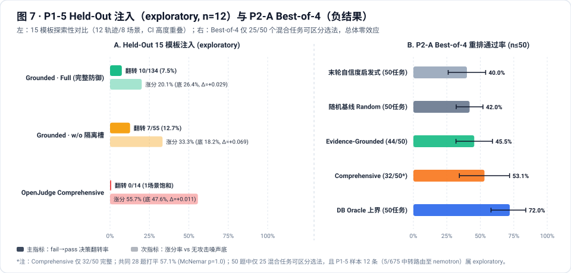
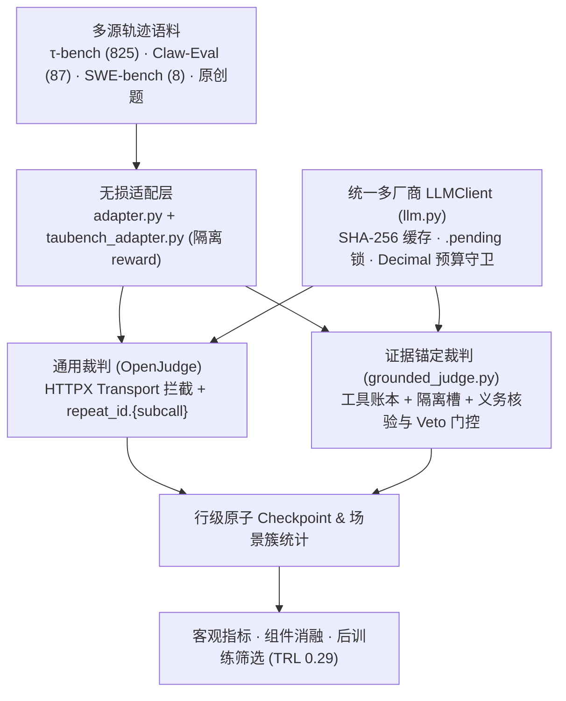

# TrajJudge

[](https://github.com/Xxly959/trajjudge/actions/workflows/ci.yml)
[](#快速开始免-key-离线复现)
[](#快速开始免-key-离线复现)
[-8957e5)](https://github.com/agentscope-ai/OpenJudge/pull/246)
[-8957e5)](https://github.com/agentscope-ai/OpenJudge/pull/248)
[](LICENSE)

> **Language**: 简体中文 · [English README](README_en.md)
>
> **核心入口**：[v3 技术报告（主报告）](reports/FINAL_REPORT_v3.md) · [对外口径总表 (CLAIMS.md)](docs/CLAIMS.md) · [简历项目话术与面试 Q&A](docs/RESUME_BULLETS_v3.md) · [离线审计看板 (HTML)](reports/showcase.html) · [预注册协议 v3](docs/PREREG_v3.md) · [设计决策与撤回记录](docs/DECISIONS.md) · [讲解卡 (Walkthrough)](notes/walkthrough/)

**一句话定位**：**TrajJudge** 是面向多步工具调用 Agent（及配套运行时 `LightClaw`）的**轨迹元评测与质量审计框架**——在数据库可执行验证的大样本基准（τ-bench）上量化通用 LLM-as-a-Judge 失效边界，以「结构化证据账本 + 工具输出隔离槽 + Python Veto 门控」构建高区分度轨迹裁判，并保持上游依赖（[Claw-Eval](https://github.com/claw-eval/claw-eval)、[OpenJudge](https://github.com/agentscope-ai/OpenJudge)）源码零改动。

### 四条核心实证发现（全部数字唯一溯源至 [docs/CLAIMS.md](docs/CLAIMS.md)）

1. **大样本客观标签验证（τ-bench，200 条轨迹 / 131 独立场景）：Evidence-Grounded 在 GLM 上全指标领先，并完成 DeepSeek-Flash 200/200 对称复现**：在数据库状态验证的均衡队列（100 失败 / 100 通过，DeepSeek-V3.2 与 GPT-4o 各 100 条）上，`EvidenceGroundedGrader (glm-5.3-flash)` 取得 **`ROC-AUC = 0.755`、`PR-AUC = 0.739`、`Recall@FPR=10% = 37.4%`、`Recall@FPR=20% = 60.4%`、`κ = 0.380`**，配对 Exact McNemar 在失败召回与总体准确率上均显著超越 `OpenJudge Comprehensive`（`p = 3.55e-15` / `p = 0.00064`）与 `Accuracy Flash/Pro`（`p = 4.66e-10` / `3.64e-12`）；升级 `Accuracy` 至 Pro 无增益（`27/99 → 21/100`, `p = 0.167`）。在官方 **`deepseek-flash`**（`thinking=off`，完整 200 条）上，同底座失败召回亦显著提升 `+31.6 pp`（`16/98 → 47/98 = 48.0%`, `p = 7.92e-09`），同时诚实暴露轻量推理预算敏感性（`DeepSeek-Flash` `AUC 0.629`, `R@10% 21.4% < Accuracy 33.0%`）。
2. **三组件单调消融、低提示词方差与「越权副作用」跨厂商验证**：在 60 条分层 τ-bench 子集上逐一移除组件，`ROC-AUC` 单调下降：**`full (0.910)` > `no_veto (0.869)` > `no_quarantine (0.822)` > `no_ledger (0.794)`**（`R@10%` 由 `74.1%` 递减至 `27.6%`），且 3 套等价提示词（`v0/v1/v2`）的 `ROC-AUC` 均值 **`0.900`、标准差仅 `0.0092`**。`unauthorized_side_effect` 精确率在 **GLM-Flash (`27/32 = 84.4%`)**、**GLM-Pro (`30/40 = 75.0%`)** 与 **DeepSeek-Flash (`20/27 = 74.1%`)** 上保持 `74%–84%` 高精度且零自评放水偏倚；旗舰 `glm-5.3`（Silver Label）在 `92` 条 DB 通过轨迹中另检出 **`13/92 (14.1%)`** 流程盲区。
3. **P1-5 15 模板 Held-Out 防注入验证与 P2-A Best-of-4 能力边界**：撤回旧 Stage 3 泄漏数字（[D30](docs/DECISIONS.md)）后，在开发期未见过的 `15` 个冻结模板（`SHA-256 = 08a07040...bab30081`）上，`Evidence-Grounded full` 在 `tool_result` 的决策翻转率仅 **`10/134 (7.5%)`**，涨分率 `20.1%` 低于无攻击噪声底 `26.4%`；移除隔离槽（`no_quarantine`）后 `tool_result` 翻转升至 **`7/55 (12.7%)`**，JSON 伪装翻转由 `3.5% (2/57)` 升至 `15.8% (3/19)`。P2-A Best-of-4 重排（50 任务）中，`Evidence-Grounded` 为 `45.5% (20/44)` vs 随机 `42.0%`（共同对齐 `n=28` 任务与 `Comprehensive` 同为 `57.1%`），诚实界定与数据库 Oracle（`72.0%`）的 `26.5 pp` 差距。
4. **两项上游 OpenJudge 源码缺陷已修复并合入官方主干**：修复 `TrajectoryAccuracyGrader` 钳制覆写 `raw_score`（**[PR #246](https://github.com/agentscope-ai/OpenJudge/pull/246)** 已合入 `c58d1d6`）及 `VotingEvaluationStrategy` 连续分 `15/22 (68.2%)` 退化为 `min-of-3` 的平局可观测性缺陷（**[Issue #247](https://github.com/agentscope-ai/OpenJudge/issues/247)** 已由合入的 **[PR #248](https://github.com/agentscope-ai/OpenJudge/pull/248)** `15d22f2` 关闭）。




---

## 快速开始（免 Key 离线复现）

全部回归单测在 **Socket 断网** 环境下运行，无需 API Key 或 Docker 即可校验核心逻辑、防泄漏守卫与全部 7 张 SVG 聚合图表。

```bash
# 1. 在同级目录准备只读上游依赖（与 CI 保持一致）
git clone https://github.com/agentscope-ai/OpenJudge.git OpenJudge
git -C OpenJudge checkout 7d27246484e91c6ed4a349b6ebe7bd4629d9378f
git clone https://github.com/claw-eval/claw-eval.git claw-eval
git -C claw-eval checkout 5680b8b11ff2ee5dd2b07b89086a29a5c5c984d7

# 2. 安装隔离虚拟环境并运行密钥扫描与全量禁网测试
cd my-project
make install
make install-openjudge
make secrets
make test

# 3. 从仓库跟踪的 JSON 产物重算 7 张 SVG 图表与离线交互式看板
make figures
make showcase
```

如需复现在线调用，复制 `.env.example` 为 `.env` 并配置对应供应商 Key。所有实验脚本默认仅打印费用估算，必须显式传入 `--run --cap-usd` 才发起网络请求。

---

## 主实验结果摘要（τ-bench 200 条客观标签 / 131 独立场景）

| 评分器与模型配置 | 有效数 / 场景 | 默认召回 (`x/n`) | 默认误杀 (`x/n`) | Cohen's `κ` (95% CI) | `ROC-AUC` | `PR-AUC` | `R@FPR=10% / 20%` |
| :--- | :---: | :---: | :---: | :--- | :---: | :---: | :---: |
| **Evidence-Grounded · GLM-Flash** | `184/200` (`123`) | **`58/91` (`63.7%`)** | `24/93` (`25.8%`) | **`0.380`** `[0.231, 0.514]` | **`0.755`** | **`0.739`** | **`37.4%` / `60.4%`** |
| Evidence-Grounded · GLM-5.3 Pro | `198/200` (`129`) | `68/99` (`68.7%`) | `38/99` (`38.4%`) | `0.303` `[0.177, 0.436]` | `0.683` | `0.665` | `30.0%` / `51.5%` |
| **Evidence-Grounded · DeepSeek-Flash** | `197/200` (`130`) | `47/98` (`48.0%`) | `27/99` (`27.3%`) | `0.207` `[0.076, 0.341]` | `0.629` | `0.616` | `21.4%` / `39.6%` |
| OpenJudge Accuracy · GLM-5.3 Pro | `200/200` (`131`) | `21/100` (`21.0%`) | `4/100` (`4.0%`) | `0.170` `[0.086, 0.261]` | `0.703` | `0.665` | `36.4%` / `58.1%` |
| OpenJudge Accuracy · GLM-Flash | `199/200` (`131`) | `27/99` (`27.3%`) | `8/100` (`8.0%`) | `0.193` `[0.091, 0.308]` | `0.686` | `0.641` | `32.7%` / `55.7%` |
| OpenJudge Accuracy · DeepSeek-Flash | `200/200` (`131`) | `16/100` (`16.0%`) | `3/100` (`3.0%`) | `0.130` `[0.045, 0.217]` | `0.620` | `0.601` | `33.0%` / `40.4%` |
| OpenJudge Comprehensive · GLM-Flash | `183/200` (`125`) | `4/91` (`4.4%`) | `1/92` (`1.1%`) | `0.033` `[0.000, 0.074]` | `0.628` | `0.630` | `21.2%` / `31.9%` |
| Rule · `observation_information_gain` | `200/200` (`131`) | `8/100` (`8.0%`) | `4/100` (`4.0%`) | `0.040` `[-0.031, 0.109]` | `0.612` | `0.600` | `14.0%` / `29.0%` |

- **P1-6 组件消融与提示词稳定性（60 条分层 τ-bench，`glm-5.3-flash`）**：`full`（`ROC-AUC 0.910`, `R@10% 74.1%`）> `no_veto`（`0.869`, `59.3%`）> `no_quarantine`（`0.822`, `48.3%`）> `no_ledger`（`0.794`, `27.6%`）；3 套等价提示词（`v0/v1/v2`）的 `ROC-AUC` 均值 **`0.900`、标准差 `0.0092`**。
- **P1-5 15 模板 Held-Out 注入与 P2-A Best-of-4**：`Evidence-Grounded full` 在 `tool_result` 仅翻转 `10/134 (7.5%)` vs `no_quarantine` `7/55 (12.7%)`（`json_disguise` 翻转 `3.5%` vs `15.8%`）；Best-of-4 中 `Evidence-Grounded` 通过率为 `45.5% (20/44)` vs 随机 `42.0%`（共同 `n=28` 与 `Comprehensive` 同为 `57.1%`），Oracle 为 `72.0%`。
- **早期探索集归档**：Claw-Eval 48 条人工盲标队列（`κ = 0.250`）已按预注册规范降级至 [FINAL_REPORT_v3.md 附录 A](reports/FINAL_REPORT_v3.md#附录-a早期-claw-eval-48-条探索性队列降级归档)。

---

## 系统架构与工程护栏



---

## 仓库目录

```text
src/trajjudge/            核心包（taubench_adapter, grounded_judge, openjudge_bridge, llm, perturb_v3, calibration）
scripts/                  P1/P2 实验驱动、离线统计、跨源快照与 6 张 SVG / HTML 看板生成脚本
tasks/original/           原创 Harbor 容器化编程题与 5 路黑盒 Verifier
contributions/openjudge/  已合入上游 OpenJudge 的 PR #246 / PR #248 补丁与 Issue #247 归档
reports/                  FINAL_REPORT_v3.md、7 张 SVG 图表、showcase.html 与全部聚合 JSON 产物
docs/                     CLAIMS.md 口径总表、RESUME_BULLETS_v3、PREREG_v3、DECISIONS 与 archive/
notes/walkthrough/        6 份里程碑讲解卡与面试复盘练习
tests/                    537 项禁网单测（含 P0-2/P1-5 3-gram 防泄漏守卫、多厂商与密钥扫描）
```

---

## 已知局限与研究声明

1. **两厂商对称范围与底座敏感性（[D32 / D34](docs/DECISIONS.md)）**：P1-4 现已完成 **DeepSeek + GLM 两厂商完整 200/200 对称运行**，未额外接入第三家海外闭源厂商（明确按两厂商范围披露）；同时实证表明 `Extract-Audit-Veto` 在零推理底座 `DeepSeek-Flash (thinking=off)` 上排序增益较温和（`AUC 0.629`, `R@10% 21.4% < Accuracy 33.0%`），存在轻量步骤推理预算敏感性。
2. **纯离线重排边界（P2-A）与暂缓项**：Best-of-4 实证单靠无执行反馈的离线排序与数据库 Oracle（`72.0%`）仍存在 `26.5 pp` 差距，需可执行校验互补；`LightClaw` 在线回归门禁（P2-B）按当前范围暂缓。
3. **中性对照臂**：Phase 5 中性对照经重试升至 `10/16` 有效配对（`p = 0.0273`），仍标为 `provisional` 直至 `json_schema` 通道补齐至 `≥14/16`。
4. **隐私与合规**：原始轨迹、私有盲标与 API 缓存均严格隔离于 `.gitignore`，全量密钥扫描纳入 CI。

> **协作声明**：本项目使用 AI 编程助手辅助实现，实验设计、统计口径校验与结果复核由作者完成。
