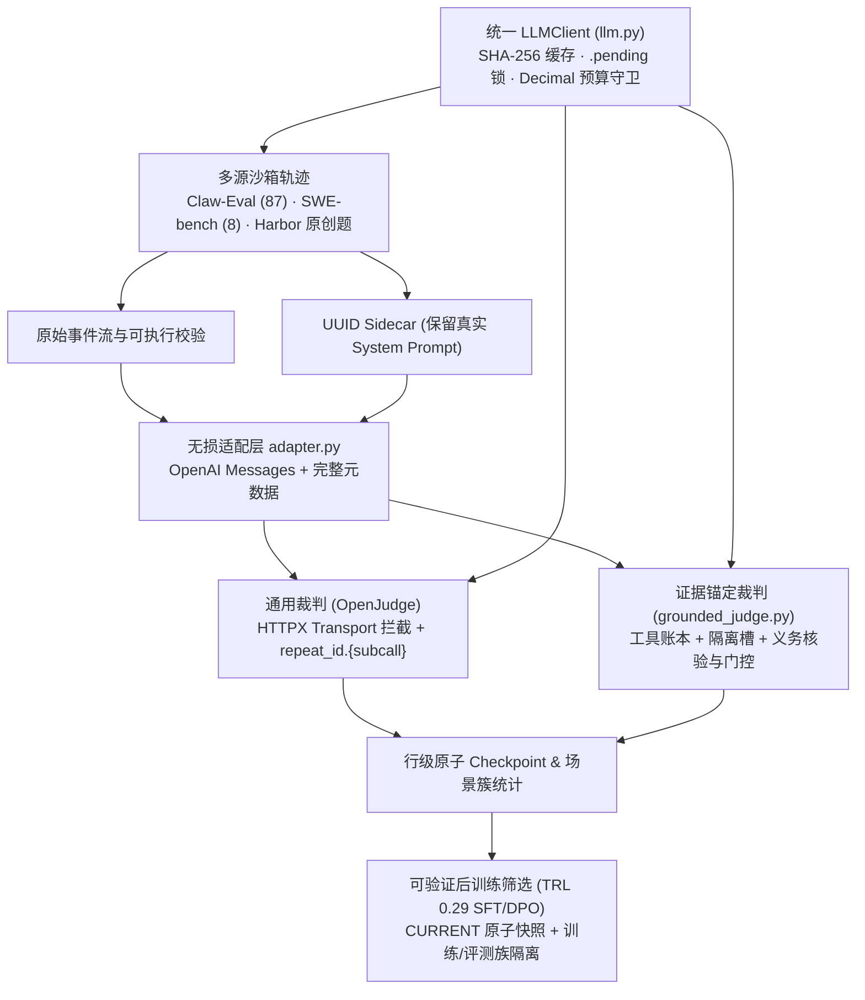

# TrajJudge

[](https://github.com/Xxly959/trajjudge/actions/workflows/ci.yml)
[](#快速开始免-key-离线复现)
[](#快速开始免-key-离线复现)
[-8957e5)](https://github.com/agentscope-ai/OpenJudge/pull/246)
[-8957e5)](https://github.com/agentscope-ai/OpenJudge/pull/248)
[](LICENSE)

> **Language**: 简体中文 · [English README](README_en.md)
>
> **核心入口**：[对外口径总表 (CLAIMS.md)](docs/CLAIMS.md) · [v2 技术报告](reports/FINAL_REPORT_v2.md) · [离线审计看板 (HTML)](reports/showcase.html) · [预注册协议](docs/PREREG_v2.md) · [设计决策与撤回记录](docs/DECISIONS.md) · [成本账本](docs/BUDGET_v2.md)

**一句话定位**：**TrajJudge** 是面向多步工具调用 Agent（及配套运行时 `LightClaw`）的**轨迹元评测与质量审计框架**——先量化通用 LLM-as-a-Judge 裁判在哪里失效、再构建证据锚定与可执行校验结合的评测管线，同时保持上游依赖（[Claw-Eval](https://github.com/claw-eval/claw-eval)、[OpenJudge](https://github.com/agentscope-ai/OpenJudge)）源码零改动。

### 三条核心实证发现（全部数字溯源至 [docs/CLAIMS.md](docs/CLAIMS.md)）

1. **通用 LLM 轨迹裁判默认阈值严重漏判，且单纯换更大模型无增益**（探索性，48 条盲标轨迹 / 28 独立场景）：OpenJudge 两个通用裁判在默认阈值下仅召回 `0/14`（`Comprehensive`）与 `1/14`（`Accuracy`）失败；将 `Accuracy` 从 `deepseek-flash` 升级到 `deepseek-v4-pro`，失败召回仍为 `1/14`（Exact McNemar `p = 1.000`）。在同误杀率对比（`FPR = 10%`）下，基于当前 48 条探索性标签，`EvidenceGroundedGrader` 尚未超过重新设阈值的 `Comprehensive`（插值召回 `22.0%` vs `42.9%`；`PR-AUC` `0.375` vs `0.558`），且离线审计证实代码侧 Veto 覆写为 `0/109`，说明改进需在更大规模客观标签数据集（P1 τ-bench + Claw-Eval 扩充）上继续验证。
2. **工具返回间接注入可显著推高连续评分，但必须对照无攻击噪声底解读**：全网格扫描中，`L3_notice/tool_result` 使未防御 `Comprehensive` 涨分率达 `89.4%`（`42/47`，归一化位移 `+0.054`，Holm `p_adj = 0.0078`），显著高于无攻击重复打分噪声底 `43.8%`（`42/96`）；加安全声明后涨分率降至 `45.5%`（`20/44`，接近噪声底 `38.6%`），但结构化输出校验异常率从 `0.93%`（`8/864`）升至 `2.20%`（`19/864`，Fisher `p = 0.0504`）。旧 Stage 3 Grounded 的 `6.25%` 防御数字因存在正则模板泄漏已按 [D30](docs/DECISIONS.md) 正式撤回，待 P1-5 held-out 攻击集重测。
3. **两项上游 OpenJudge 源码缺陷已修复并合入官方主干**：定位并修复 `TrajectoryAccuracyGrader` 钳制覆盖 `raw_score`（**[PR #246](https://github.com/agentscope-ai/OpenJudge/pull/246)** 已合入 `c58d1d6`），以及 `VotingEvaluationStrategy` 在连续分上 `15/22`（`68.2%`）面板退化为 `min-of-3` 的可观测性缺陷（**[Issue #247](https://github.com/agentscope-ai/OpenJudge/issues/247)** 已由合入的 **[PR #248](https://github.com/agentscope-ai/OpenJudge/pull/248)** `15d22f2` 关闭）。


---

## 快速开始（免 Key 离线复现）

全部 528 项回归单测在 **Socket 断网** 环境下运行，无需 API Key 或 Docker 即可校验核心逻辑、防泄漏守卫与全部聚合图表。

```bash
# 1. 在同级目录准备只读上游依赖（与 CI 保持一致）
git clone https://github.com/agentscope-ai/OpenJudge.git OpenJudge
git -C OpenJudge checkout 7d27246484e91c6ed4a349b6ebe7bd4629d9378f
git clone https://github.com/claw-eval/claw-eval.git claw-eval
git -C claw-eval checkout 5680b8b11ff2ee5dd2b07b89086a29a5c5c984d7

# 2. 安装隔离虚拟环境并运行全量禁网测试与密钥扫描
cd my-project
make install
make install-openjudge
make secrets
make test

# 3. 从仓库跟踪的 JSON 产物重算图表与离线交互式看板
make figures
make showcase
```

如需复现在线调用，复制 `.env.example` 为 `.env` 并填入 `DEEPSEEK_API_KEY`。所有实验脚本默认仅打印费用估算，必须显式传入 `--run --cap-usd` 才发起网络请求。

---

## 核心实验结果摘要（详细口径与 CI 见 [docs/CLAIMS.md](docs/CLAIMS.md)）

### 1. 评分器可靠性与同误杀率对比（48 条冻结盲标 / 28 独立场景，探索性 `v2` 标签）

| 评分器与模型配置 | 默认阈值召回 (`x/14`) | 正常样本误杀 (`x/n`) | Cohen's `κ` (95% 簇 CI) | `ROC-AUC` | `PR-AUC` | `Recall@FPR=10%` (step / interp) |
| :--- | :---: | :---: | :--- | :---: | :---: | :---: |
| **OpenJudge Comprehensive · Flash** (`≥0.60`) | `0/14` (`0.0%`) | `0/34` (`0.0%`) | `0.000` (不可估) | `0.744` | `0.558` | `42.9%` / `42.9%` |
| **OpenJudge Accuracy · Flash** (`≥2.0`) | `1/14` (`7.1%`) | `1/34` (`2.9%`) | `0.056` `[0.000, 0.187]` | `0.556` | `0.333` | `14.3%` / `20.5%` |
| **OpenJudge Accuracy · v4-Pro** | `1/14` (`7.1%`) | `2/34` (`5.9%`) | `0.016` `[-0.047, 0.113]` | `0.506` | `0.295` | `7.1%` / `11.2%` |
| **Evidence-Grounded · Flash** (`≥0.50`, `n=47`) | `2/14` (`14.3%`) | `3/33` (`9.1%`) | `0.064` `[-0.112, 0.288]` | `0.530` | `0.363` | `14.3%` / `15.1%` |
| **Evidence-Grounded · v4-Pro** (`≥0.50`, `n=46`) | `3/14` (`21.4%`) | `3/32` (`9.4%`) | `0.144` `[-0.085, 0.432]` | `0.557` | `0.375` | `21.4%` / `22.0%` |
| **Claw-Eval 任务专属混合 Rubric** (二值) | `5/14` (`35.7%`) | `0/34` (`0.0%`) | `0.440` `[0.101, 0.780]` | `0.679` | `0.545` | `35.7%` / `42.1%` |

- **28 折留一场景校准（LOSO）**：`Comprehensive` 在均衡准确率目标下仍漏判 `10/16`（`62.5%`）并误杀 `5/32`（`15.6%`）；若强行压低漏判至 `≤25%`，则误杀率升至 `23/32`（`71.9%`）。`Accuracy` 在 `miss ≤ 50%/25%/10%` 目标下全部退化为 `always_fail`（误杀 `32/32`）。
- **离线组件审计（P1-6 离线）**：在全部 `109` 条已有有效 Grounded 评估中，代码侧 Veto 覆写模型 `pass` 判定的比例为 `0/109`（`0.0%`），表明当前小样本上的默认阈值召回变化来自审计提示词与账本拆解，而非后置 Veto 门控本身（见 [reports/veto_ablation_offline.json](reports/veto_ablation_offline.json)）。

### 2. 系统架构与工程护栏



- **上游零改动可复现**：通过 `DIST_EXTRA_CONFIG` 与 `PYTHONDONTWRITEBYTECODE=1` 隔离构建元数据，单测自动校验上游目录零变更。
- **子调用级确定性缓存（`repeat_id.{subcall}`）**：在 [SharedCompletionTransport](src/trajjudge/openjudge_bridge.py) 中注入子调用序号，避免 `Average` / `Voting` 重复采样误命中同一缓存。
- **Fail-Closed 预算守卫与原子续跑**：付费调用前写入 `.pending` 锁并按字节上界预留费用；行级原子落盘支持 `HTTP 402` 中断后无脏写续跑。

---

## 仓库目录

```text
src/trajjudge/            核心包（adapter, openjudge_bridge, llm, grounded_judge, calibration, scenario_stats）
scripts/                  实验运行、离线统计（p0_analysis.py）、跨源/数据快照与 SVG/HTML 生成脚本
tasks/original/           原创 Harbor 容器化编程题与 5 路黑盒 Verifier
contributions/openjudge/  合入上游 OpenJudge 的 PR #246 / PR #248 补丁与 Issue #247 归档
reports/                  技术报告、5 张 SVG 图表、showcase.html 与全部聚合 JSON 产物
docs/                     CLAIMS.md 口径总表、PREREG_v2、DECISIONS、BUDGET_v2 与 archive/ 历史过程文档
notes/walkthrough/        关键改动讲解卡与复盘练习
tests/                    528 项禁网单测（含模板防泄漏守卫与密钥扫描）
```

---

## 已知局限与研究声明

1. **样本规模与人工参照噪声**：当前核心实验基于 48 条人工盲标轨迹（28 独立场景），双轮盲标 `κ = 0.250 < 0.60`，因此所有人工参照指标严格定位为 **exploratory**。下一阶段（P1）将基于 **τ-bench + 扩充 Claw-Eval** 的程序可验证客观标签（目标 `≥ 100` 失败、`≥ 60` 独立场景）重跑核心对照。
2. **单一模型供应商**：现有实测仅覆盖 DeepSeek 家族（`deepseek-flash` / `deepseek-v4-pro`），尚未剥离同源模型自评偏好（Self-Preference Bias）；多厂商裁判对照（P1-4）与 held-out 注入攻击评估（P1-5）将在 P1 阶段补齐。
3. **中性对照臂低覆盖**：Phase 5 中性通知对照因无 `json_schema` 约束导致 `11/32` 格式缺失（仅 `6/16` 有效配对），当前结果标为 `provisional`，代码层已补齐 `json_schema` 与校验重试支持，待在线重跑至 `≥ 14/16` 有效配对。
4. **隐私与合规**：提示注入实验仅针对本地评测配置；原始轨迹、私有盲标与 API 缓存均严格隔离于 `.gitignore`。

> **协作声明**：本项目使用 AI 编程助手辅助实现，实验设计、统计口径校验与结果复核由作者完成。
