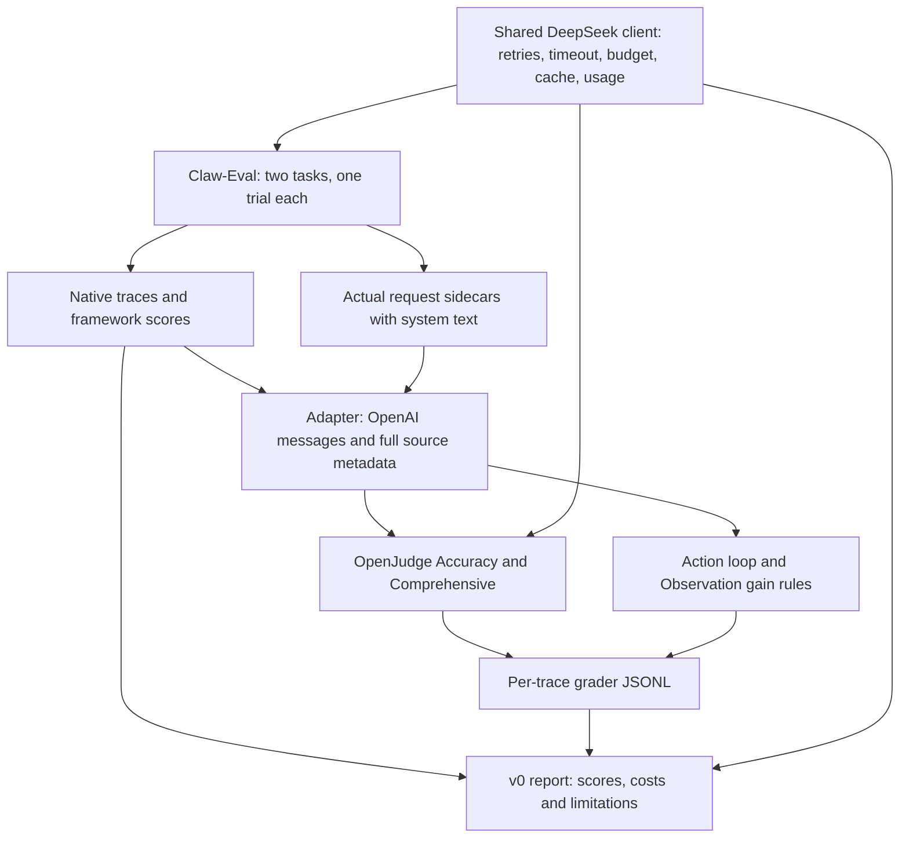

# trajjudge

An open research project on the reliability and prompt-injection resistance of
LLM graders evaluating agent trajectories. It connects
[Claw-Eval](https://github.com/claw-eval/claw-eval) traces to
[OpenJudge](https://github.com/agentscope-ai/OpenJudge) graders.

**Phase 1 delivered the integration, two real task executions, four graders and
a [v0 report](reports/phase1.md).** The two-task pilot verifies the pipeline.
Later phases address grader agreement, stability and injection resistance.

**Working status, 2026-11-10:** recovery, a frozen blind-annotation kit,
recoverable stage drivers and offline analysis are available. RQ1 has a partial
comparison on 48 human labels. A ten-trace Flash Direct stability pilot has
119 valid results and one preserved error. The four-trace follow-up compared
Flash strategies and Flash/Pro Direct. The formal LLM injection experiment
remains pending. The free
rule-control report is exploratory. An OpenJudge fix is prepared locally and is
unsubmitted. These are draft status statements, not approved resume conclusions.
P2's main judge run now has 100/100 valid verdicts. The single-case sampling probe
has 18 observations (17 new calls plus one cache reuse), 15 valid and three genuine
format errors. Both runs replay from cache. Coverage does not establish correctness;
the probe does not establish general stability. See [execution record](docs/APPROVED_RUNS.md).
See [recovery](docs/STATE_RECOVERY.md), [current checkpoint](docs/PROGRESS.md),
[runbook and proposed budgets](docs/EXPERIMENT_RUNBOOK.md),
[incomplete research report](reports/FINAL_REPORT.md),
[resume draft](docs/RESUME_NOTES.md), and [Chinese walkthrough](docs/WALKTHROUGH.md).

```sh
make test                     # offline, all model requests mocked
make phase1                   # historical cache replay; needs restored evidence
make phase2 phase3 phase4      # offline analysis; explicitly pending without data
make rule-controls            # free deterministic perturbation controls
.venvs/judge/bin/python scripts/annotate.py label   # owner only
```

Raw evidence, blank/filled label files and private mappings stay local and ignored.
See [third-party provenance and release boundaries](docs/THIRD_PARTY.md).

For a guided review of this public snapshot, start with [REVIEW.md](REVIEW.md).

## Research questions

1. **Agreement:** how do trajectory graders compare with benchmark rubric scores
   and, after human annotation, human judgments?
2. **Stability:** how much do judgments vary across repeated evaluations?
3. **Injection resistance:** can instructions embedded in trajectory content
   change a judge's verdict?

Phase 1 prepares evidence for these questions; it does not answer them from two
examples. No human labels, stability runs or injection experiments were generated.

## Pipeline



Live execution routes every model role through the shared client. `make phase1`
replays the OpenJudge calls from cache, runs the rules locally and regenerates
the report. It never reruns Claw-Eval or falls back to a paid request.

## Setup and offline tests

Use macOS, uv, and sibling source checkouts. Clone this repository as
`agent-eval/my-project/`, with `agent-eval/OpenJudge/` and
`agent-eval/claw-eval/` beside it. The audited commits are:

| Dependency | Commit |
| --- | --- |
| OpenJudge | `7d27246484e91c6ed4a349b6ebe7bd4629d9378f` |
| Claw-Eval | `5680b8b11ff2ee5dd2b07b89086a29a5c5c984d7` |

For **new dependency clones**, the commands below use the audited OpenJudge
checkout's recorded source URL. Verify existing upstream versions without
changing those checkouts.

```bash
# From agent-eval/, after cloning this repository as my-project/:
git clone https://github.com/Xxly959/OpenJudge.git OpenJudge
git -C OpenJudge checkout 7d27246484e91c6ed4a349b6ebe7bd4629d9378f
git clone https://github.com/claw-eval/claw-eval.git claw-eval
git -C claw-eval checkout 5680b8b11ff2ee5dd2b07b89086a29a5c5c984d7
cd my-project
make install
make install-openjudge
make test
make secrets
```

Installation may need network access for Python/packages. Once installed,
`make test` is offline, blocks sockets and mocks all LLM replies. Tests need the
sibling source checkouts, but no API key, prior outputs or Docker daemon.
They include two structural goldens with synthetic content and native OpenJudge
integration with synthetic provider replies.

Python support is `>=3.11,<3.13`; Make selects 3.12. `.venvs/judge` holds this
package and editable OpenJudge. `.venvs/claw` holds Claw host dependencies; these
environments are separate. The OpenJudge installer redirects build/egg metadata
into this project's cache and verifies upstream file hashes before/after.
Make exports `PYTHONDONTWRITEBYTECODE=1` to prevent bytecode writes upstream.
NumPy/pandas/SciPy/scikit-learn are OpenJudge runtime requirements; no training
extras or report-specific dependency was added.

## Rebuild the report offline

With the original local evidence and cache present:

```bash
make phase1
```

This writes `outputs/grades/s6-offline.jsonl`, its replay summary, full adapted
snapshots and `reports/phase1.md`. It needs neither credentials nor Docker and
makes zero network requests. Missing cache entries, invalid verdicts or unknown
accounting return nonzero. A failed command has not refreshed the report; inspect
its partial/error output instead of relying on an older Markdown file.

The committed report is readable in a source-only clone. Regenerating the real
report also requires these ignored local trees; mocked fixtures cannot replace
the actual experiment and its paid ledger:

```text
outputs/claw_eval/s5/       native traces, sidecars and completed pilot manifest
outputs/usage/             original append-only usage ledger
.cache/llm/                complete provider-response cache
```

For local backup and restore into a fresh checkout:

```bash
tar -czf /tmp/trajjudge-phase1-local.tgz outputs/claw_eval/s5 outputs/usage .cache/llm
# In the fresh my-project/, after installing its environment:
tar -xzf /tmp/trajjudge-phase1-local.tgz
make phase1
```

Keep this bundle local: it contains raw trajectory/model content and is not a
publication artifact. `.env` is excluded. Legacy absolute manifest paths resolve
under the current checkout's `outputs/`, without falling back to another working
tree. Cache keys retain original messages, endpoint, model and parameters.
The report uses original paid timestamps and usage, so repeated replay leaves
its Markdown byte-identical. To render existing scores without grader replay:

```bash
PYTHONDONTWRITEBYTECODE=1 .venvs/judge/bin/python scripts/report.py
```

## Reproduce live integration

These commands incur usage. The total phase-1 budget is USD 3; batch estimates
and smaller reservations apply inside that ceiling. Create `.env` from the
example only if absent, then edit `DEEPSEEK_API_KEY` locally. Never print its
contents or put the key in a shell command. All model calls use
`https://api.deepseek.com` through the shared client.

```bash
cp -n .env.example .env
# Edit .env locally.
make smoke SMOKE_ARGS=--list-models
make smoke SMOKE_ARGS=--estimate
make smoke
make smoke-openjudge OPENJUDGE_ARGS=--estimate
make smoke-openjudge
make install-claw
docker build -f ../claw-eval/Dockerfile.agent -t trajjudge-claw-agent:s5 ../claw-eval
make claw-preflight
make claw-pilot
make score-trajectories
make score-trajectories SCORE_ARGS=--run
make phase1
```

`deepseek-flash` was discovered on 2026-11-04 and selected by the user. Verify
model discovery before a new experiment; IDs live in `configs/deepseek.yaml`.
S2 probes plain chat, thinking off/on and a thinking-mode tool round trip carrying
the exact assistant `reasoning_content`. Thinking probes use explicit low effort
to bound cost. Only reasoning presence is printed; text stays in the ignored cache.
The S3 weather fixture matches OpenJudge's documented example exactly; its score
is a connectivity result, not a research label.

The bounded pilot permits only `T010_contact_lookup` and `T002_email_triage`,
one trial each, one spawn worker and the original Docker sandbox/mock services.
It validates commit/config/fixtures/ports and preserves native message conversion,
task execution and rubric graders, including direct `judge.client` calls.
These tasks do not use a simulated-user model. A completed `pilot.json` prevents
an accidental rerun; existing S6 online output similarly prevents another paid
batch. Default pilot/scoring script invocations estimate only. See the
[read-only reconnaissance](notes/claw_eval_recon.md) for source-backed details.

## Measurements and contracts

The [v0 report](reports/phase1.md) contains two trajectories and eight verdicts.
Phase 1 used 19 actual completion attempts, 54,064 input and 2,874 output tokens,
with conservative peak-price cost **$0.019668**. Report replay adds zero paid calls.

| Grader | Scale | Model / native setting |
| --- | --- | --- |
| TrajectoryAccuracyGrader | 1–3 | DeepSeek Flash, thinking off, output cap 1,024 |
| TrajectoryComprehensiveGrader | 0–1 | DeepSeek Flash, thinking off, output cap 3,072 |
| ActionLoopDetectionGrader | 0–1 | No model, similarity threshold 1.0 |
| ObservationInformationGainGrader | 0–1 | No model, similarity threshold 0.5 |

The adapter preserves every original event/sidecar in metadata, maps assistant
calls and tool IDs exactly, and retains reasoning text. Tool names are joined by
ID; system text comes from matching real request sidecars. Unsupported semantic
content prevents scoring. Final native `grading_result` supplies the framework
score; all grading history remains. TraceEnd default scores are not labels.
Each grader row includes trace ID, grader, score, reason, model/thinking,
OpenJudge commit, timestamp, usage and provenance. Rules have null model/thinking
and zero usage. Errors have null scores. Full metadata snapshots are referenced
by the rows. Goldens under `tests/fixtures/claw_s5/` use independent native SDK
messages; IDs, addresses, phones and host paths are redacted with provenance.
They test structure only; paid scoring uses original local traces.

## Safeguards and limitations

- **Single provider, self-preference risk.** Agents and judges are both DeepSeek (`deepseek-flash`). A judge may favour outputs from its own model family, and no result here generalises to other vendors' judges. Cross-vendor validation is not yet done.
- **Defensive evaluation only.** Planned injection tests use benign grading-manipulation strings against our own judge configurations.

- One provider, two tasks and one trial cannot establish human agreement,
  statistical correlation, stability, injection resistance or model benefit.
- Framework scores use native task rubrics with DeepSeek replacing benchmark
  Gemini/Claude roles; they are not leaderboard-comparable official labels.
- S5 agent thinking is off/output cap 1,024; its framework judge keeps default
  thinking on/cap 8,192. OpenJudge thinking is off. Non-streaming IO, 60-second
  timeout, controlled retries and a 48k conservative input-estimate guard differ
  from native execution. Inputs are not truncated; full deviations are in the report.
- OpenJudge's native model supports API key/base URL and `extra_body`. Our local
  subclass replaces JSON Schema requests with DeepSeek JSON-object output and
  original-schema validation before callbacks, through the shared SDK transport.
  Upstream prompts/formulas/files are preserved; this is an explicit runtime change.
- Comprehensive counts assistant tool-call batches (2/3), not individual calls
  (2/8). Its four raw dimensions are 1–5, normalized overall to 0–1. Its native
  prompt excludes system text, so its score cannot establish system compliance.
- Both rules use Jaccard word overlap, not semantic correctness or useful
  information gain. Native Accuracy clamping and Comprehensive empty-step fallback
  are guarded by raw score/schema checks, full step coverage and output completion.
- The shared client owns 429/5xx/timeout backoff, timeout, disk cache and per-attempt
  usage. SDK retries are disabled. Stage jobs may share one locked client across
  threads; separate paid processes must not share a budget ledger. Unknown usage, corrupt ledgers or pending
  accounting blocks new paid calls and prevents a complete-cost report.
- Cache keys include endpoint, model, messages, tools, thinking, output format and
  supported parameters. Cache is checked first; offline misses fail without an
  endpoint fallback. Cached logical tokens are not counted as new spending.
- Costs use [verified peak/cache-miss prices](https://api-docs.deepseek.com/quick_start/pricing/)
  from 2026-11-04, not an exact invoice. Raw usage retains provider cache/reasoning
  details. Verify prices before future paid work.
- Original safety fixtures were retained, with no new attack payload, manual label,
  stability experiment or injection variant added in phase 1.
- Raw evidence/caches, venvs and `.env` stay ignored. `make secrets` checks staged
  blobs and nonignored files, reports paths only and must pass before every commit.
  Project commands do not modify the upstream source files.

## Files

```text
src/trajjudge/       shared IO, adapter, native bridges, runner and reporting
configs/            endpoint/model/thinking, pricing and Claw-Eval overrides
scripts/            installers, probes, bounded pilot, scoring and report
tests/              offline mocked tests and anonymized real structural goldens
samples/            official weather example and recorded smoke verdict
reports/phase1.md    generated v0 report
notes/log.md        public experiment record index
docs/DECISIONS.md   design decisions, deviations and rationale
```
