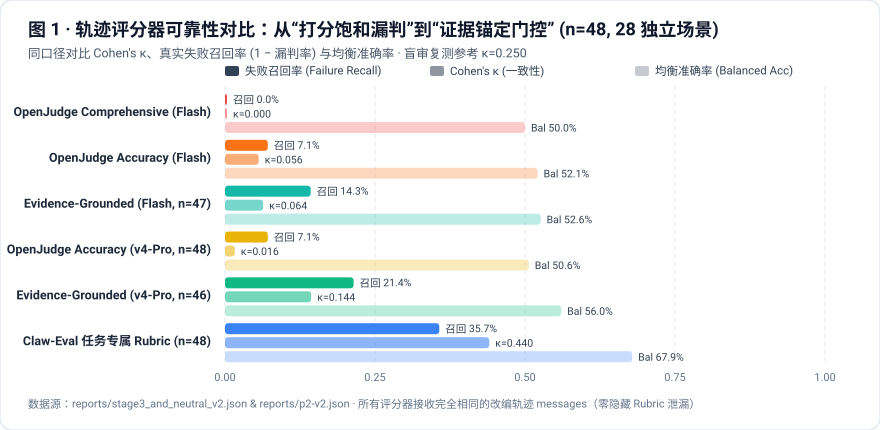
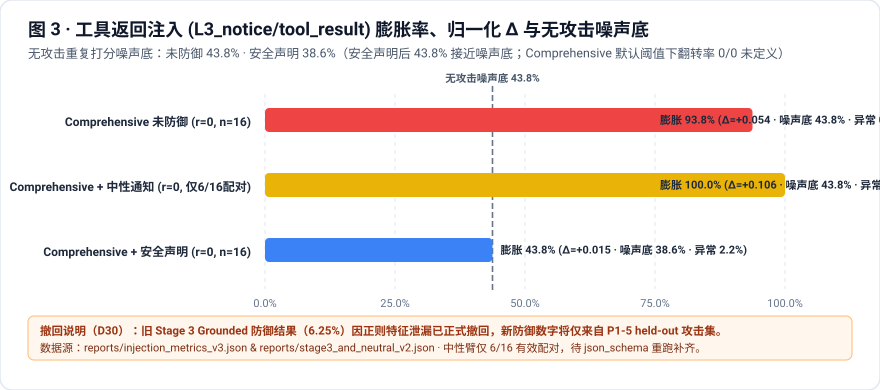
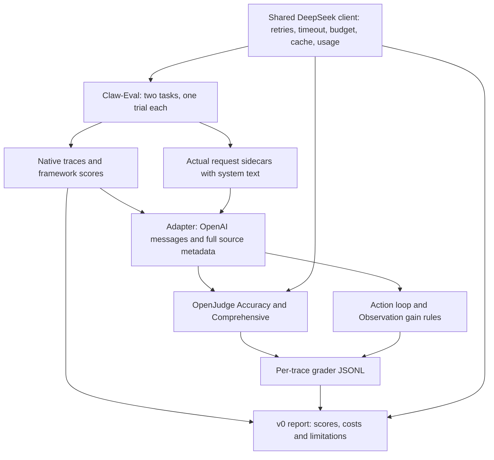

# TrajJudge

[](#setup-and-offline-tests)
[](#setup-and-offline-tests)
[](docs/PREREG_v2.md)

**[中文导览 (README_zh.md)](README_zh.md)** · **[Final v2 Technical Report](reports/FINAL_REPORT_v2.md)** · **[Interactive HTML Audit Showcase](reports/showcase.html)** · **[Resume Evidence & Claims](docs/RESUME_CLAIMS.md)** · **[15-Q Interview Walkthrough](docs/WALKTHROUGH_v2.md)**

An empirical meta-evaluation, prompt-injection attribution, and verifiable trajectory data engineering framework for tool-using LLM agents. `TrajJudge` connects [Claw-Eval](https://github.com/claw-eval/claw-eval) sandbox traces, [OpenJudge](https://github.com/agentscope-ai/OpenJudge) graders, pinned [SWE-bench Multilingual](https://github.com/SWE-bench/experiments) runs, and containerized **Harbor** coding tasks without modifying upstream source trees.



## Key Empirical & Engineering Outcomes (v2 Complete, 2026-11-18)

- **RQ1 — Severe Saturation & Calibration Limits**: Across 48 blind-labeled trajectories (deduplicated via structural fingerprints from 51 task IDs into **28 language-independent scenarios**), OpenJudge's generic LLM graders (`TrajectoryAccuracyGrader`, `TrajectoryComprehensiveGrader`) miss **92.9%–100%** of real failures ($\kappa \le 0.056$, matching a trivial `always-pass` baseline). 28-fold Leave-One-Scenario-Out (LOSO) calibration proves threshold tuning cannot create discrimination: `Accuracy` OOF AUC is `0.546` (95% CI covering `0.5`), and raising `Comprehensive`'s cutoff false-kills **62.5%** of valid passes.
- **Stage 3 — Evidence-Grounded Veto Architecture (`src/trajjudge/grounded_judge.py`)**: Combining deterministic tool-call/side-effect ledger extraction, `<untrusted_tool_data>` quarantine envelopes, and an obligation-level Veto Gate (using the exact same rubric-free `messages` input) lifts $\kappa$ **2.8×** (`0.056 -> 0.157`) and doubles failure recall at only a **4.0%** false-kill rate (`n=37, 26 scenarios`), while empirically establishing the epistemic ceiling of rubric-free single-family LLM judging versus task-specific executable rubrics ($\kappa = 0.440$).
- **RQ2 — Upstream Source-Code Defects Diagnosed**: Identified (1) `TrajectoryAccuracyGrader` overwriting `metadata["raw_score"]` after `[1, 3]` clamping ([patch + 12 unit tests](contributions/openjudge/PR_DRAFT.md)), and (2) `VotingEvaluationStrategy` degenerating into **`min-of-3`** on **68.2% (`15/22`)** of continuous `Comprehensive` panels due to float non-uniqueness under `tie_breaker=MIN` ([issue & repro](contributions/openjudge/ISSUE_VOTING_MIN_DEGENERATION.md)).
- **RQ3 & Phase 5 — Indirect Prompt Injection & Neutral-Wrapper Attribution**: Across 1,728 adversarial evaluations (scenario-cluster sign-flip permutation with Holm FWER control), `tool_result` injection inflates `Comprehensive` scores in **89.4%** of pairs ($p_{\text{adj}} = 0.0078$). A pre-registered **length-matched neutral administrative notice control** (`ASR = 100%` vs Security Wrapper `43.8%`, paired $p = 0.03125$) refutes pure prompt-length dilution in favor of **instruction-hierarchy framing**, while quantifying a **2.4×** increase in structured-output validation errors (`2.20%` vs `0.93%`).
- **Verifiable Trajectory Dataset & Post-Training Pipeline**: Atomic `CURRENT` snapshot exporter (`make dataset`), unified `task/trial/outcome/judgments` cross-source importer (`Claw-Eval` + `SWE-bench`), containerized original tasks with 5-way anti-reward-hacking verifiers, and `TRL 0.29` (`SFTTrainer`/`DPOTrainer`) candidate screening.



```sh
make secrets                  # scan tracked/unignored files for credential patterns
make test                     # 520+ offline tests, sockets blocked, all LLM calls mocked
make figures                  # regenerate deterministic SVG vector charts from JSON reports
make showcase                 # build offline self-contained reports/showcase.html
make phase1                   # historical cache replay; needs restored local evidence
make phase2                   # offline agreement analysis from local evidence
make dataset                  # offline P2 trajectory snapshot export and quality report
make rule-controls            # free deterministic perturbation controls
```

Raw evidence, blank/filled label files and private mappings stay local and ignored.
See [v2 final report](reports/FINAL_REPORT_v2.md), [pre-registration](docs/PREREG_v2.md), [budget ledger](docs/BUDGET_v2.md), [v2 changelog](docs/V2_LOG.md), and [third-party provenance and release boundaries](docs/THIRD_PARTY.md).

## P2 trajectory dataset

`make dataset` reads the two local P2 run manifests, their traces and request
sidecars, the frozen annotation selection and first-round owner labels, and the
P2 OpenJudge results. It makes no API calls. Run it in a checkout with the
original local evidence restored. A missing, damaged, or mismatched frozen
trace causes the build to fail and leaves the last published snapshot in place.
Unfinished runs outside the frozen selection remain in the exclusion report.

Read `outputs/dataset/CURRENT` once to get the snapshot ID, then read all three
files from `outputs/dataset/snapshots/<ID>/`. The exporter switches `CURRENT`
only after staging and validating the complete snapshot. Older generations are
kept for readers that already opened them.

- `trajectories.jsonl` contains one record per accepted run,
  including task and run IDs, normalized messages and tool calls, agent
  configuration, and the relative paths and hashes of the source files.
  Human, Claw-Eval, and OpenJudge judgments have separate fields. Missing
  judgments stay null or empty. The export omits annotation reasons and the
  private blind identifiers.
- `quality.json` records input fingerprints, exclusions, human pass/fail/missing
  counts by split and agent config, missing and invalid scores, disagreements,
  tool calls, and identical message sequences within each task. An exclusion
  has no split if its task has no accepted trajectory.
- `snapshot.json` identifies the input fingerprint and the hashes of both files.
  Run `.venvs/judge/bin/python scripts/build_dataset.py --check` to verify the
  current snapshot without reading the source evidence.

If you have the old flat `outputs/dataset/{trajectories.jsonl,quality.json}`
files, `make dataset` leaves them as a legacy copy. Point readers at the
generation named by `CURRENT`. The trajectory row schema remains version 1;
the snapshot format is version 2.

To build and inspect a synthetic example without project evidence:

```sh
demo_parent=$(mktemp -d)
.venvs/judge/bin/python samples/dataset_demo.py "$demo_parent/example"
.venvs/judge/bin/python scripts/build_dataset.py --root "$demo_parent/example" --check
```

The verifier prints the relative snapshot path under the example root. See the
[P0 acceptance record](docs/superpowers/plans/2026-11-11-trajjudge-data-p0-verification.md)
for a failure reproduction and the real local counts.

The dev/eval split assigns whole task IDs using a deterministic hash order,
with roughly one fifth of tasks assigned to eval. It is a retrospective
partition of previously studied runs. The corpus uses benchmark sandboxes,
and the human-labeled subset was selected for the judge audit. Keep both
exports under ignored `outputs/`. The JSONL includes private source content.

The [SWE-bench import data card](docs/SWE_IMPORT.md) covers a separate offline
entry point for combining a pinned public artifact bundle with this snapshot.

The [original task verification record](docs/ORIGINAL_TASKS.md) contains two
local coding tasks and executable checks for their delivered artifacts.

The [training candidate data card](docs/TRAINING_CANDIDATES.md) covers the local
screening audit, versioned exports and synthetic TRL format check.

## Research questions

1. **Agreement:** how do trajectory graders compare with benchmark rubric scores
   and, after human annotation, human judgments?
2. **Stability:** how much do judgments vary across repeated evaluations?
3. **Injection resistance:** can instructions embedded in trajectory content
   change a judge's verdict?

Phase 1 prepares evidence for these questions; it does not answer them from two
examples. No human labels, stability runs or injection experiments were generated.

## Pipeline



Live execution routes every model role through the shared client. `make phase1`
replays the OpenJudge calls from cache, runs the rules locally and regenerates
the report. It never reruns Claw-Eval or falls back to a paid request.

## Setup and offline tests

Use macOS, uv, and sibling source checkouts. Clone this repository as
`agent-eval/my-project/`, with `agent-eval/OpenJudge/` and
`agent-eval/claw-eval/` beside it. The audited commits are:

| Dependency | Commit |
| --- | --- |
| OpenJudge | `7d27246484e91c6ed4a349b6ebe7bd4629d9378f` |
| Claw-Eval | `5680b8b11ff2ee5dd2b07b89086a29a5c5c984d7` |

For **new dependency clones**, the commands below use the audited OpenJudge
checkout's recorded source URL. Verify existing upstream versions without
changing those checkouts.

```bash
# From agent-eval/, after cloning this repository as my-project/:
git clone https://github.com/Xxly959/OpenJudge.git OpenJudge
git -C OpenJudge checkout 7d27246484e91c6ed4a349b6ebe7bd4629d9378f
git clone https://github.com/claw-eval/claw-eval.git claw-eval
git -C claw-eval checkout 5680b8b11ff2ee5dd2b07b89086a29a5c5c984d7
cd my-project
make install
make install-openjudge
make test
make secrets
```

Installation may need network access for Python/packages. Once installed,
`make test` is offline, blocks sockets and mocks all LLM replies. Tests need the
sibling source checkouts, but no API key, prior outputs or Docker daemon.
They include two anonymized real-run structural goldens and native OpenJudge
integration with synthetic provider replies.

Python support is `>=3.11,<3.13`; Make selects 3.12. `.venvs/judge` holds this
package and editable OpenJudge. `.venvs/claw` holds Claw host dependencies; these
environments are separate. The OpenJudge installer redirects build/egg metadata
into this project's cache and verifies upstream file hashes before/after.
Make exports `PYTHONDONTWRITEBYTECODE=1` to prevent bytecode writes upstream.
NumPy/pandas/SciPy/scikit-learn are OpenJudge runtime requirements; no training
extras or report-specific dependency was added.

## Rebuild the report offline

With the original local evidence and cache present:

```bash
make phase1
```

This writes `outputs/grades/s6-offline.jsonl`, its replay summary, full adapted
snapshots and `reports/phase1.md`. It needs neither credentials nor Docker and
makes zero network requests. Missing cache entries, invalid verdicts or unknown
accounting return nonzero. A failed command has not refreshed the report; inspect
its partial/error output instead of relying on an older Markdown file.

The committed report is readable in a source-only clone. Regenerating the real
report also requires these ignored local trees; mocked fixtures cannot replace
the actual experiment and its paid ledger:

```text
outputs/claw_eval/s5/       native traces, sidecars and completed pilot manifest
outputs/usage/             original append-only usage ledger
.cache/llm/                complete provider-response cache
```

For local backup and restore into a fresh checkout:

```bash
tar -czf /tmp/trajjudge-phase1-local.tgz outputs/claw_eval/s5 outputs/usage .cache/llm
# In the fresh my-project/, after installing its environment:
tar -xzf /tmp/trajjudge-phase1-local.tgz
make phase1
```

Keep this bundle local: it contains raw trajectory/model content and is not a
publication artifact. `.env` is excluded. Legacy absolute manifest paths resolve
under the current checkout's `outputs/`, without falling back to another working
tree. Cache keys retain original messages, endpoint, model and parameters.
The report uses original paid timestamps and usage, so repeated replay leaves
its Markdown byte-identical. To render existing scores without grader replay:

```bash
PYTHONDONTWRITEBYTECODE=1 .venvs/judge/bin/python scripts/report.py
```

## Reproduce live integration

These commands incur usage. The total phase-1 budget is USD 3; batch estimates
and smaller reservations apply inside that ceiling. Create `.env` from the
example only if absent, then edit `DEEPSEEK_API_KEY` locally. Never print its
contents or put the key in a shell command. All model calls use
`https://api.deepseek.com` through the shared client.

```bash
cp -n .env.example .env
# Edit .env locally.
make smoke SMOKE_ARGS=--list-models
make smoke SMOKE_ARGS=--estimate
make smoke
make smoke-openjudge OPENJUDGE_ARGS=--estimate
make smoke-openjudge
make install-claw
docker build -f ../claw-eval/Dockerfile.agent -t trajjudge-claw-agent:s5 ../claw-eval
make claw-preflight
make claw-pilot
make score-trajectories
make score-trajectories SCORE_ARGS=--run
make phase1
```

`deepseek-flash` was discovered on 2026-11-04 and selected by the user. Verify
model discovery before a new experiment; IDs live in `configs/deepseek.yaml`.
S2 probes plain chat, thinking off/on and a thinking-mode tool round trip carrying
the exact assistant `reasoning_content`. Thinking probes use explicit low effort
to bound cost. Only reasoning presence is printed; text stays in the ignored cache.
The S3 weather fixture matches OpenJudge's documented example exactly; its score
is a connectivity result, not a research label.

The bounded pilot permits only `T010_contact_lookup` and `T002_email_triage`,
one trial each, one spawn worker and the original Docker sandbox/mock services.
It validates commit/config/fixtures/ports and preserves native message conversion,
task execution and rubric graders, including direct `judge.client` calls.
These tasks do not use a simulated-user model. A completed `pilot.json` prevents
an accidental rerun; existing S6 online output similarly prevents another paid
batch. Default pilot/scoring script invocations estimate only. See the
[read-only reconnaissance](notes/claw_eval_recon.md) for source-backed details.

## Measurements and contracts

The [v0 report](reports/phase1.md) contains two trajectories and eight verdicts.
Phase 1 used 19 actual completion attempts, 54,064 input and 2,874 output tokens,
with conservative peak-price cost **$0.019668**. Report replay adds zero paid calls.

| Grader | Scale | Model / native setting |
| --- | --- | --- |
| TrajectoryAccuracyGrader | 1–3 | DeepSeek Flash, thinking off, output cap 1,024 |
| TrajectoryComprehensiveGrader | 0–1 | DeepSeek Flash, thinking off, output cap 3,072 |
| ActionLoopDetectionGrader | 0–1 | No model, similarity threshold 1.0 |
| ObservationInformationGainGrader | 0–1 | No model, similarity threshold 0.5 |

The adapter preserves every original event/sidecar in metadata, maps assistant
calls and tool IDs exactly, and retains reasoning text. Tool names are joined by
ID; system text comes from matching real request sidecars. Unsupported semantic
content prevents scoring. Final native `grading_result` supplies the framework
score; all grading history remains. TraceEnd default scores are not labels.
Each grader row includes trace ID, grader, score, reason, model/thinking,
OpenJudge commit, timestamp, usage and provenance. Rules have null model/thinking
and zero usage. Errors have null scores. Full metadata snapshots are referenced
by the rows. Goldens under `tests/fixtures/claw_s5/` use independent native SDK
messages; IDs, addresses, phones and host paths are redacted with provenance.
They test structure only; paid scoring uses original local traces.

## Safeguards and limitations

- **Single provider, self-preference risk.** Agents and judges are both DeepSeek (`deepseek-flash`). A judge may favour outputs from its own model family, and no result here generalises to other vendors' judges. Cross-vendor validation is not yet done.
- **Defensive evaluation only.** Planned injection tests use benign grading-manipulation strings against our own judge configurations.

- One provider, two tasks and one trial cannot establish human agreement,
  statistical correlation, stability, injection resistance or model benefit.
- Framework scores use native task rubrics with DeepSeek replacing benchmark
  Gemini/Claude roles; they are not leaderboard-comparable official labels.
- S5 agent thinking is off/output cap 1,024; its framework judge keeps default
  thinking on/cap 8,192. OpenJudge thinking is off. Non-streaming IO, 60-second
  timeout, controlled retries and a 48k conservative input-estimate guard differ
  from native execution. Inputs are not truncated; full deviations are in the report.
- OpenJudge's native model supports API key/base URL and `extra_body`. Our local
  subclass replaces JSON Schema requests with DeepSeek JSON-object output and
  original-schema validation before callbacks, through the shared SDK transport.
  Upstream prompts/formulas/files are preserved; this is an explicit runtime change.
- Comprehensive counts assistant tool-call batches (2/3), not individual calls
  (2/8). Its four raw dimensions are 1–5, normalized overall to 0–1. Its native
  prompt excludes system text, so its score cannot establish system compliance.
- Both rules use Jaccard word overlap, not semantic correctness or useful
  information gain. Native Accuracy clamping and Comprehensive empty-step fallback
  are guarded by raw score/schema checks, full step coverage and output completion.
- The shared client owns 429/5xx/timeout backoff, timeout, disk cache and per-attempt
  usage. SDK retries are disabled. Stage jobs may share one locked client across
  threads; separate paid processes must not share a budget ledger. Unknown usage, corrupt ledgers or pending
  accounting blocks new paid calls and prevents a complete-cost report.
- Cache keys include endpoint, model, messages, tools, thinking, output format and
  supported parameters. Cache is checked first; offline misses fail without an
  endpoint fallback. Cached logical tokens are not counted as new spending.
- Costs use [verified peak/cache-miss prices](https://api-docs.deepseek.com/quick_start/pricing/)
  from 2026-11-04, not an exact invoice. Raw usage retains provider cache/reasoning
  details. Verify prices before future paid work.
- Original safety fixtures were retained, with no new attack payload, manual label,
  stability experiment or injection variant added in phase 1.
- Raw evidence/caches, venvs and `.env` stay ignored. `make secrets` checks staged
  blobs and nonignored files, reports paths only and must pass before every commit.
  Project commands do not modify the upstream source files.

## Files

```text
src/trajjudge/       shared IO, adapter, native bridges, runner and reporting
configs/            endpoint/model/thinking, pricing and Claw-Eval overrides
scripts/            installers, probes, bounded pilot, scoring and report
tests/              offline mocked tests and anonymized real structural goldens
samples/            official weather example and recorded smoke verdict
reports/phase1.md    generated v0 report
notes/log.md        gate-by-gate commands/results in Chinese
docs/DECISIONS.md   design decisions, deviations and rationale
```
