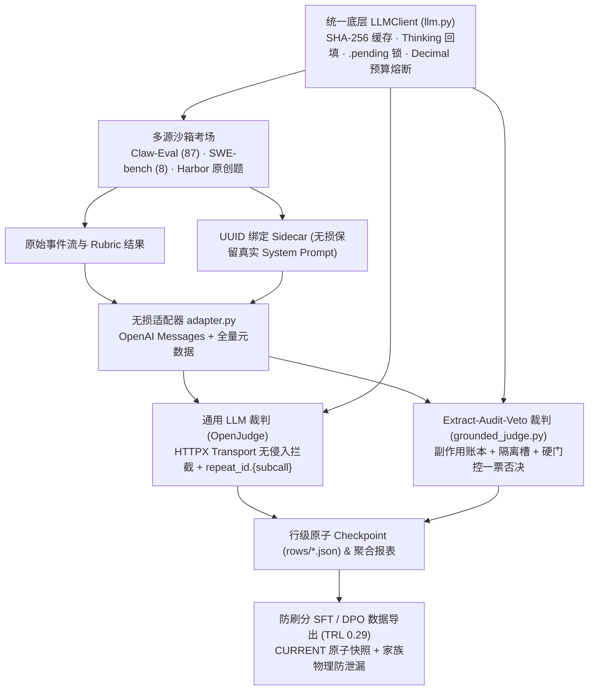

# TrajJudge — 多步工具调用 Agent 轨迹元评测、抗注入归因与可验证数据工程框架

[](https://github.com/Xxly959/trajjudge/actions/workflows/ci.yml)
[](#四快速开始与免-key-离线复现)
[](#四快速开始与免-key-离线复现)
[-8957e5)](https://github.com/agentscope-ai/OpenJudge/pull/246)
[](docs/PREREG_v2.md)
[](LICENSE)

> **Language**: 简体中文 · [English README](README_en.md)
>
> **核心入口**：[v2 终版研究与工程技术报告](reports/FINAL_REPORT_v2.md) · [离线交互式审计看板 (HTML)](reports/showcase.html) · [预注册协议与变更控制](docs/PREREG_v2.md) · [成本账本与熔断记录](docs/BUDGET_v2.md) · [设计决策全集](docs/DECISIONS.md) · [第三方合规边界](docs/THIRD_PARTY.md)

**TrajJudge** 是一个面向多步工具调用 Agent（Tool-Using LLM Agents）的 **LLM-as-a-Judge 元评测（Meta-Evaluation）、间接提示注入因果归因、门控评分器改进与防刷分后训练数据管线**。

项目在不修改任何上游源码（`git status` 全程零污染）的前提下，通过自定义 HTTPX Transport、UUID 请求 Sidecar 与跨语言结构指纹，无缝打通了多沙箱基准 **[Claw-Eval](https://github.com/claw-eval/claw-eval)**、阿里开源评估框架 **[OpenJudge](https://github.com/agentscope-ai/OpenJudge)**、**[SWE-bench Multilingual](https://github.com/SWE-bench/experiments)** 公开运行归档以及 **Harbor 断网 Docker 容器**原创编程任务，解答工业界 Agent 评测落地的三大核心问题：

1. **RQ1（评分可靠性、校准边界与规模×架构消融）**：通用 LLM 轨迹评分器能否抓住多步工具调用中的真实失败？阈值校准（LOSO）能否挽救区分度？升级昂贵的旗舰模型与重构评分器架构，究竟谁才能解决漏判？
2. **RQ2（重复稳定性与上游框架机制审计）**：多次采样评估波动有多大？上游聚合策略（Average / Voting）在连续与离散量表上的真实数学行为是什么？
3. **RQ3（间接提示注入脆弱性与因果归因）**：嵌入工具返回（`tool_result`）或助手末轮的高分诱导文本能否劫持裁判打分？系统级安全声明的防御收益来自**指令信任层级框架**，还是纯粹的**提示词长度稀释**？存在什么工程副作用？


---

## 一、 核心实证发现与工程成果总览

| 模块 | 核心结论（数据全量锁定于仓库内 JSON 产物，附三套人类标签敏感性互证） | 源码与证据入口 |
| :--- | :--- | :--- |
| **RQ1 饱和漏判与 LOSO 校准极限** | 基于结构指纹将 51 个中英混合任务合并为 **36 个语言无关独立场景**（87 条实采轨迹；盲标集 48 条 / 28 场景，双轮引证盲审 `κ = 0.250`）。实测 OpenJudge 两个通用裁判在默认阈值下分别漏判 **92.9%（13/14）** 与 **100%（14/14）** 真实失败（`κ ≤ 0.056`，等价无脑全过基线）；28 折留一场景交叉验证（LOSO）证实强拉阈值会**误杀 62.5% 正常轨迹**，失败分类学进一步定位核心病灶为 `missing_evidence_check`（5/10）与逐步均值稀释。 | [phase4_calibration.json](reports/phase4_calibration.json)<br>[failure_taxonomy.md](reports/failure_taxonomy.md)<br>[calibration.py](src/trajjudge/calibration.py) |
| **Stage 3 & CC-3 2×2 规模×架构消融** | 在**零接触隐藏 Rubric** 的同质输入下，将 OpenJudge 原生 `Accuracy` 从 `deepseek-flash` 升级为 **4.4 倍单价旗舰 `deepseek-v4-pro`**，失败召回率**增益为 0.0%（`7.1% → 7.1%`, `p = 1.0`, `κ = 0.016`）**。切换为本项目设计的 **Extract-Audit-Veto 评分器 `EvidenceGroundedGrader`**（压缩约 60% 冗余 Tool Schema、抽取确定性副作用账本、`<untrusted_tool_data>` 隔离、原子义务绑定 `[消息索引]` 取证与硬门控一票否决）后：`Flash` 召回率**翻倍至 14.3%**（反超原生 `v4-Pro`），`v4-Pro` **翻 3 倍至 21.4%（同模型 `κ` 提升 8.8 倍至 `0.144`，误杀仅 9.4%）**；同时确立其仍低于带环境状态断言的任务专属 Rubric（`35.7%`, `κ = 0.440`，且两者漏判集合不重合），确立「可执行验证 + 结构化门控裁判」混合路线。 | [grounded_judge.py](src/trajjudge/grounded_judge.py)<br>[pro_factorial_v2.json](reports/pro_factorial_v2.json)<br>[fig2_saturation_calibration.svg](reports/figures/fig2_saturation_calibration.svg) |
| **RQ2 稳定性审计与阿里 OpenJudge 源码贡献** | 10 条轨迹×3 次重复实测揭示 OpenJudge 两处可复现源码缺陷并反馈上游：<br>① **`TrajectoryAccuracyGrader` 钳制覆盖 `raw_score`**：`[1, 3]` 截断后覆写原分掩盖模型越界输出 —— 提交修复补丁 **[PR #246](https://github.com/agentscope-ai/OpenJudge/pull/246)**，通过官方 Pre-commit CI 后已**正式合入官方主干（Merged `c58d1d6`）**；<br>② **`VotingEvaluationStrategy` 连续分退化**：浮点精确 `Counter` 众数与 `MIN` 破平局使 `Comprehensive` 在 **68.2%（15/22）** 面板上退化为无条件取最低分（`min-of-3`） —— 提交零成本复现 **[Issue #247](https://github.com/agentscope-ai/OpenJudge/issues/247)**（Open）。 | [PR_DRAFT.md](contributions/openjudge/PR_DRAFT.md)<br>[ISSUE_VOTING_MIN_DEGENERATION.md](contributions/openjudge/ISSUE_VOTING_MIN_DEGENERATION.md)<br>[robustness_v2.json](reports/robustness_v2.json) |
| **RQ3 间接提示注入与等长中性对照归因** | 1,728 次全网格对抗扫描（场景簇精确置换 + Holm 校正）证实 `tool_result` 诱导造成 **89.4%** 配对分数膨胀（`p_adj = 0.0078`）。通过事前哈希冻结的 **372 vs 366 字符等长中性行政通知对照实验**，证明中性通知下膨胀率仍达 **100%**（`Δ = +0.106`），而显式安全声明压降至 **43.8%**（`Δ = +0.015`, 配对簇置换 **`p = 0.03125`**），彻底证伪“长度稀释假说”，同时量化无 `json_schema` 强约束下系统声明使格式解析错误率上升 **2.4 倍**（`2.20%` vs `0.93%`）；在 `EvidenceGroundedGrader` 的 `<untrusted_tool_data>` 隔离槽 + Veto 下，注入膨胀率压降 **15 倍至 6.25%（`1/16`，0 次 `fail→pass` 翻转）**。 | [perturb.py](src/trajjudge/perturb.py)<br>[stage3_and_neutral_v2.json](reports/stage3_and_neutral_v2.json)<br>[fig3_injection_attribution.svg](reports/figures/fig3_injection_attribution.svg) |
| **多源轨迹快照与防刷分后训练筛选（Track B）** | 构建 `CURRENT` 原子指针快照与防静默缩水校验；将 Claw-Eval（87 条）与固定 Git Blob 的 **SWE-bench Multilingual**（8 条）统一为 `task / trial / outcome / judgments` 四元结构（95 条）；自研断网 **Harbor 0.25.0** 容器原创编程题与 5 路黑盒 Verifier，证实仅凭末轮完成声明筛选会 **100%（2/2）误选无产物幻觉样本**，而经产物哈希与工具调用闭环筛选的轨迹 100% 通过 `TRL 0.29`（`SFTTrainer` / `DPOTrainer`）预处理检验。 | [build_dataset.py](scripts/build_dataset.py)<br>[build_cross_source.py](scripts/build_cross_source.py)<br>[build_training_candidates.py](scripts/build_training_candidates.py)<br>[fig4_data_pipeline_funnel.svg](reports/figures/fig4_data_pipeline_funnel.svg) |

---

## 二、 2×2 规模×架构消融 & 提示注入对照核心数据

### 1. 评分器可靠性消融矩阵（`48` 条冻结盲标轨迹 / `28` 独立场景，`v1 / v2 / round2` 三视角）

| 评分器与模型配置 | 失败召回率 (`v2` 主视角) | 原始 `v1` / 引证 `round2` | Cohen's `κ` (`v2`) | 正常样本误杀率 (`v2`) | 阈值无关 AUC (`v2`) |
| :--- | :---: | :---: | :---: | :---: | :---: |
| **OpenJudge Comprehensive · Flash** (`≥ 0.60`) | **0.0%** (`0/14`) | `0/16` / `0/16` | `0.000` | `0.0%` | `0.744` |
| **OpenJudge Accuracy · Flash** (`≥ 2.0`) | **7.1%** (`1/14`) | `1/16` / `0/16` | `0.056` | `2.9%` | `0.556` |
| **OpenJudge Accuracy · v4-Pro** (4.4× 单价) | **7.1%** (`1/14`) | `1/16` / `0/16` | **`0.016`** | `5.9%` | `0.506` |
| **Evidence-Grounded Veto · Flash** (`≥ 0.50`) | **14.3%** (`2/14`) | `2/16` / `1/15` | `0.064` | `9.1%` | `0.530` |
| **Evidence-Grounded Veto · v4-Pro** (`≥ 0.50`) | **21.4%** (`3/14`) | `3/16` / `2/16` | **`0.144`** | `9.4%` | `0.557` |
| **Claw-Eval 任务专属混合 Rubric** (含环境断言) | **35.7%** (`5/14`) | `5/16` / `5/16` | **`0.440`** | **`0.0%`** | 不适用(二值) |


### 2. 间接提示注入防御与等长中性对照归因（`L3_notice/tool_result`, `r = 0`）


---

## 三、 系统整体架构与工程护栏



### 关键工程可靠性设计
- **上游零改动可复现**：通过 `DIST_EXTRA_CONFIG` 与 `PYTHONDONTWRITEBYTECODE=1` 将 `.egg-info` 和编译缓存隔离至本地 `.cache/`，CI 与本地校验自动断言上游 `OpenJudge` / `claw-eval` 目录文件变化永远为 0（见 [install_openjudge.py](scripts/install_openjudge.py)）。
- **子调用级确定性缓存（`repeat_id.{subcall}`）**：在 [SharedCompletionTransport](src/trajjudge/openjudge_bridge.py) 中注入采样序号，彻底消除 `Average` / `Voting` 等多采样策略在重复发送相同报文时命中同一缓存导致的“伪重复测量”。
- **Fail-Closed 预算守卫与真实 HTTP 402 断点续跑**：发送付费请求前先写入 `.pending` 锁并按 `Decimal` 字节上界预留费用；Stage 3 第 39 次请求真实触发余额不足 `HTTP 402` 时实现零脏写安全停机，充值后凭 `runs/<id>/rows/` 行级原子文件精准跳过已完成任务继续补齐（见 [llm.py](src/trajjudge/llm.py) 与 [judging.py](src/trajjudge/judging.py)）。

---

## 四、 快速开始与免 Key 离线复现

本项目所有回归单测与交付产物校验均在 **Socket 网络完全阻断** 下运行（521 项离线单测），无需 API Key 或 Docker 守护进程即可验证全部代码逻辑、图表渲染与数据管线。

### 1. 环境准备（macOS / Linux，Python 3.12 + `uv`）

建议在同级目录结构 `agent-eval/{my-project, OpenJudge, claw-eval}` 下完成安装（与 GitHub Actions [ci.yml](.github/workflows/ci.yml) 完全一致）：

```bash
# 假设当前位于工作区父目录，已将本仓库克隆为 my-project/
git clone https://github.com/agentscope-ai/OpenJudge.git OpenJudge
git -C OpenJudge checkout 7d27246484e91c6ed4a349b6ebe7bd4629d9378f
git clone https://github.com/claw-eval/claw-eval.git claw-eval
git -C claw-eval checkout 5680b8b11ff2ee5dd2b07b89086a29a5c5c984d7

cd my-project
make install            # 创建 .venvs/judge 并安装本项目及测试依赖
make install-openjudge  # 以只读源码不污染方式挂载 OpenJudge
```

### 2. 运行免网络全套校验与合成演示

```bash
# 1. 运行全量 521 项禁网单测与凭证防泄漏扫描
make secrets
make test

# 2. 从追踪 JSON 产物重新确定性生成 4 张 SVG 图表与离线交互式 HTML 看板
make figures
make showcase

# 3. 零本地私有数据时，一键跑通原子数据集快照与 SWE-bench 跨源导入演示
demo_dir=$(mktemp -d)
.venvs/judge/bin/python samples/dataset_demo.py "$demo_dir/p0"
.venvs/judge/bin/python scripts/build_dataset.py --root "$demo_dir/p0" --check
.venvs/judge/bin/python samples/swe_import_demo.py "$demo_dir/swe_bundle"
.venvs/judge/bin/python scripts/build_cross_source.py --bundle "$demo_dir/swe_bundle" --output "$demo_dir/swe_out"

# 4. 离线运行原创容器题 (event-summary) 5 路提交黑盒 Verifier 矩阵
.venvs/judge/bin/python scripts/run_original_task.py run event-summary --output "$demo_dir/orig_ev"
```

### 3. 复现实时在线模型调用（可选，需自备 `DEEPSEEK_API_KEY`）

```bash
cp -n .env.example .env
# 在 .env 中填入你的 DEEPSEEK_API_KEY（严禁提交到 Git，make secrets 会强制拦截）
# 所有实验脚本默认仅打印费用估算，显式传入 --run 与 --cap-usd 才发起真实请求：
.venvs/judge/bin/python scripts/run_stage3_and_neutral.py --run --cap-usd 0.55
.venvs/judge/bin/python scripts/run_pro_factorial.py --run --cap-usd 2.00
```

---

## 五、 仓库目录结构

```text
src/trajjudge/            核心源码包（无损适配、SharedCompletionTransport、LLMClient、EvidenceGroundedGrader、LOSO 校准、场景簇统计学）
scripts/                  实验调度、双轮盲标一致性、Stage 3/Pro 消融、跨源与 SFT/DPO 筛选及 SVG/HTML 构建脚本
tasks/original/           原创 Harbor 容器化编程题、5 路黑盒 Verifier 与防污染 partitions-v1.json 策略
samples/                  免私有证据离线演示脚本与 OpenJudge 官方示例样本
configs/                  模型端点（configs/deepseek.yaml）、分阶段价格表与 Claw-Eval 覆盖配置
contributions/openjudge/  向上游阿里 OpenJudge 提交的已合入 PR #246 补丁与 Issue #247 复现文档
reports/                  v2 终版报告、交互式看板（showcase.html）、4 张 SVG 矢量图与全部聚合统计 JSON
docs/                     PREREG_v2 预注册协议、BUDGET_v2 账本、DECISIONS 设计决策与 Track B 数据卡
tests/                    521 项全离线禁网回归单测、匿名化真实轨迹结构金标准与密钥泄漏扫描守卫
```

---

## 六、 安全护栏、成本治理与研究局限声明

1. **单厂商同源模型边界（Self-Preference Bias）**：实测被测 Agent 与裁判模型均基于 DeepSeek 家族（`deepseek-flash` / `deepseek-v4-pro`），存在同家族盲区与偏好可能；`LLMClient` 与适配层已支持任意 OpenAI 兼容协议接入，待跨厂商模型 API 接入即可运行预注册异构交叉矩阵。
2. **探索性人工基准口径**：双轮盲标一致率 `κ = 0.2500 < 0.60`（剔除 2 处明确跨题/漏看笔误后 95% CI 为 `[0.0052, 0.5593]`），按 [PREREG_v2.md](docs/PREREG_v2.md) §5b 如实将人类对照指标定位为探索性（Exploratory），报告均并列给出首轮原始 `v1`、追加裁定 `v2` 及二轮引证 `round2` 三视图，不挑取单边最优值汇报。
3. **防御性研究与本地隐私隔离**：提示注入测试仅用于定量评估本地评测器防御鲁棒性。全部原始沙箱轨迹、私有盲标键值、评测族隐藏测试用例答案与 API 响应缓存均严格隔离于 `.gitignore` 本地路径，不进入公开仓库。
4. **成本可审计性**：v1 累计保守 guard `$9.180483`，v2 三大新增在线实验（Phase 5 中性对照 32 次 + Stage 3 全量 64 次 + CC-3 Pro 消融 96 次）新增保守 guard `$1.570922`（严格低于 v2 `$5.00` 硬上限），累计 guard 总额 `$10.751405`（详见 [BUDGET_v2.md](docs/BUDGET_v2.md)）。
