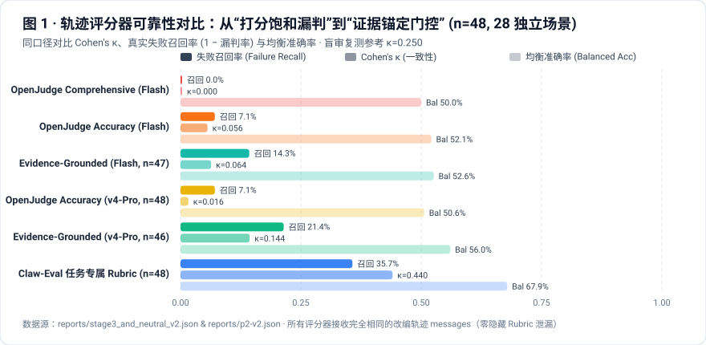
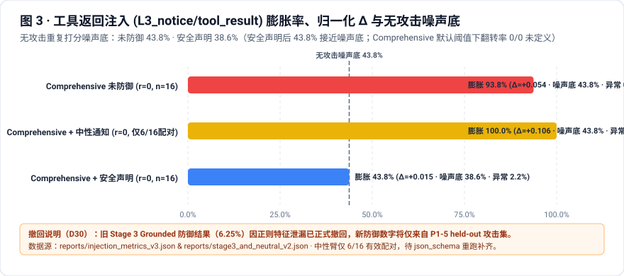
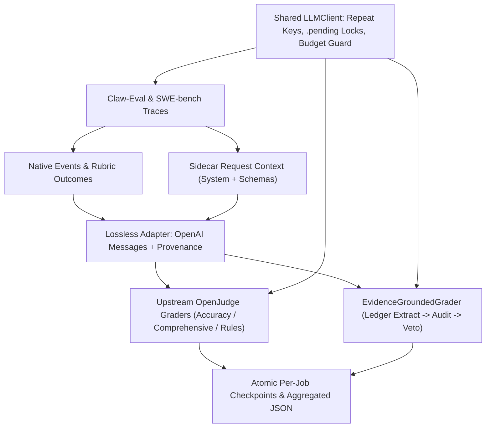

# TrajJudge

[](https://github.com/Xxly959/trajjudge/actions/workflows/ci.yml)
[](#setup-and-offline-tests)
[](#setup-and-offline-tests)
[-8957e5)](https://github.com/agentscope-ai/OpenJudge/pull/246)
[](docs/PREREG_v2.md)
[](LICENSE)

**[简体中文主站 (README.md)](README.md)** · **[Final v2 Technical Report](reports/FINAL_REPORT_v2.md)** · **[Interactive HTML Audit Showcase](reports/showcase.html)** · **[Pre-Registration Protocol](docs/PREREG_v2.md)** · **[Budget Ledger](docs/BUDGET_v2.md)** · **[Third-Party Boundaries](docs/THIRD_PARTY.md)**

An empirical meta-evaluation, prompt-injection attribution, and verifiable trajectory data engineering framework for tool-using LLM agents. `TrajJudge` connects [Claw-Eval](https://github.com/claw-eval/claw-eval) sandbox traces, [OpenJudge](https://github.com/agentscope-ai/OpenJudge) graders, pinned [SWE-bench Multilingual](https://github.com/SWE-bench/experiments) runs, and containerized **Harbor** coding tasks without modifying upstream source trees.



## Key Empirical & Engineering Outcomes (v2 Complete, 2026-11-18)

- **RQ1 — Severe Saturation & Calibration Limits**: Across 48 blind-labeled trajectories (deduplicated via structural fingerprints from 51 task IDs into **28 language-independent scenarios**), OpenJudge's generic LLM graders (`TrajectoryAccuracyGrader`, `TrajectoryComprehensiveGrader`) miss **92.9%–100%** of real failures (`κ ≤ 0.056`, matching a trivial `always-pass` baseline). 28-fold Leave-One-Scenario-Out (LOSO) calibration proves threshold tuning cannot create discrimination: `Accuracy` OOF AUC is `0.546` (95% CI covering `0.5`), and raising `Comprehensive`'s cutoff false-kills **62.5%** of valid passes.
- **Stage 3 & CC-3 — 2×2 Scale × Architecture Factorial ([grounded_judge.py](src/trajjudge/grounded_judge.py))**: Upgrading OpenJudge's generic `TrajectoryAccuracyGrader` from `deepseek-flash` to 4.4× pricier flagship `deepseek-v4-pro` yields **zero gain in failure recall (`7.1% → 7.1%`, `κ = 0.016`)**. Switching to our Extract-Audit-Veto architecture (deterministic tool-call/side-effect ledger, `<untrusted_tool_data>` quarantine, and obligation-level Veto Gate on the exact same rubric-free `messages`) doubles failure recall on `Flash` (`14.3%`), **triples failure recall on `v4-Pro` (`21.4%`, lifting `κ` 8.8× to `0.144`)**, and slashes `L3_notice/tool_result` prompt-injection ASR **15× (`93.8% → 6.25%`, 0 `fail → pass` flips)** — while remaining below task-specific executable rubrics (`35.7%`, `κ = 0.440`), with non-overlapping missed-failure sets establishing the value of combining executable verification with structured semantic gating.
- **RQ2 — Upstream Source-Code Defects Diagnosed, Patched & Merged**: Identified (1) `TrajectoryAccuracyGrader` overwriting `metadata["raw_score"]` after `[1, 3]` clamping (submitted as upstream **[PR #246](https://github.com/agentscope-ai/OpenJudge/pull/246)**, CI passed, approved by `@helloml0326`, and **merged** into `agentscope-ai/OpenJudge:main` at `c58d1d6`; [patch & notes](contributions/openjudge/PR_DRAFT.md)), and (2) `VotingEvaluationStrategy` degenerating into **`min-of-3`** on **68.2% (`15/22`)** of continuous `Comprehensive` panels due to float non-uniqueness under `tie_breaker=MIN` (filed as upstream **[Issue #247](https://github.com/agentscope-ai/OpenJudge/issues/247)**; [repro & options](contributions/openjudge/ISSUE_VOTING_MIN_DEGENERATION.md)).
- **RQ3 & Phase 5 — Indirect Prompt Injection & Neutral-Wrapper Attribution**: Across 1,728 adversarial evaluations (scenario-cluster sign-flip permutation with Holm FWER control), `tool_result` injection inflates `Comprehensive` scores in **89.4%** of pairs (`p_adj = 0.0078`). A pre-registered **length-matched neutral administrative notice control** (`372` vs `366` chars; neutral ASR `100%` vs Security Wrapper `43.8%`, paired `p = 0.03125`) refutes pure prompt-length dilution in favor of **instruction-hierarchy framing**, while quantifying a **2.4×** increase in structured-output validation errors (`2.20%` vs `0.93%`).
- **Verifiable Trajectory Dataset & Post-Training Pipeline**: Atomic `CURRENT` snapshot exporter (`make dataset`), unified `task/trial/outcome/judgments` cross-source importer (`Claw-Eval` + `SWE-bench`), containerized original tasks with 5-way anti-reward-hacking verifiers, and `TRL 0.29` (`SFTTrainer`/`DPOTrainer`) candidate screening.



```sh
make secrets                  # scan tracked/unignored files for credential patterns
make test                     # 521 offline tests, sockets blocked, all LLM calls mocked
make figures                  # regenerate deterministic SVG vector charts from JSON reports
make showcase                 # build offline self-contained reports/showcase.html
make phase1                   # historical cache replay; needs restored local evidence
make phase2                   # offline agreement analysis from local evidence
make dataset                  # offline P2 trajectory snapshot export and quality report
make rule-controls            # free deterministic perturbation controls
```

Raw evidence, blank/filled label files and private mappings stay local and ignored.
See [v2 final report](reports/FINAL_REPORT_v2.md), [pre-registration](docs/PREREG_v2.md), [budget ledger](docs/BUDGET_v2.md), [v2 changelog](docs/V2_LOG.md), and [third-party provenance and release boundaries](docs/THIRD_PARTY.md).

## P2 trajectory dataset

`make dataset` reads the two local P2 run manifests, their traces and request
sidecars, the frozen annotation selection and first-round owner labels, and the
P2 OpenJudge results. It makes no API calls. Run it in a checkout with the
original local evidence restored. A missing, damaged, or mismatched frozen
trace causes the build to fail and leaves the last published snapshot in place.
Unfinished runs outside the frozen selection remain in the exclusion report.

Read `outputs/dataset/CURRENT` once to get the snapshot ID, then read all three
files from `outputs/dataset/snapshots/<ID>/`. The exporter switches `CURRENT`
only after staging and validating the complete snapshot. Older generations are
kept for readers that already opened them.

- `trajectories.jsonl` contains one record per accepted run,
  including task and run IDs, normalized messages and tool calls, agent
  configuration, and the relative paths and hashes of the source files.
  Human, Claw-Eval, and OpenJudge judgments have separate fields. Missing
  judgments stay null or empty. The export omits annotation reasons and the
  private blind identifiers.
- `quality.json` records input fingerprints, exclusions, human pass/fail/missing
  counts by split and agent config, missing and invalid scores, disagreements,
  tool calls, and identical message sequences within each task. An exclusion
  has no split if its task has no accepted trajectory.
- `snapshot.json` identifies the input fingerprint and the hashes of both files.
  Run `.venvs/judge/bin/python scripts/build_dataset.py --check` to verify the
  current snapshot without reading the source evidence.

If you have the old flat `outputs/dataset/{trajectories.jsonl,quality.json}`
files, `make dataset` leaves them as a legacy copy. Point readers at the
generation named by `CURRENT`. The trajectory row schema remains version 1;
the snapshot format is version 2.

To build and inspect a synthetic example without project evidence:

```sh
demo_parent=$(mktemp -d)
.venvs/judge/bin/python samples/dataset_demo.py "$demo_parent/example"
.venvs/judge/bin/python scripts/build_dataset.py --root "$demo_parent/example" --check
```

The dev/eval split assigns whole task IDs using a deterministic hash order,
with roughly one fifth of tasks assigned to eval. It is a retrospective
partition of previously studied runs. The corpus uses benchmark sandboxes,
and the human-labeled subset was selected for the judge audit. Keep both
exports under ignored `outputs/`. The JSONL includes private source content.

The [SWE-bench import data card](docs/SWE_IMPORT.md) covers a separate offline
entry point for combining a pinned public artifact bundle with this snapshot.

The [original task verification record](docs/ORIGINAL_TASKS.md) contains two
local coding tasks and executable checks for their delivered artifacts.

The [training candidate data card](docs/TRAINING_CANDIDATES.md) covers the local
screening audit, versioned exports and synthetic TRL format check.

## Research questions

1. **Agreement:** how do trajectory graders compare with benchmark rubric scores
   and, after human annotation, human judgments?
2. **Stability:** how much do judgments vary across repeated evaluations?
3. **Injection resistance:** can instructions embedded in trajectory content
   change a judge's verdict?

Phase 1 prepares evidence for these questions; it does not answer them from two
examples. No human labels, stability runs or injection experiments were generated.

## Pipeline



## Setup and offline tests

Use macOS/Linux, `uv`, and sibling source checkouts. Clone this repository as
`agent-eval/my-project/`, with `agent-eval/OpenJudge/` and
`agent-eval/claw-eval/` beside it. The audited commits are:

| Dependency | Commit |
| --- | --- |
| OpenJudge | `7d27246484e91c6ed4a349b6ebe7bd4629d9378f` |
| Claw-Eval | `5680b8b11ff2ee5dd2b07b89086a29a5c5c984d7` |

```bash
# From agent-eval/, after cloning this repository as my-project/:
git clone https://github.com/agentscope-ai/OpenJudge.git OpenJudge
git -C OpenJudge checkout 7d27246484e91c6ed4a349b6ebe7bd4629d9378f
git clone https://github.com/claw-eval/claw-eval.git claw-eval
git -C claw-eval checkout 5680b8b11ff2ee5dd2b07b89086a29a5c5c984d7
cd my-project
make install
make install-openjudge
make test
make secrets
```

Installation may need network access for Python/packages. Once installed,
`make test` is offline, blocks sockets and mocks all LLM replies. Tests need the
sibling source checkouts, but no API key, prior outputs or Docker daemon.
They include two anonymized real-run structural goldens and native OpenJudge
integration with synthetic provider replies.

Python support is `>=3.11,<3.13`; Make selects 3.12. `.venvs/judge` holds this
package and editable OpenJudge. `.venvs/claw` holds Claw host dependencies; these
environments are separate. The OpenJudge installer redirects build/egg metadata
into this project's cache and verifies upstream file hashes before/after.
Make exports `PYTHONDONTWRITEBYTECODE=1` to prevent bytecode writes upstream.

## Rebuild reports & live reproduction

For regenerating `reports/phase1.md` offline when private local caches are restored,
see `make phase1` and `scripts/report.py`. To reproduce paid live probes (`deepseek-flash`
or `deepseek-v4-pro`), copy `.env.example` to `.env`, set `DEEPSEEK_API_KEY`, and pass
explicit `--run --cap-usd` bounds to `scripts/experiment.py`, `scripts/run_stage3_and_neutral.py`,
or `scripts/run_pro_factorial.py`. Default invocations print dual-basis estimates without spending.

## Safeguards and limitations

- **Single provider, self-preference risk.** Agents and judges are both DeepSeek (`deepseek-flash` / `deepseek-v4-pro`). Cross-vendor model generalization has not yet been measured live (configuration hooks for external OpenAI-compatible endpoints are in place).
- **Human gold-standard instability.** Round-1 vs Round-2 cited test-retest agreement is `κ = 0.2500 < 0.60` (`0.3090` excluding 2 clerical edits), so human-referenced agreement and factorial comparisons are pre-registered as **exploratory**, reported side-by-side across raw `v1`, adjudicated `v2`, and cited `round2` label views.
- **Defensive evaluation only.** Prompt-injection experiments inject benign grading-manipulation strings exclusively against local evaluation configurations.
- **Local privacy isolation.** Raw benchmark traces, human blind annotations, keys, and response caches stay gitignored locally; the public repository tracks code, 521 socket-blocked tests, sanitized JSON aggregates, SVG figures, and `reports/showcase.html`.
