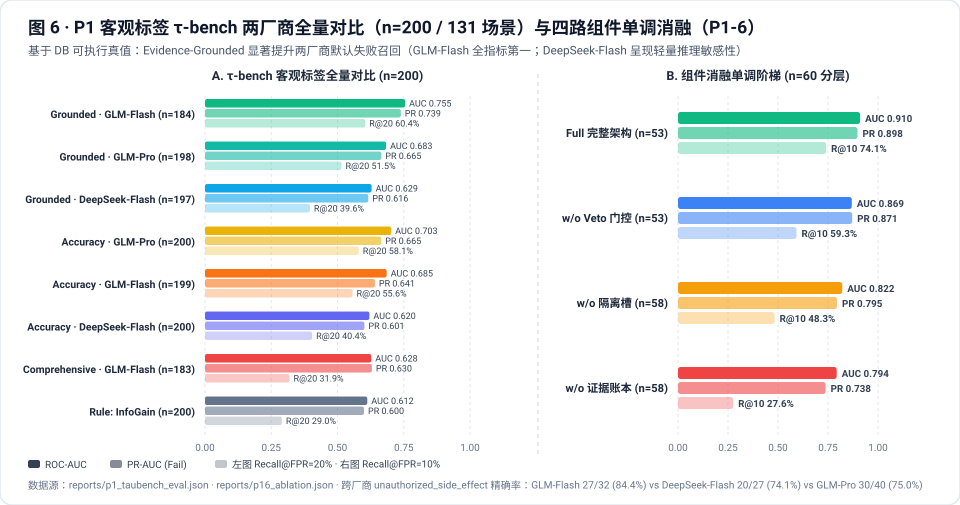

# TrajJudge

[](https://github.com/Xxly959/trajjudge/actions/workflows/ci.yml)
[](#quick-start-offline-no-api-key)
[](#quick-start-offline-no-api-key)
[-8957e5)](https://github.com/agentscope-ai/OpenJudge/pull/246)
[-8957e5)](https://github.com/agentscope-ai/OpenJudge/pull/248)
[](LICENSE)

> **Language**: [简体中文主站 (README.md)](README.md) · English
>
> **Key Links**: [v3 Technical Report (Primary)](reports/FINAL_REPORT_v3.md) · [Verified Claims Registry (CLAIMS.md)](docs/CLAIMS.md) · [Resume & Interview Bullets](docs/RESUME_BULLETS_v3.md) · [Interactive HTML Audit Showcase](reports/showcase.html) · [Pre-Registration v3](docs/PREREG_v3.md) · [Decisions & Retractions](docs/DECISIONS.md) · [Walkthrough Cards](notes/walkthrough/)

**One-line positioning**: **TrajJudge** is a trajectory meta-evaluation and quality-audit framework for multi-step tool-using LLM agents (designed alongside the `LightClaw` runtime) — diagnosing generic LLM-as-a-Judge failure modes on database-verified trajectories (τ-bench), demonstrating monotonic gains from an evidence-ledger + quarantine + veto architecture, and keeping upstream checkouts ([Claw-Eval](https://github.com/claw-eval/claw-eval), [OpenJudge](https://github.com/agentscope-ai/OpenJudge)) strictly read-only.

### Four Core Empirical Findings (all figures sourced from [docs/CLAIMS.md](docs/CLAIMS.md))

1. **Objective-label τ-bench benchmark (200 traces / 131 deduplicated scenarios): Evidence-Grounded leads strongly on GLM-Flash and replicates failure capture on full 200-trace DeepSeek-Flash**: On a balanced DB-verified cohort (100 failures / 100 passes, 50/50 across DeepSeek-V3.2 and GPT-4o), `EvidenceGroundedGrader (glm-5.3-flash)` achieves **`ROC-AUC = 0.755`**, **`PR-AUC = 0.739`**, **`Recall@FPR=10% = 37.4%`**, **`Recall@FPR=20% = 60.4%`**, and **`κ = 0.380`**, significantly outperforming `OpenJudge Comprehensive` (exact McNemar fail `p = 3.55e-15`, accuracy `p = 0.00064`) and `OpenJudge Accuracy Flash/Pro` (fail `p = 4.66e-10` / `3.64e-12`, accuracy `p = 0.0328` / `0.0183`). Upgrading generic `Accuracy` from Flash to Pro gives zero significant gain (`27/99 → 21/100`, `p = 0.167`). On full post-D31 **`deepseek-flash`** (`thinking=off`, 200 traces), `Evidence-Grounded` raises default failure recall by `+31.6 pp` (`16/98 → 47/98 = 48.0%`, `p = 7.92e-09`) while revealing backbone reasoning-budget sensitivity (`AUC 0.629` vs `Accuracy 0.620`, `R@10% 21.4% < 33.0%`).
2. **Monotonic 4-way component ablation, low prompt variance & cross-vendor `unauthorized_side_effect` validation**: On a stratified 60-trace τ-bench subset (`glm-5.3-flash`), removing components monotonically degrades `ROC-AUC` (**`full 0.910 > no_veto 0.869 > no_quarantine 0.822 > no_ledger 0.794`**) and `Recall@FPR=10%` (**`74.1% → 59.3% → 48.3% → 27.6%`**), while 3 equivalent prompt rewrites (`v0/v1/v2`) stay tightly clustered (`ROC-AUC` mean **`0.900`**, SD **`0.0092`**). Precision of `unauthorized_side_effect` flags stays consistently strong across vendors (**`84.4%` (`27/32`) on GLM-Flash**, **`75.0%` (`30/40`) on GLM-Pro**, **`74.1%` (`20/27`) on DeepSeek-Flash**) with zero self-preference bias toward DeepSeek-V3.2; a flagship silver-label audit (`glm-5.3`) flags **`13/92 (14.1%)`** DB-pass traces as process blind spots.
3. **15-template held-out prompt injection (P1-5) & Best-of-4 reranking (P2-A)**: Replacing the retracted Stage 3 leakage number ([D30](docs/DECISIONS.md)), across 15 frozen unseen templates (`SHA-256 = 08a07040...bab30081`), `Evidence-Grounded full` suffers only **`10/134 (7.5%)`** decision flips on `tool_result` (score inflation `20.1%` below its `26.4%` noise floor), whereas removing quarantine (`no_quarantine`) raises `tool_result` flips to **`7/55 (12.7%)`** and JSON-disguise flips from `3.5% (2/57)` to `15.8% (3/19)`. On 50 Best-of-4 tasks, `Evidence-Grounded` reaches `45.5% (20/44)` vs `42.0%` random (tied with `Comprehensive` at `57.1%` on `n=28` paired tasks), trailing the `72.0%` DB Oracle by `26.5 pp`.
4. **Two upstream OpenJudge defects fixed and merged into `main`**: Preserving unclamped `raw_score` in `TrajectoryAccuracyGrader` (**[PR #246](https://github.com/agentscope-ai/OpenJudge/pull/246)** merged at `c58d1d6`) and exposing tie metadata / documenting `min-of-3` degeneration (`15/22` continuous panels) in `VotingEvaluationStrategy` (**[Issue #247](https://github.com/agentscope-ai/OpenJudge/issues/247)** closed by merged **[PR #248](https://github.com/agentscope-ai/OpenJudge/pull/248)** at `15d22f2`).




---

## Quick Start (Offline, No API Key)

All regression tests run with network sockets blocked and LLM replies mocked — no API key or Docker daemon required.

```bash
# 1. Clone pinned read-only upstream dependencies as siblings of my-project/
git clone https://github.com/agentscope-ai/OpenJudge.git OpenJudge
git -C OpenJudge checkout 7d27246484e91c6ed4a349b6ebe7bd4629d9378f
git clone https://github.com/claw-eval/claw-eval.git claw-eval
git -C claw-eval checkout 5680b8b11ff2ee5dd2b07b89086a29a5c5c984d7

# 2. Install isolated venv and run secret scan + offline test suite
cd my-project
make install
make install-openjudge
make secrets
make test

# 3. Rebuild deterministic SVG figures (7 charts) and offline HTML showcase from tracked JSON reports
make figures
make showcase
```

For live online runs, copy `.env.example` to `.env`, configure provider keys, and pass explicit `--run --cap-usd` bounds (default invocations only print cost estimates).

---

## Primary Benchmark Summary (τ-bench, 200 Objective Traces / 131 Scenarios)

| Judge & Model | Valid / Scens | Default Recall | False Kills | Cohen's `κ` (95% CI) | `ROC-AUC` | `PR-AUC` | `R@FPR=10% / 20%` |
| :--- | :---: | :---: | :---: | :--- | :---: | :---: | :---: |
| **Evidence-Grounded · GLM-Flash** | `184/200` (`123`) | **`58/91` (`63.7%`)** | `24/93` (`25.8%`) | **`0.380`** `[0.231, 0.514]` | **`0.755`** | **`0.739`** | **`37.4%` / `60.4%`** |
| Evidence-Grounded · GLM-5.3 Pro | `198/200` (`129`) | `68/99` (`68.7%`) | `38/99` (`38.4%`) | `0.303` `[0.177, 0.436]` | `0.683` | `0.665` | `30.0%` / `51.5%` |
| **Evidence-Grounded · DeepSeek-Flash** | `197/200` (`130`) | `47/98` (`48.0%`) | `27/99` (`27.3%`) | `0.207` `[0.076, 0.341]` | `0.629` | `0.616` | `21.4%` / `39.6%` |
| OpenJudge Accuracy · GLM-5.3 Pro | `200/200` (`131`) | `21/100` (`21.0%`) | `4/100` (`4.0%`) | `0.170` `[0.086, 0.261]` | `0.703` | `0.665` | `36.4%` / `58.1%` |
| OpenJudge Accuracy · GLM-Flash | `199/200` (`131`) | `27/99` (`27.3%`) | `8/100` (`8.0%`) | `0.193` `[0.091, 0.308]` | `0.686` | `0.641` | `32.7%` / `55.7%` |
| OpenJudge Accuracy · DeepSeek-Flash | `200/200` (`131`) | `16/100` (`16.0%`) | `3/100` (`3.0%`) | `0.130` `[0.045, 0.217]` | `0.620` | `0.601` | `33.0%` / `40.4%` |
| OpenJudge Comprehensive · GLM-Flash | `183/200` (`125`) | `4/91` (`4.4%`) | `1/92` (`1.1%`) | `0.033` `[0.000, 0.074]` | `0.628` | `0.630` | `21.2%` / `31.9%` |
| Rule · `observation_information_gain` | `200/200` (`131`) | `8/100` (`8.0%`) | `4/100` (`4.0%`) | `0.040` `[-0.031, 0.109]` | `0.612` | `0.600` | `14.0%` / `29.0%` |

- **P1-6 Component Ablation & Prompt Stability (60 stratified τ-bench traces, `glm-5.3-flash`)**: `full` (`ROC-AUC 0.910`, `R@10% 74.1%`) > `no_veto` (`0.869`, `59.3%`) > `no_quarantine` (`0.822`, `48.3%`) > `no_ledger` (`0.794`, `27.6%`); across 3 prompt rewrites (`v0/v1/v2`), `ROC-AUC` mean is **`0.900` (SD `0.0092`)**.
- **P1-5 Held-Out Injection & P2-A Best-of-4**: `Evidence-Grounded full` holds `tool_result` flip rate at `10/134 (7.5%)` vs `7/55 (12.7%)` without quarantine (`json_disguise` `3.5%` vs `15.8%`); Best-of-4 reaches `45.5% (20/44)` vs `42.0%` random (`57.1%` vs `57.1%` on `n=28` aligned tasks, `72.0%` DB Oracle).
- **Demoted exploratory cohort**: The earlier 48-trace human-labeled Claw-Eval cohort (`κ = 0.250`) is archived in Appendix A of [FINAL_REPORT_v3.md](reports/FINAL_REPORT_v3.md).

---

## Limitations & Scope Disclosure

- **Two-vendor symmetry & backbone sensitivity ([D32 / D34](docs/DECISIONS.md))**: Cross-vendor evaluation covers full 200-trace **DeepSeek-Flash + GLM-Flash/Pro** pairs (third overseas commercial vendor omitted by budget) and surfaces reasoning-budget sensitivity on zero-thinking `deepseek-flash` (`ROC-AUC 0.629`, `R@10% 21.4% < Accuracy 33.0%`).
- **Offline reranking boundary (P2-A) & deferred gate**: Best-of-4 demonstrates a `26.5 pp` gap vs the DB Oracle (`72.0%`) for execution-free single-trace ranking; LightClaw PR gating (P2-B) is deferred.
- **Neutral wrapper coverage**: Retried to `10/16` valid pairs (`p = 0.0273`); remains `provisional` until rerun with strict `json_schema` support (`≥ 14/16`).

> **AI-Assisted Development Disclosure**: Implementation was assisted by an AI coding agent; experimental design, statistical verification, retractions, and result review were performed by the author.
