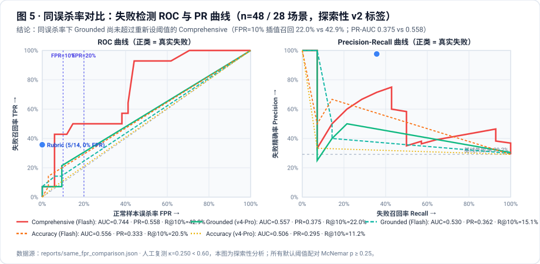

# TrajJudge

[](https://github.com/Xxly959/trajjudge/actions/workflows/ci.yml)
[](#quick-start-offline-no-api-key)
[](#quick-start-offline-no-api-key)
[-8957e5)](https://github.com/agentscope-ai/OpenJudge/pull/246)
[-8957e5)](https://github.com/agentscope-ai/OpenJudge/pull/248)
[](LICENSE)

> **Language**: [简体中文主站 (README.md)](README.md) · English
>
> **Key Links**: [Verified Claims Registry (CLAIMS.md)](docs/CLAIMS.md) · [v2 Technical Report](reports/FINAL_REPORT_v2.md) · [Interactive HTML Audit Showcase](reports/showcase.html) · [Pre-Registration Protocol](docs/PREREG_v2.md) · [Design Decisions & Retractions](docs/DECISIONS.md) · [Budget Ledger](docs/BUDGET_v2.md)

**One-line positioning**: **TrajJudge** is a trajectory meta-evaluation and quality-audit framework for multi-step tool-using LLM agents (designed alongside the `LightClaw` agent runtime) — quantifying where generic LLM-as-a-Judge graders fail, testing evidence-grounded and executable verification pipelines, and keeping upstream checkouts ([Claw-Eval](https://github.com/claw-eval/claw-eval), [OpenJudge](https://github.com/agentscope-ai/OpenJudge)) strictly read-only.

### Three Core Empirical Findings (all figures sourced from [docs/CLAIMS.md](docs/CLAIMS.md))

1. **Generic LLM trajectory judges miss nearly all failures at default cutoffs, and scaling the judge model alone gives zero recall gain** (*exploratory*, 48 blind-labeled trajectories / 28 deduplicated scenarios): OpenJudge's default `Comprehensive` and `Accuracy` graders catch only `0/14` and `1/14` failures; upgrading `Accuracy` from `deepseek-flash` to `deepseek-v4-pro` stays at `1/14` (exact McNemar `p = 1.000`). At matched false-kill rates (`FPR = 10%`), `EvidenceGroundedGrader` does **not** yet outperform threshold-adjusted `Comprehensive` on these 48 exploratory labels (interpolated recall `22.0%` vs `42.9%`; `PR-AUC` `0.375` vs `0.558`), and offline auditing shows Python Veto overrode the LLM `0/109` times — motivating the next-stage large-sample objective-label rerun (τ-bench + expanded Claw-Eval).
2. **Indirect prompt injection in `tool_result` inflates continuous scores well above the unperturbed noise floor**: Under `L3_notice/tool_result`, undefended `Comprehensive` shows `89.4%` (`42/47`) score inflation (`mean normalized Δ = +0.054`, Holm `p_adj = 0.0078`) versus an unperturbed repeat-to-repeat noise floor of `43.8%` (`42/96`). Adding a security notice lowers inflation to `45.5%` (`20/44`, near the `38.6%` noise floor) while increasing structured-output validation errors from `0.93%` (`8/864`) to `2.20%` (`19/864`, Fisher `p = 0.0504`). The earlier Stage 3 Grounded defense figure (`6.25%`) has been formally **retracted** under [D30](docs/DECISIONS.md) due to regex template leakage and will be replaced by held-out attacks in P1-5.
3. **Two reproducible upstream OpenJudge defects fixed and merged into `main`**: Preserving unclamped `raw_score` in `TrajectoryAccuracyGrader` (**[PR #246](https://github.com/agentscope-ai/OpenJudge/pull/246)** merged at `c58d1d6`) and exposing tie metadata / documenting `min-of-3` degeneration (`15/22` continuous panels) in `VotingEvaluationStrategy` (**[Issue #247](https://github.com/agentscope-ai/OpenJudge/issues/247)** closed by merged **[PR #248](https://github.com/agentscope-ai/OpenJudge/pull/248)** at `15d22f2`).



---

## Quick Start (Offline, No API Key)

All 528 regression tests run with network sockets blocked and LLM replies mocked — no API key or Docker daemon required.

```bash
# 1. Clone pinned read-only upstream dependencies as siblings of my-project/
git clone https://github.com/agentscope-ai/OpenJudge.git OpenJudge
git -C OpenJudge checkout 7d27246484e91c6ed4a349b6ebe7bd4629d9378f
git clone https://github.com/claw-eval/claw-eval.git claw-eval
git -C claw-eval checkout 5680b8b11ff2ee5dd2b07b89086a29a5c5c984d7

# 2. Install isolated venv and run secret scan + offline test suite
cd my-project
make install
make install-openjudge
make secrets
make test

# 3. Rebuild deterministic SVG figures and offline HTML showcase from tracked JSON reports
make figures
make showcase
```

For live online runs, copy `.env.example` to `.env`, set `DEEPSEEK_API_KEY`, and pass explicit `--run --cap-usd` bounds to experiment drivers (default invocations print cost estimates without making network calls).

---

## Summary of Key Metrics (Full Audit Trail in [docs/CLAIMS.md](docs/CLAIMS.md))

| Judge & Model (`v2` exploratory labels, 48 traces / 28 scenarios) | Default Recall (`x/14`) | False Kills (`x/n`) | Cohen's `κ` (95% cluster CI) | `ROC-AUC` | `PR-AUC` | `Recall@FPR=10%` (step / interp) |
| :--- | :---: | :---: | :--- | :---: | :---: | :---: |
| **OpenJudge Comprehensive · Flash** (`≥0.60`) | `0/14` (`0.0%`) | `0/34` (`0.0%`) | `0.000` (not estimable) | `0.744` | `0.558` | `42.9%` / `42.9%` |
| **OpenJudge Accuracy · Flash** (`≥2.0`) | `1/14` (`7.1%`) | `1/34` (`2.9%`) | `0.056` `[0.000, 0.187]` | `0.556` | `0.333` | `14.3%` / `20.5%` |
| **OpenJudge Accuracy · v4-Pro** | `1/14` (`7.1%`) | `2/34` (`5.9%`) | `0.016` `[-0.047, 0.113]` | `0.506` | `0.295` | `7.1%` / `11.2%` |
| **Evidence-Grounded · Flash** (`≥0.50`, `n=47`) | `2/14` (`14.3%`) | `3/33` (`9.1%`) | `0.064` `[-0.112, 0.288]` | `0.530` | `0.363` | `14.3%` / `15.1%` |
| **Evidence-Grounded · v4-Pro** (`≥0.50`, `n=46`) | `3/14` (`21.4%`) | `3/32` (`9.4%`) | `0.144` `[-0.085, 0.432]` | `0.557` | `0.375` | `21.4%` / `22.0%` |
| **Claw-Eval Task-Specific Rubric** (binary) | `5/14` (`35.7%`) | `0/34` (`0.0%`) | `0.440` `[0.101, 0.780]` | `0.679` | `0.545` | `35.7%` / `42.1%` |

---

## Limitations & Disclosure

- **Small exploratory human cohort**: Round-1 vs Round-2 human test-retest agreement is `κ = 0.250` (`< 0.60`), so all human-referenced metrics are strictly **exploratory**. Next-stage experiments (P1) target `≥ 100` failures across `≥ 60` scenarios using executable program-verified labels (τ-bench + expanded Claw-Eval).
- **Single model provider**: Current online runs cover only DeepSeek (`deepseek-flash` / `deepseek-v4-pro`); cross-vendor judge evaluation (P1-4) and held-out injection evaluation (P1-5) are scheduled next.
- **Neutral wrapper low coverage**: The initial neutral-control run suffered `11/32` format validation failures (`6/16` valid pairs) and is marked `provisional` until rerun with `json_schema` + schema retries (`≥ 14/16` valid pairs).
- **Process docs archive**: Historical runbooks and recovery logs live under [docs/archive/](docs/archive/).

> **AI-Assisted Development Disclosure**: Implementation was assisted by an AI coding agent; experimental design, statistical verification, retractions, and result review were performed by the author.
