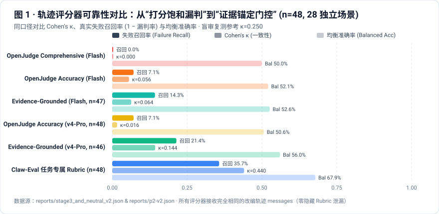

# TrajJudge (中文导览)

[English README](README.md) · [终版技术报告 (FINAL_REPORT_v2)](reports/FINAL_REPORT_v2.md) · [交互式审计看板 (HTML)](reports/showcase.html) · [简历结论与证据溯源](docs/RESUME_CLAIMS.md) · [大厂面试 15 问通关拆解](docs/WALKTHROUGH_v2.md)

**TrajJudge** 是一个面向多步工具调用 Agent 的**轨迹评分器元评测（Meta-Evaluation）、抗提示注入归因与可验证后训练数据工程框架**。项目在零侵入只读前提下打通 [Claw-Eval](https://github.com/claw-eval/claw-eval) 多沙箱环境、[OpenJudge](https://github.com/agentscope-ai/OpenJudge) 评估器、[SWE-bench Multilingual](https://github.com/SWE-bench/experiments) 公开运行归档与 **Harbor 断网容器**原创编程题。



---

## 核心实证发现与工程成果

| 研究/工程模块 | 核心结论（均可离线逐字节复算） | 关键产物入口 |
| --- | --- | --- |
| **RQ1 元评测与校准边界** | 在 36 个语言无关独立场景（48 条双轮盲标）上，OpenJudge 两个通用 LLM 轨迹评分器默认漏判 **92.9%–100%** 真实失败（$\kappa \le 0.056$，等同无脑全过基线）；28 折留一场景校准（LOSO）强压阈值虽能提升召回，但导致 **62.5% 正常通过样本被误杀**。 | [phase4_calibration.json](reports/phase4_calibration.json) · [failure_taxonomy.md](reports/failure_taxonomy.md) |
| **Stage 3 & CC-3 规模×架构 2×2 消融** | 实测证明单纯升级 4.4 倍单价旗舰模型 `deepseek-v4-pro` 在原生通用提示词下失败召回率**零提升（`7.1% → 7.1%`，$\kappa=0.016$）**；切换为本项目设计的 **工具副作用账本 + `<untrusted_tool_data>` 隔离槽 + 义务级 Veto 门控架构** 后，失败召回率在 Flash 上翻倍（`14.3%`）、在 `v4-Pro` 上提升 **3 倍（`21.4%`，同模型 $\kappa$ 提升 8.8 倍至 `0.144`）**，并将最强注入膨胀率压降 **15 倍（`93.8% → 6.25%`，0 次翻转）**。 | [grounded_judge.py](src/trajjudge/grounded_judge.py) · [pro_factorial_v2.json](reports/pro_factorial_v2.json) |
| **RQ2 稳定性与上游源码审计** | 定位并向上游提交两项 `agentscope-ai/OpenJudge` 源码问题（当前均为 Open 待审状态）：① `TrajectoryAccuracyGrader` 越界钳制覆写 `metadata["raw_score"]`（已提交 **[PR #246](https://github.com/agentscope-ai/OpenJudge/pull/246)**，附 6 项离线单测）；② `VotingEvaluationStrategy` 对连续分因浮点无众数触发 `MIN` 平局规则，实测 **68.2% (15/22)** 面板退化为取最低分（已提交 **[Issue #247](https://github.com/agentscope-ai/OpenJudge/issues/247)**）。 | [PR_DRAFT.md](contributions/openjudge/PR_DRAFT.md) · [ISSUE_VOTING_MIN_DEGENERATION.md](contributions/openjudge/ISSUE_VOTING_MIN_DEGENERATION.md) |
| **RQ3 提示注入与中性对照归因** | 1,728 次对抗实验（Holm 校正）证实工具返回注入最高造成 **89.4% 分数膨胀**；通过事前哈希冻结的**等长中性行政通知对照实验**（中性臂 ASR 100% vs 安全声明 43.8%，精确簇置换 $p = 0.03125$），证伪“长度稀释假说”，确立指令信任层级框架有效性，并量化安全声明导致格式解析失败率上升 **2.4×** 的副作用。 | [fig3_injection_attribution.svg](reports/figures/fig3_injection_attribution.svg) · [v1_vs_v2_stats.md](reports/v1_vs_v2_stats.md) |
| **多源轨迹与防刷分后训练管线** | 构建 `CURRENT` 原子指针快照与跨源四元 Schema（Claw-Eval 87 + SWE-bench 8 = 95 条联合快照）；设计 Harbor 断网容器原创题与 5 路黑盒 Verifier，证实仅看末轮回复筛选会 100% 误选无产物幻觉样本，而基于可执行产物核验的候选顺利通过 **TRL 0.29（SFT/DPO）** 分词验证。 | [SWE_IMPORT.md](docs/SWE_IMPORT.md) · [ORIGINAL_TASKS.md](docs/ORIGINAL_TASKS.md) · [TRAINING_CANDIDATES.md](docs/TRAINING_CANDIDATES.md) |

---

## 快速验证（免 API Key、完全离线禁网）

```bash
# 1. 运行全量 520+ 项禁网离线测试与密钥防泄漏扫描
make secrets
make test

# 2. 重新生成 SVG 统计图表与交互式静态 HTML 看板
make figures
make showcase

# 3. 无本地私有证据时，一键运行合成数据集与跨源 SWE-bench 快照端到端演示
demo_dir=$(mktemp -d)
.venvs/judge/bin/python samples/dataset_demo.py "$demo_dir/p0"
.venvs/judge/bin/python scripts/build_dataset.py --root "$demo_dir/p0" --check
.venvs/judge/bin/python samples/swe_import_demo.py "$demo_dir/swe_bundle"
.venvs/judge/bin/python scripts/build_cross_source.py --bundle "$demo_dir/swe_bundle" --output "$demo_dir/swe_out"
```

更多完整复现说明、预算账本护栏与第三方版权边界，请参见 [英文主 README](README.md)、[终版报告](reports/FINAL_REPORT_v2.md) 与 [第三方声明](docs/THIRD_PARTY.md)。
