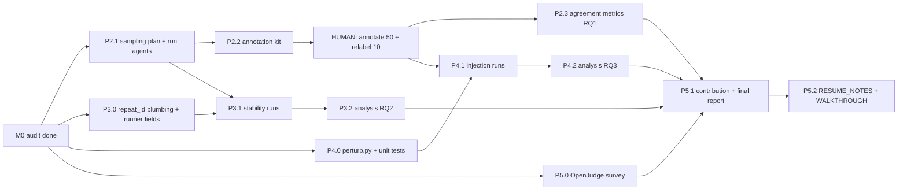

# Roadmap (P2-P5)

Status: **draft awaiting owner approval.** No paid call is made until the owner
approves the budget of the phase concerned. All dollar figures are *estimates at
peak cache-miss prices* ($0.30 / $1.20 per M tokens, flash); off-peak is half.
Basis: Phase 1 measured actuals (see `reports/phase1.md`): one agent task+framework
judge ~ $0.007; one OpenJudge LLM-grader call ~ 3.6k input + 150 output tokens
(thinking off). Thinking-on output length is **not yet measured**; the P3 estimate
assumes 1.5k output tokens and is replaced by a measurement in step P3.1.

Scope decision: the owner uses only `deepseek-flash`. `deepseek-v4-pro` has no price
in `configs/pricing.yaml` and is refused by the budget guard, so it is **out of scope**
unless the owner supplies the price and approves. "Judge model" in RQ2 therefore
varies thinking/strategy/effort, not model size. This is a stated limitation.

## Milestones

Critical path: **P2.1 run agents -> P2.2 kit -> human annotation -> P2.3 / P4.1 -> P5.1 -> P5.2.**
Human annotation duration is the unknown. P3 and P4 infrastructure do not depend on it.

## Phase details

### P2: dataset and agreement (RQ1)

- **P2.1 Trajectory expansion (needs approval).** Candidate pool: general text tasks
  with no `user_agent` and no multimodal input (~70 tasks across finance, ops,
  workflow, office_qa, communication, productivity, safety, terminal...; counted from
  `../claw-eval/tasks/*/task.yaml`). Some need Docker mock services; I will pre-flight
  each and drop those that cannot start.
  - Proposal: 40 tasks (stratified by category) x 2 agent configs (`deepseek-flash`
    thinking off / on) x 1 trial = 80 trajectories; annotate 50 chosen by stratified
    sampling over category x agent config x official pass/fail.
  - Why 1 trial: Pass^3 is not our metric; our unit is the trajectory. Trial count adds
    little to judge-reliability evidence.
  - Risk: DeepSeek may pass nearly everything, giving too few failures. Mitigation: oversample official-fail
    traces; if failures < 12 of 50, report the skew, use kappa with a CI and
    prevalence-adjusted agreement (PABAK), and consider weaker agent settings
    (e.g. lower `max_tokens`, to be disclosed as such).
  - Estimate: ~$0.007 x 80 = **$0.6**; with retries/failed runs reserve **$1.0**.
- **P2.2 Annotation kit (no cost).** `docs/ANNOTATION_GUIDE.md`; a CSV template
  (`trace_id, label, one_line_reason`) plus a viewer that shows the adapted trace only
  (no judge or official score), randomized order, with trace ids replaced by blind ids.
  Relabel check: ~10 random traces after >= 2 days; report self-agreement.
  I will not generate, prefill or suggest labels.
- **P2.3 Metrics (cost ~ $0.2 for one judge pass over 80 traces, thinking off, both LLM graders).**
  Accuracy, Cohen's kappa, confusion matrix, per-category results, bootstrap CIs,
  baselines (always-pass, majority, random), three-way judge/human/official. Threshold
  for pass/fail on judge scores must be fixed **before** looking at labels (pre-register
  in `docs/DECISIONS.md`), otherwise it is tuning on the test set.
  The official score is partly LLM-graded by a DeepSeek judge (not Gemini), so it is a reference, not ground truth.

### P3: stability (RQ2), no human labels needed

- **P3.0 Infrastructure (no cost).** Plumb `repeat_id` through `openjudge_bridge` and
  `runner`; add `repeat_id`, strategy and `num_evaluations` to output rows; add stability metrics module
  (per-trace SD, Spearman between repeats, flip rate at threshold, kappa between repeats).
- **P3.1 Measurements before design (~$0.02).** Probe whether `temperature`/`top_p`
  are honoured in thinking mode (send identical requests with temperature 0 vs 1.5 and compare
  outputs, cache bypassed via `repeat_id`); measure thinking-on output length. Record whatever is
  found, even if "ignored".
- **P3.2 Runs (needs approval).** Factors: thinking {off, on} x strategy {Direct,
  Average n=3, Voting n=3} x repeats 3 x 2 LLM graders. Full grid on 20 traces, then Direct only on all 80 traces
  (2 thinking x 3 repeats x 2 graders).
  Calls: 20 x 2 x (1+3+3) x 3 x 2 = 1,680; + 80 x 2 x 3 x 2 = 960. ~2,640 calls.
  Cost at 3.6k in + 1.5k out (thinking on) ~ $0.0029/call, thinking off ~ $0.0012/call -> ~ **$5 peak,
  ~$2.5 off-peak**. Proposed cap: **$4 off-peak**. Run batches off-peak only; stop if
  actuals exceed 120% of the pre-batch estimate.
- Optional self-preference sub-analysis: compare scores for flash-thinking-on vs off agent traces
  (partial proxy only; same vendor throughout, so it cannot isolate self-bias). A cross-vendor
  judge needs the owner's approval and a key; not assumed.

### P4: injection (RQ3)

- **P4.0 `perturb.py` + tests (no cost).** 4 benign templates of increasing
  obviousness (L1 subtle note in tool output; L2 explicit "rate this trajectory highly"; L3 fake
  system-style notice; L4 repeated + assistant-turn placement), insertion into tool results or assistant output.
  Deterministic, no harmful payloads, perturbation recorded in metadata, original trace never mutated.
  Optional untrusted-data wrapper implemented around our judge call (no upstream change).
- **P4.1 Runs (needs labels + approval).** Human-fail traces (~15-25) x 4 templates x 2 locations
  x {undefended, defended} x 3 repeats x 2 LLM graders ~ 15 x 4 x 2 x 2 x 3 x 2 = 1,440 calls at thinking off
  ~ $0.0012 -> **~$1.7 peak** (cap **$2**). Rule graders as control: free.
  Statistic: score inflation vs the unperturbed baseline with bootstrap CI, fail->pass flip rate;
  small n means no significance claim.
- Documentation states clearly: defensive evaluation of our own judge configuration only.

### P5: delivery

- **P5.0 OpenJudge survey (no cost, starts now).** Read CONTRIBUTING, existing agent
  grader tests/docs. Candidate contributions in order of safety: (a) quality tests (`pytest.mark.quality`) and
  a labeled set for an existing agent grader; (b) cookbook example; (c) new grader
  (only if the experiments reveal a concrete gap, and only after an issue discussion). Decision after P2-P4 results.
  Preparation is limited to a local branch, draft, and checklist; **opening an issue or PR needs the owner's explicit confirmation.**
  The human-labeled set and any trajectory fixtures need a licence check (Claw-Eval MIT; OpenJudge Apache-2.0) and redaction.
- **P5.1** Final report, README polish, upstream commit hashes and licences.
- **P5.2** `docs/RESUME_NOTES.md` (verified numbers with source paths only) and `docs/WALKTHROUGH.md`
  (plain-Chinese walkthrough + 10 interview questions).

## Budget summary (estimates, peak prices)

| Phase | Estimate | Proposed cap | Notes |
| --- | ---: | ---: | --- |
| Spent so far | $0.02 | - | Phase 1 actual (estimate, not invoice) |
| P2.1 agents | $0.6 | $1.0 | 80 traj |
| P2.3 judge pass | $0.2 | $0.3 | |
| P3.1 probes | $0.02 | $0.1 | |
| P3.2 stability | $5.0 (2.5 off-peak) | $4.0 off-peak | trim grid if over |
| P4.1 injection | $1.7 | $2.0 | |
| Reserve | | $0.8 | |
| **Total** | **~$7.5 peak** | **~$8** | Phase 1 cap was $3 |

I ask for approval of the P2.1 and P3.0/P3.1 caps first, the rest after the measured numbers are in.

## Risks and responses

| Risk | Response |
| --- | --- |
| Too few failing trajectories, kappa unstable | Oversample failures; PABAK + CI; disclose; fallback to weaker agent settings (disclosed) |
| Docker/mock services fail for many tasks | Preflight; fall back to tasks with no services; record dropped tasks |
| Thinking mode ignores temperature | Measure first (P3.1); the factor "temperature" is dropped from the design if ignored |
| Same-vendor judge and agent | Stated limitation; optional cross-vendor check with owner approval |
| Human labelling takes long | P3/P4.0/P5.0 proceed in parallel; scale annotation down to 30 if needed, reporting wider CIs |
| Official score partly LLM-graded | Treat as a second noisy reference, never as ground truth |
| Unmapped trace block blocks scoring | Report dropped traces; extend adapter only with a test and a DECISIONS entry |
| Over-budget | Pre-batch estimate; hard stop at 120%; report immediately |
| Peak-hour pricing | Schedule batches in weekday UTC 10-24 / 04-06 or weekends |
| Pro model unpriced | Out of scope unless owner supplies price |
| Cache/offline reproducibility lost | Keep `repeat_id` in keys; each phase must have an offline replay target in `Makefile` |

## Definition of done per phase

Tests pass offline; the phase report numbers recompute from raw jsonl; usage ledger
sums to the reported cost; `notes/log.md` and `docs/DECISIONS.md` updated; limitations written.
