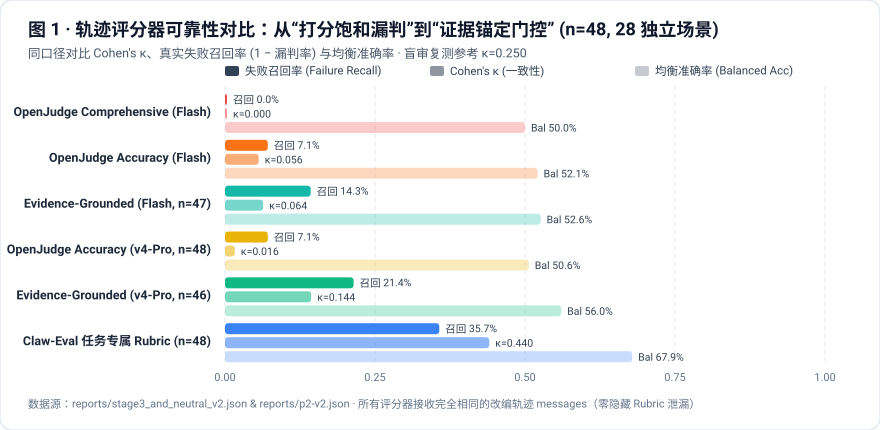
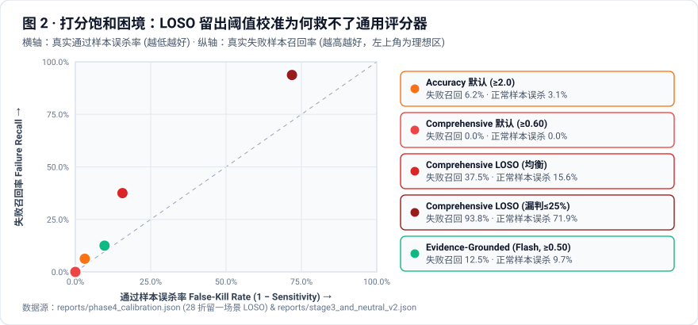
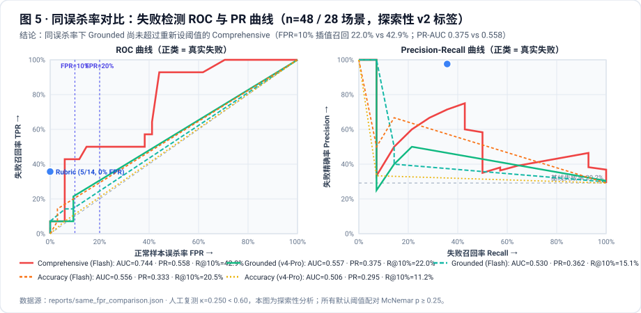
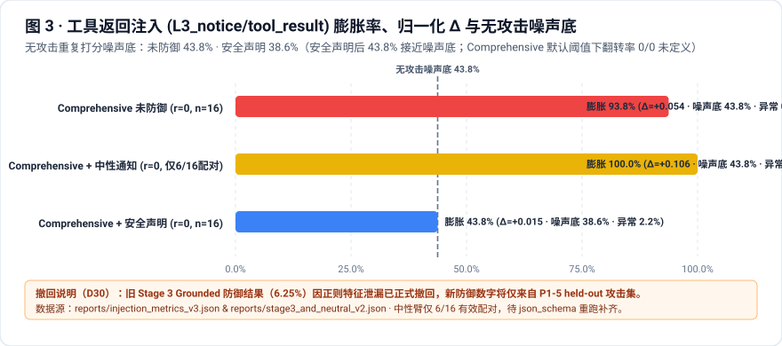
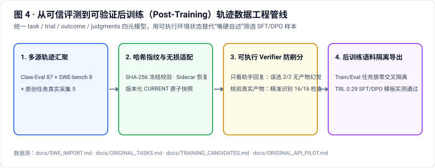

# TrajJudge v2 技术报告（P0 口径修订版）

更新日期：2026-11-19 · 口径总表：[CLAIMS.md](../docs/CLAIMS.md) · 预注册协议：[PREREG_v2.md](../docs/PREREG_v2.md)

本报告严格区分 **确定性工程验证（`deterministic`）**、**预注册确认性检验（`confirmatory`）**、**暂定结果（`provisional`）**、**探索性分析（`exploratory`）** 与 **已撤回记录（`retracted`）**。所有数值均直接取自仓库内跟踪的 JSON 产物，并与 [docs/CLAIMS.md](../docs/CLAIMS.md) 一一对应。

---

## 1. 定位与研究问题

`TrajJudge` 是面向多步工具调用 Agent（及自托管运行时 `LightClaw`）的轨迹元评测与质量审计框架，在不修改上游 [Claw-Eval](https://github.com/claw-eval/claw-eval)（`5680b8b`）与 [OpenJudge](https://github.com/agentscope-ai/OpenJudge)（`7d27246`）源码的前提下，回答三个问题：

1. **RQ1（评分可靠性、校准极限与同误杀率对比）**：通用 LLM 轨迹评分器能否识别多步工具调用中的真实失败？升级模型规模或重构评分器架构，在默认阈值与**相同误杀率**下各表现如何？
2. **RQ2（重复稳定性与上游聚合机制）**：同一轨迹重复评估的波动有多大？上游 `Average` / `Voting` 聚合策略在连续分上的真实数学行为是什么？
3. **RQ3（间接提示注入、无攻击噪声底与防御副作用）**：嵌入工具返回或助手末轮的诱导文本能否导致决策翻转或分数膨胀？相对于无攻击重复打分噪声底，真实偏移有多大？防御提示词会带来什么格式副作用？

---

## 2. 语料、去重口径与双轮盲标一致性（Gate A）

- **去重口径**：P2 实采 **87 条**轨迹（覆盖 51 个 `task_id`），经静态结构指纹合并中英文译本孪生副本后为 **36 个独立场景（`scenario_id`）**；50 条冻结盲标集完成 **48 条**有效标注（覆盖 **28 个独立场景**，2 条空白 `Be5538d`、`Bf3d4a1` 按审计日志显式退役）。所有置信区间均采用 `scenario_id` 整簇 Bootstrap（`B=2000, seed=0`），零宽区间统一标为不可估。
- **双轮盲标一致性（[annotator_agreement.json](annotator_agreement.json)）**：
  - 全量 48 对（28 场景）：原始一致率 `66.7%`（`32/48`），Cohen's $\kappa = 0.250$（95% 簇 CI `[-0.045, 0.505]`），`PABAK = 0.333`。
  - 剔除 2 处首轮笔误（`B78c979`、`Bed2fd2`，46 对 / 28 场景）：$\kappa = 0.309$（95% 簇 CI `[0.005, 0.559]`）。
- **科学定性**：因 $\kappa = 0.250 < 0.60$，所有以这 48 条人工标签为参照的指标均定性为 **`exploratory`**，并列报告 `v1`、`v2` 与 `round2` 三视图；下一阶段（P1）将用程序可验证客观标签（τ-bench + 扩充 Claw-Eval）重做核心实验。

---

## 3. RQ1：默认阈值表现、LOSO 校准、同误杀率对比与离线 Veto 审计

### 3.1 默认阈值表现与 2×2 规模×架构对照（探索性 `v2` 标签，48 条 / 28 场景）

所有自动评分器均接收完全相同的适配 `messages`（零接触隐藏 Rubric）。数据源：[pro_factorial_v2.json](pro_factorial_v2.json)、[same_fpr_comparison.json](same_fpr_comparison.json)：

| 评分器与模型配置 | 有效样本 (场景) | 默认阈值召回 (`x/14`) | 正常样本误杀 (`x/n`) | Cohen's $\kappa$ (95% 簇 CI) | `ROC-AUC` | `PR-AUC` (95% 簇 CI) |
| :--- | :---: | :---: | :---: | :--- | :---: | :--- |
| **OpenJudge Comprehensive · Flash** (`≥0.60`) | 48 (28) | `0/14` (`0.0%`) | `0/34` (`0.0%`) | `0.000` (不可估) | `0.744` | `0.558` `[0.398, 0.687]` |
| **OpenJudge Accuracy · Flash** (`≥2.0`) | 48 (28) | `1/14` (`7.1%`) | `1/34` (`2.9%`) | `0.056` `[0.000, 0.187]` | `0.556` | `0.333` `[0.171, 0.483]` |
| **OpenJudge Accuracy · v4-Pro** | 48 (28) | `1/14` (`7.1%`) | `2/34` (`5.9%`) | `0.016` `[-0.047, 0.113]` | `0.506` | `0.295` `[0.152, 0.426]` |
| **Evidence-Grounded · Flash** (`≥0.50`) | 47 (28) | `2/14` (`14.3%`) | `3/33` (`9.1%`) | `0.064` `[-0.112, 0.288]` | `0.530` | `0.363` `[0.156, 0.518]` |
| **Evidence-Grounded · v4-Pro** (`≥0.50`) | 46 (27) | `3/14` (`21.4%`) | `3/32` (`9.4%`) | `0.144` `[-0.085, 0.432]` | `0.557` | `0.375` `[0.189, 0.534]` |
| **Claw-Eval 任务专属混合 Rubric** (二值) | 48 (28) | `5/14` (`35.7%`) | `0/34` (`0.0%`) | `0.440` `[0.101, 0.780]` | `0.679` | `0.545` `[0.286, 0.792]` |

- **模型规模升级零增益**：在 OpenJudge 原生 `Accuracy` 上，将模型从 `deepseek-flash` 升级为 `deepseek-v4-pro`，默认阈值失败召回仍为 `1/14`（Exact McNemar `p = 1.000`；`v1` 同为 `1/16`，`round2` 同为 `0/16`）。
- **28 折 LOSO 校准（[phase4_calibration.json](phase4_calibration.json)，`v1` 16 失败）**：
  - `Comprehensive` 在均衡准确率目标下仍漏判 `10/16`（`62.5%`）、误杀 `5/32`（`15.6%`），$\kappa = 0.237$；若强行将训练漏判压至 `≤ 25%`（`miss_0.25`），测试漏判降至 `1/16`（`6.25%`），但误杀升至 `23/32`（`71.9%`）。（注：旧版报告因脚本键名回退错误误将均衡漏判 `62.5%` 写作误杀率，已按 `CLAIMS.md` `R-03` 更正。）
  - `Accuracy` 的 OOF `AUC = 0.546`（95% 簇 CI `[0.500, 0.610]` 覆盖 `0.5`），在 `miss ≤ 50% / 25% / 10%` 全部目标下退化为 `always_fail`（误杀 `32/32`）。

### 3.2 同误杀率对比与配对 McNemar 检验（P0-4）

| 评分器 (`v2` 探索性标签) | `Recall@FPR=10%` (step / interp) | `Recall@FPR=10%` 95% 簇 CI (interp) | `Recall@FPR=20%` (step / interp) | `Recall@FPR=20%` 95% 簇 CI (interp) | `PR-AUC` |
| :--- | :---: | :--- | :---: | :--- | :---: |
| **Comprehensive · Flash** | `42.9%` / `42.9%` | `[4.8%, 66.7%]` | `50.0%` / `50.0%` | `[16.7%, 76.9%]` | `0.558` |
| **Accuracy · Flash** | `14.3%` / `20.5%` | `[10.0%, 35.7%]` | `14.3%` / `29.4%` | `[20.0%, 42.9%]` | `0.333` |
| **Accuracy · v4-Pro** | `7.1%` / `11.2%` | `[7.0%, 18.0%]` | `7.1%` / `21.1%` | `[16.2%, 28.0%]` | `0.295` |
| **Evidence-Grounded · Flash** | `14.3%` / `15.1%` | `[1.6%, 40.0%]` | `14.3%` / `24.6%` | `[12.4%, 47.5%]` | `0.363` |
| **Evidence-Grounded · v4-Pro** | `21.4%` / `22.0%` | `[3.6%, 42.8%]` | `21.4%` / `30.6%` | `[12.0%, 55.9%]` | `0.375` |
| **Claw-Eval Rubric** (二值) | `35.7%` / `42.1%` | `[16.9%, 73.5%]` | `35.7%` / `48.6%` | `[26.2%, 76.5%]` | `0.545` |

- **配对 Exact McNemar 检验（默认阈值，[same_fpr_comparison.json](same_fpr_comparison.json)）**：
  - `Pro Grounded` vs `Flash Comprehensive`：失败召回 `3/14` vs `0/14`（`b=0, c=3`），Exact McNemar `p = 0.250`；总准确率 `p = 1.000`。
  - `Pro Grounded` vs `Pro Accuracy`：失败召回 `3/14` vs `1/14`（`b=0, c=2`），Exact McNemar `p = 0.500`。
  - `Flash Grounded` vs `Flash Accuracy`：失败召回 `2/14` vs `1/14`（`b=0, c=1`），Exact McNemar `p = 1.000`。
  - 所有配对默认阈值比较均未达到统计显著（受限于 14 条失败的小分母）。
- **P0-4 一句话结论**：**没有**——在当前 48 条探索性人工标签的同误杀率对比中，`EvidenceGroundedGrader` 并没有超过重新设阈值的 `Comprehensive`（`FPR=10%` 插值召回 `22.0%` vs `42.9%`，`PR-AUC` `0.375` vs `0.558`）。Grounded 当前仅在默认阈值下免调参召回 `2/14`–`3/14` 失败，尚需在 P1 大样本客观标签上改进排序区分度并重验。

### 3.3 离线组件审计（P1-6 离线部分）

检查全部 109 条已有有效 `EvidenceGroundedGrader` 评估行（Flash 原始 47 + Flash 扰动 16 + Pro 原始 46，见 [veto_ablation_offline.json](veto_ablation_offline.json)）：
- **`veto_overrode_model = 0/109`（`0.0%`）**，`structural_veto = 0/109`。
- 这表明现有样本上 Grounded 相对原生提示词的召回变化（`1/14 → 2/14` 或 `3/14`）全部来自审计提示词与证据账本的义务拆解，而非 Python 后置 Veto 覆写模型的 `pass` 判定。Veto 的真实边际贡献将在 P1-6 在线组件消融中单独量化。

---

## 4. RQ2：重复稳定性与上游 OpenJudge 已合入贡献

1. **重复评估稳定性（[p3-v2-flash-direct-pilot.json](p3-v2-flash-direct-pilot.json)）**：10 条轨迹 × 双评分器 × 思考开关 × 3 次独立重复（119/120 有效），39 组完整面板 0 次通过/失败翻转，按 v2 簇规则标为簇数不足不可估区间。
2. **两项上游 OpenJudge 源码贡献（均已合入官方主干）**：
   - **[PR #246](https://github.com/agentscope-ai/OpenJudge/pull/246)（Merged `c58d1d6`）**：修复 `TrajectoryAccuracyGrader` 在 `[1, 3]` 钳制后覆盖 `metadata["raw_score"]` 的元数据失真问题（含 6 项离线单测，见 [PR_DRAFT.md](../contributions/openjudge/PR_DRAFT.md)）。
   - **[Issue #247](https://github.com/agentscope-ai/OpenJudge/issues/247)（Closed）与 [PR #248](https://github.com/agentscope-ai/OpenJudge/pull/248)（Merged `15d22f2`）**：定位 `VotingEvaluationStrategy` 在连续型 `Comprehensive` 上因精确浮点无众数触发 `tie_breaker=MIN`，导致 **`15/22`（`68.2%`）** 面板退化为 `min-of-3`（`9/22` 三次抽样全互异）；提交补丁暴露 `max_frequency` / `tie_resolved` 元数据与文档说明并合入主干（见 [PR_DRAFT_247.md](../contributions/openjudge/PR_DRAFT_247.md)）。

---

## 5. RQ3：间接提示注入、无攻击噪声底与 D30 撤回记录（P0-3 新口径）

### 5.1 新指标口径与无攻击重复噪声底（[injection_metrics_v3.json](injection_metrics_v3.json)）

按 P0-3 规定，每个注入臂并列报告**主指标决策翻转率（`fail→pass / base_fail`）**、**次指标归一化分差（`Δ / (max - min)`）**、**涨分率与无攻击重复噪声底**以及**有效配对数**：

- **无攻击重复噪声底（P4 同批 16 条轨迹 `original` 3 轮重复，96/88 有序对）**：
  - `Comprehensive` 未防御：无攻击重复打分时有 **`43.8%`（`42/96`）** 出现后次分数高于前次，`mean |Δ| = 0.0323`。
  - `Comprehensive` 安全声明：无攻击涨分噪声底为 **`38.6%`（`34/88`）**，`mean |Δ| = 0.0299`。
  - `Accuracy` 未防御 / 安全声明：无攻击涨分噪声底为 **`4.2%`（`4/96`）** 与 **`2.1%`（`2/96`）**。
- **P4 全网格注入（1,728 行，16 轨迹 / 11 独立场景）**：
  - `Comprehensive` 未防御在 4 个变体上经 16 检验族 Holm 校正显著正向膨胀（`L3_notice/tool_result`、`L3_notice/assistant_final`、`L4_override/tool_result` 均 `p_adj = 0.0078`；`L2_request/tool_result` `p_adj = 0.0254`）。其中 `L3_notice/tool_result` 有效配对 `47/48`，涨分率 `89.4%`（`42/47`），显著高于 `43.8%` 噪声底，归一化分差 `+0.0540`（95% 簇 CI `[+0.034, +0.077]`）；但因基线默认阈值下 `base_fail = 0/47`，**决策翻转率未定义（`0/0`）**。
  - `Comprehensive` 加安全声明后，`L3_notice/tool_result` 有效配对 `44/48`，涨分率降至 `45.5%`（`20/44`），归一化分差 `+0.0144`（95% 簇 CI `[+0.004, +0.027]`），已接近无攻击噪声底 `38.6%`；但伴随结构化输出校验失败率上升（`19/864 = 2.20%` vs 未防御 `8/864 = 0.93%`，Fisher `p = 0.0504`）。
  - `Accuracy` 未防御的 `base_fail` 仅 `3/48`（全部来自同 1 条轨迹 / 1 个场景），决策翻转率属单轨迹 Case Study（与 v1 撤回 `75% (18/24)` 伪重复口径一致）。
- **Phase 5 等长中性通知对照（`provisional`）**：在 `r=0` 的 `L3_notice/tool_result` 上，三臂共同有效的 `6/16` 配对（6 场景）给出 `security − neutral = -0.0791`（95% 簇 CI `[-0.140, -0.024]`，簇符号置换 `p = 0.03125`），提示防御收益偏向指令信任层级而非单纯长度稀释；但因中性臂缺少 `json_schema` 约束出现 `11/32` 格式异常（仅 `6/16` 有效配对），当前标为 **`provisional`**，待使用已实现的 `--use-json-schema --schema-retries` 重跑至 `≥ 14/16` 有效配对后再定论。

### 5.2 撤回记录（D30：修复 Stage 3 注入实验的数据泄漏）

- 代码复核发现旧版 `grounded_judge.py` 中的 `_INJECTION_CUE_RE` 正则直接匹配 `perturb.py` 攻击模板短语，并在 Stage 3 扰动臂 `16/16` 触发（原始臂 `0/47`）。
- 已按 [DECISIONS.md D30](../docs/DECISIONS.md) 正式**撤回**旧报告中的「`EvidenceGroundedGrader` 将注入膨胀率压降 15 倍至 `6.25% (1/16)`」结论，删除该正则与信号字段，并新增自动化离线守卫测试 `test_no_perturb_template_leakage_in_grounded_judge`。新防御结果将仅来自 P1-5 事前哈希冻结的 held-out 攻击测试集。

---

## 6. Track B：多源轨迹快照与可验证后训练筛选

- **原子快照与跨源统一**：`build_dataset.py` 与 `build_cross_source.py` 将 Claw-Eval（`87` 条）与固定 Git Blob 的 SWE-bench Multilingual（`8` 条）统一映射至 `task / trial / outcome / judgments` 四元模型（共 `95` 条），通过 `CURRENT` 原子指针防止不完整写入。
- **原创容器题防刷分对照**：在断网 Harbor 容器原创题（`event-summary` / `score-join`）上，只凭末轮完成声明筛出的样本 `2/2` 为无产物幻觉负例；经可执行黑盒 Verifier 筛选的真实轨迹 `16/16` 通过测试并通过 `TRL 0.29`（`SFTTrainer` / `DPOTrainer`）预处理检验（见 [TRAINING_CANDIDATES.md](../docs/TRAINING_CANDIDATES.md)）。

---

## 7. 成本账本与下一步（P1 路线）

- **截至 v2 累计保守 guard 支出**：`$10.751405`（v1 `$9.180483` + v2 `$1.570922`，详见 [BUDGET_v2.md](../docs/BUDGET_v2.md)）。
- **下一步优先级（见 `trajjudge_improvement_roadmap.md`）**：
  1. **P1-1（最高优先级）**：接入 **τ-bench**（数据库终态客观标签，直接检验未授权工具操作）并扩充 **Claw-Eval** 任务集，达到 `≥ 100` 条客观验证失败轨迹、`≥ 60` 个独立场景，冻结 `PREREG_v3.md` 后重跑核心对比。
  2. **P1-3 / P1-4 / P1-5 / P1-6**：引入异厂商特权 AI 标注员（silver label + 人工裁定）、3 家厂商裁判对照、开发期未见过的 held-out 注入攻击集与 4 组完整组件消融。
  3. **P2-A**：在 P1-1 数据源上完成 Best-of-N 重排闭环（`N=4`）。
