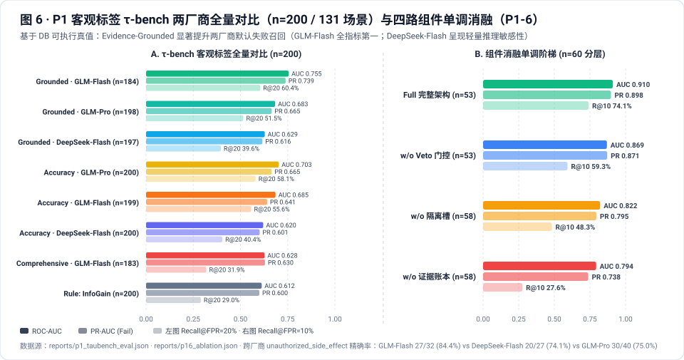
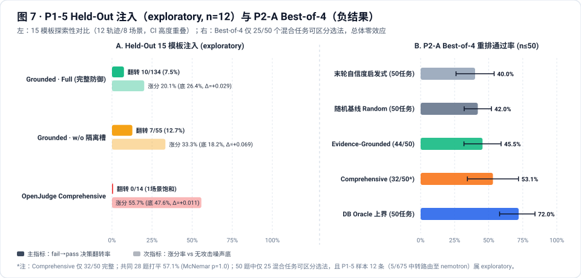
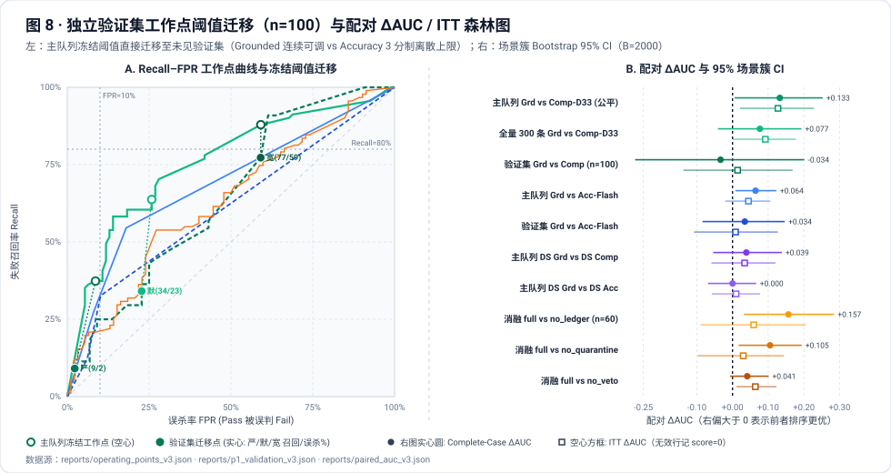
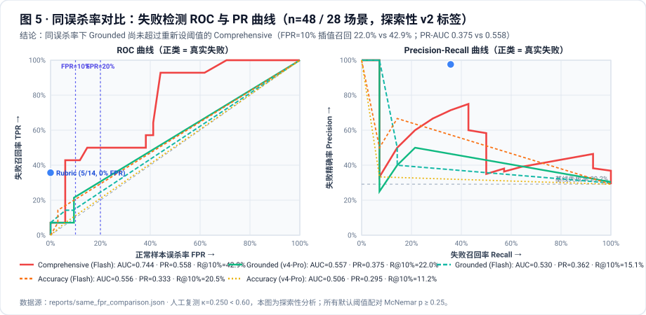

# TrajJudge v3 技术报告：面向多步工具调用 Agent 的客观标签元评测、证据锚定架构与组件消融

> **版本与口径说明**：本报告为 v3 主技术报告（2026-11-20），全部数值唯一溯源至 [docs/CLAIMS.md](../docs/CLAIMS.md) 与跟踪的 `reports/*.json`。依据预注册协议 [docs/PREREG_v3.md](../docs/PREREG_v3.md)，**200 条数据库可执行验证的 τ-bench 轨迹（131 个独立场景）** 为本报告主实验证据；早期 48 条人工盲标 Claw-Eval 队列（双轮复测 `κ = 0.250 < 0.60`）已按预注册规范降级至 **附录 A**。

---

## 摘要

> **核心定位（统一解释）**：结构化架构没有凭空提升模型的辨别能力。它的价值在于：① 让通用裁判从基本失效变为可用（相对 `Comprehensive` 显著提升）；② 把判定点推到高召回区，并提供可调阈值；③ 每个判定都附带证据索引和越权标记，可以审计。

通用 LLM-as-a-Judge 在多步工具调用 Agent 轨迹评测中存在系统性失效。在早期 48 条人工盲标 Claw-Eval 队列上，人工标签噪声与小样本限制掩盖了架构改进的真实效应；本阶段我们将主评测迁移至 **200 条数据库可执行状态验证的 τ-bench 多轮轨迹（`100` 失败 + `100` 通过、`131` 个独立场景，DeepSeek-V3.2 与 GPT-4o 精确 50/50 平衡）**，并完成预注册独立验证集（`n=100`）与工作点阈值迁移、配对 `ΔAUC` 与 ITT 敏感性、4 路组件消融、两厂商（GLM + DeepSeek）对称复现及中转站模型身份审计：

1. **主队列（`n=200`）配对 `ΔAUC` 与 D33 公平对齐验证（P1-1，[D31 / D35 / D36](../docs/DECISIONS.md)）**：修复多轮对话终止态误杀与领域政策截断后，`EvidenceGroundedGrader (glm-5.3-flash)` 无论相对历史 pre-D33 `Comprehensive`（`ΔAUC = +0.156, p = 0.001` / ITT `+0.121, p = 0.012`），还是在**同 D33 推理对齐公平对照（`Comprehensive-D33`, `89.5%` 思考链）**下，均双口径显著领先（**cc `ΔAUC = +0.133 [+0.006, +0.253], p = 0.038 (n = 132)`；ITT `+0.127 [+0.021, +0.229], p = 0.024 (n = 200)`**），且 `Comp-D33 vs pre-D33` 自身无差异（`p = 0.709 / 0.919`）、反致 `53/200` 报错与默阈 `2.9%`。相对 `OpenJudge Accuracy`（Flash `0.686` / Pro `0.703`），主要差异在于高召回工作点与 `46` 档连续分值（GLM-Flash cc `+0.064, p = 0.024`，ITT `+0.045` 跨 0）。
2. **两厂商完整三路对称对照：通用扩模无收益、判定点移动与轻推理条件性（P1-1 & P1-4，[D32 / D34 / D36](../docs/DECISIONS.md)）**：将通用 `Accuracy` 从 `glm-5.3-flash` 升级到 `glm-5.3` Pro 召回无增益（`27/99 → 21/100`, `p = 0.167`）。在官方直连 `deepseek-flash`（三路全 `thinking=off` 0% 思考链）补齐 `DS-Comprehensive`（`198/200`, 默阈仅 `5/98 = 5.1%`, `AUC 0.588`）后，证实无思考链底座上三路排序差不显著（`DS-Grounded` vs `DS-Accuracy` `ΔAUC = 0.000`、vs `DS-Comprehensive` `+0.039, p = 0.427`），但架构仍将默阈召回推升至 `48.0%`（vs `Accuracy +31.6 pp`、vs `Comprehensive +42.9 pp`）并保持高越权精确率（**GLM-Flash `27/32 = 84.4%` · GLM-Pro `30/40 = 75.0%` · DeepSeek-Flash `20/27 = 74.1%`**）；搭配轻推理后（`GLM-Flash`）才同时释放公平对齐下的排序优势。
3. **预注册独立验证集（`n=100`, `96% retail`）、全量 300 条合并与工作点分域校准（模块 B，[D35 / D36](../docs/DECISIONS.md)）**：在事前冻结的 `100` 条独立验证集上，**预注册主假设（`Grounded > Comprehensive` `ΔAUC > 0`）未复现**（cc `-0.034 [-0.273, +0.201], n=69`；ITT `+0.014, n=100`），但默认阈值 `Comprehensive` 仍仅抓 `2/39 (5.1%)` vs `Grounded 15/44 (34.1%)`。结合 `p1d33` 公平对照证伪“仅靠 D33 开推理就能救活 `Comprehensive`”后，根因定位为**域分布漂移**（`airline 36.5% → 4%`；同域 `retail` `Grounded 0.677 → 0.638` 无 D31 过拟合）叠加 `gpt-4o-retail` 小样本抽样方差（`n=69`, CI 宽 `0.47`），且**合并主 200 + 验 100 全量 `300` 条（`163` 场景）公平 D33 ITT 仍显著领先（`+0.092 [+0.001, +0.178], p = 0.049`）**。冻结阈值迁移证实跨领域须分域校准工作点，且 `{1,2,3}` 离散 `Accuracy` 无法平滑调至 `≥80%` 召回档。
4. **共同样本消融（P1-6）与探索性发现（P1-3 / P1-5 / P2-A）**：在 60 条分层子集（该子集本身偏容易、主实验同批 AUC 亦为 `0.910`，且全组 `252` 次调用 `98.8%` 思考链对齐）上，complete-case 配对显示**证据账本（`ΔAUC +0.157, p=0.012`）与隔离槽（`+0.105, p=0.015`）贡献显著**，Veto 方向为正（`+0.041`）但 CI 跨 0（另披露 ITT 敏感性）；3 套等价提示词方差极低（`ROC-AUC` SD `0.0092`）。P1-5 15 模板注入（`12` 轨迹/`8` 场景，中转审计查出 `p15` 中 `5/675` 调用被路由至 `nemotron`）整体定性为 **`exploratory`**；P1-3 在 `92` 条 DB 通过轨迹中由银标筛出 `13` 条疑似盲区（**待人工复核确认**）；P2-A Best-of-4 仅 `25/50` 混合任务有区分力，作为零效应负结果保留。
5. **上游开源贡献与中转审计透明化**：向 `agentscope-ai/OpenJudge` 贡献的 **[PR #246](https://github.com/agentscope-ai/OpenJudge/pull/246)** 与 **[PR #248](https://github.com/agentscope-ai/OpenJudge/pull/248)**（关闭 Issue #247）均已合入官方主干；全量审计 `7,010` 条缓存形成 `reports/relay_audit.json` 并主动撤回 `R-01 / R-02 / R-03` 三项早期有偏口径。

---

## 1. 主实验设计：为什么选择 τ-bench 客观标签队列（P1-1）

早期 48 条 Claw-Eval 队列受限于两项根本瓶颈：样本量小（`14` 失败 / `28` 场景）与人工双轮盲标一致性偏低（`κ = 0.250`）。为消除标签噪声，本项目依据 [docs/PREREG_v3.md](../docs/PREREG_v3.md) 构建了基于 **τ-bench（airline + retail）** 的标准化客观标签评测集（`C-P1-DATA-01`）：

- **源池清洗与零泄漏**：汇聚 3 份干净公开轨迹归档（`gpt-4o-retail.json` 460 条、`gpt-4o-airline.json` 200 条、`DeepSeek-V3.2-Exp-thinking-off.jsonl` 165 条，剔除 1 份含 61/165 空消息的损坏归档），共 **825 条零未映射角色** 标准化轨迹。`src/trajjudge/taubench_adapter.py` 强制将 `reward` 与 `expected_actions` 隔离至 `privileged_outcome`，任何评分器在推理时均不可见。
- **冻结主队列（`n = 200`, `131` 独立场景）**：确定性分层抽取 **100 条客观失败 + 100 条客观通过**，在两类被测 Agent（`DeepSeek-V3.2` 50 失败 / 50 通过；`gpt-4o` 50 失败 / 50 通过）上精确 50/50 平衡，覆盖 `airline`（73 条）与 `retail`（127 条），平均 `31.8` 条消息、`8.1` 次工具调用、`1.7` 次写操作（`cohort_sha256 = e460dbef6668ce2c5d9185728e0300e49ee0c3abac6a5e42d18e6806e1bed73a`）。
- **工程复盘（D31 多轮终止态修复）**：在 τ-bench 首次试跑中，我们发现旧版 `has_final_assistant_reply` 假设最后一条消息必为 `assistant`（单轮假设），导致 `170/200` 条以用户 `###STOP###` 收尾及 `27/200` 条以 `transfer_to_human_agents` 收尾的多轮轨迹被误判结构异常；同时旧版 `_extract_system_summary` 在 1,500 字符处截断了 6KB 领域业务政策。D31 修复上述两项缺陷并引入连续排序置信度 `confidence_pass`（仍严格服从 Veto 分区：`pass ∈ [0.50, 1.00]`、`fail ∈ [0.00, 0.45]`），成为打通客观大样本表现的关键转折。

---

## 2. 主实验结果：τ-bench 200 条客观标签全量对比（P1-1 & P1-4）

下表汇总全部 LLM 评分器（含 GLM 与 DeepSeek 官方完整 200 条对称运行）与规则基线在 200 条冻结 τ-bench 队列上的完整指标（全部置信区间为 `B = 2000` 场景簇 Bootstrap，数据源：`reports/p1_taubench_eval.json`）：

| 评分器与模型配置 | 有效数 / 场景 | 默认召回 (`x/n`) | 默认误杀 (`x/n`) | Cohen's `κ` (95% 簇 CI) | `ROC-AUC` (95% 簇 CI) | `PR-AUC` (95% 簇 CI) | `R@FPR=10%` (step / interp) | `R@FPR=20%` (step / interp) | 越权副作用精确率 |
| :--- | :---: | :---: | :---: | :--- | :--- | :--- | :---: | :---: | :---: |
| **Evidence-Grounded · GLM-Flash** | `184/200` (`123`) | **`58/91` (`63.7%`)** | `24/93` (`25.8%`) | **`0.380`** `[0.231, 0.514]` | **`0.755`** `[0.673, 0.825]` | **`0.739`** `[0.637, 0.830]` | **`37.4%` / `37.4%`** | **`60.4%` / `60.4%`** | **`27/32` (`84.4%`)** |
| Evidence-Grounded · GLM-5.3 Pro | `198/200` (`129`) | `68/99` (`68.7%`) | `38/99` (`38.4%`) | `0.303` `[0.177, 0.436]` | `0.683` `[0.616, 0.753]` | `0.665` `[0.573, 0.757]` | `0.0%` / `30.0%` | `51.5%` / `51.5%` | `30/40` (`75.0%`) |
| **Evidence-Grounded · DeepSeek-Flash** *(post-D31)* | `197/200` (`130`) | `47/98` (`48.0%`) | `27/99` (`27.3%`) | `0.207` `[0.076, 0.341]` | `0.629` `[0.553, 0.707]` | `0.616` `[0.514, 0.717]` | `21.4%` / `21.4%` | `38.8%` / `39.6%` | `20/27` (`74.1%`) |
| OpenJudge Accuracy · GLM-5.3 Pro | `200/200` (`131`) | `21/100` (`21.0%`) | `4/100` (`4.0%`) | `0.170` `[0.086, 0.261]` | `0.703` `[0.641, 0.764]` | `0.665` `[0.580, 0.745]` | `21.0%` / `36.4%` | `57.0%` / `58.1%` | — |
| OpenJudge Accuracy · GLM-Flash | `199/200` (`131`) | `27/99` (`27.3%`) | `8/100` (`8.0%`) | `0.193` `[0.091, 0.308]` | `0.686` `[0.623, 0.753]` | `0.641` `[0.550, 0.728]` | `27.3%` / `32.7%` | `54.6%` / `55.7%` | — |
| OpenJudge Accuracy · DeepSeek-Flash | `200/200` (`131`) | `16/100` (`16.0%`) | `3/100` (`3.0%`) | `0.130` `[0.045, 0.217]` | `0.620` `[0.566, 0.672]` | `0.601` `[0.516, 0.681]` | `30.0%` / `33.0%` | `30.0%` / `40.4%` | — |
| OpenJudge Comprehensive · GLM-Flash | `183/200` (`125`) | `4/91` (`4.4%`) | `1/92` (`1.1%`) | `0.033` `[0.000, 0.074]` | `0.628` `[0.538, 0.710]` | `0.630` `[0.527, 0.733]` | `20.9%` / `21.2%` | `31.9%` / `31.9%` | — |
| Rule · `observation_information_gain` | `200/200` (`131`) | `8/100` (`8.0%`) | `4/100` (`4.0%`) | `0.040` `[-0.031, 0.109]` | `0.612` `[0.533, 0.693]` | `0.600` `[0.493, 0.715]` | `14.0%` / `14.0%` | `29.0%` / `29.0%` | — |
| Rule · `action_loop_detection` | `200/200` (`131`) | `0/100` (`0.0%`) | `0/100` (`0.0%`) | `0.000` (不可估) | `0.583` `[0.527, 0.639]` | `0.554` `[0.465, 0.649]` | `22.0%` / `20.0%` | `30.0%` / `35.6%` | — |

### 核心分析

> **统一核心结论**：结构化架构没有凭空提升模型的辨别能力。它的价值在于：① 让通用裁判从基本失效变为可用（相对 Comprehensive 显著提升）；② 把判定点推到高召回区，并提供可调阈值；③ 每个判定都附带证据索引和越权标记，可以审计。

1. **配对 ΔAUC 与 ITT（误差归零 `raw_score = 0.0`）双口径检验 + D33 公平对齐验证（数据源：`reports/paired_auc_v3.json`、`B = 2000` 场景簇 Bootstrap，[D36](../docs/DECISIONS.md)）**：
   - **vs `Comprehensive-D33`（公平对齐，`reasoning_effort=low`, `max_tokens=4096`）**：为消除主队列历史 `Comprehensive` 跑在 D33 前（仅 `59.6%` 思考链）的潜在混杂，我们在同 200 条主队列上按 D33 补跑公平对照（`162/162` 缓存 100% GLM 家族，思考链率 `89.5%`、均 `1647` tok，有效 `147/200`，`53/200` 失败含 `44` 网络 + `8` 超长截断 + `1` 无效输出，默阈召回仍仅 `2/70 = 2.9%`）。实测 `Comp-D33 vs Comp-preD33` 自身配对差异近零（cc `+0.0132, p = 0.709`；ITT `-0.0061, p = 0.919`），**直接证伪“仅靠开推理就能救活 `Comprehensive`”的混杂假说**；在 100% 公平对齐下，`Evidence-Grounded` 依然在完整样本（`0.7486 vs 0.6161`, **`ΔAUC = +0.1325 [+0.0058, +0.2529], p = 0.038, n = 132`**）与 ITT（`0.7332 vs 0.6058`, **`ΔAUC = +0.1274 [+0.0210, +0.2286], p = 0.024, n = 200`**）上双双显著领先（历史 pre-D33 对照为 cc `+0.1561, p = 0.001` / ITT `+0.1212, p = 0.012`）；即使合并主 200 + 独立验证 100 全量 **`300` 条（`163` 场景）**，公平 D33 ITT 仍保持显著（**`+0.0921 [+0.0012, +0.1780], p = 0.049`**）。
   - **vs `Accuracy`（GLM-Flash / GLM-Pro，`n = 184` / ITT `n = 200`）**：完整共同样本下 `Grounded (GLM-Flash)` 显著高于同底座 `Accuracy (GLM-Flash)`（`0.7552 vs 0.6908`, `ΔAUC = +0.0644 [+0.0078, +0.1229], p = 0.024`），但在计入 16 条 HTTP 504/解析缺失的 ITT 口径下收窄为未达显著（`0.7332 vs 0.6886`, `ΔAUC = +0.0446 [-0.0206, +0.1062], p = 0.184`）；相对 `Accuracy (GLM-Pro)` 的配对差异同样未达统计显著（cc `+0.0541 [-0.0151, +0.1239], p = 0.121`；ITT `+0.0307 [-0.0459, +0.0989], p = 0.404`）。`Grounded` 相对 `Accuracy` 的核心工程增益体现在将默阈工作点从漏判率极高的低召回区（`27.3%`）推升至高召回区（`63.7%`, `+36.9 pp`, Exact McNemar `p = 4.66e-10`），同时总体准确率提升（`69.0% vs 60.3%, p = 0.0328`）并输出连续可微调风险分（vs `Accuracy` `{1, 2, 3}` 离散死区）。
2. **「通用模型扩容悖论」、轻推理敏感性与官方 DeepSeek 三路完全对称对照（GLM-Flash vs GLM-Pro vs DeepSeek-Flash）**：
   - 通用 `Accuracy` 从 `GLM-Flash` 升级至 `GLM-Pro`，默阈失败召回不升反降（`27/99 → 21/100`, Exact McNemar `p = 0.167`），配对排序能力也无显著差异（`ΔAUC +0.0142 [-0.0448, +0.0750], p = 0.614`；ITT `+0.0139, p = 0.622`）。
   - **官方直连 `deepseek-flash`（三路全 `thinking=off` 0% 思考链，无第三方中转）揭示机制边界**：补齐 `DS-Comprehensive`（`198/200`, 默阈召回仅 **`5/98 = 5.1%`**, 误杀 `2/100`, `κ = 0.031`, `AUC = 0.588`）后，官方 `deepseek-flash` 形成完整三路对称对照：`DS-Grounded`（`197/200`, 召回 `48.0%`, `AUC = 0.629`）相对 `DS-Accuracy` 的 `ΔAUC = +0.0000 (p = 0.973)`、相对 `DS-Comprehensive` 为 cc **`+0.0387 [-0.0544, +0.1381], p = 0.427`** / ITT **`+0.0340, p = 0.436`**——均未达统计显著，但仅靠账本-Veto 工作点平移即将默阈召回相对 `Accuracy` 推高 `+31.6 pp`（`p = 7.92e-09`）、相对 `Comprehensive` 推高 **`+42.9 pp`**，越权精确率 `20/27 (74.1%)`。跨两厂商对比揭示：**无思考链底座（`DeepSeek-Flash` / `GLM-Pro`）下架构价值集中于默认工作点救活与过程可审计；搭配轻量步骤推理（`GLM-Flash`）后，才能在 D33 公平对齐下同时释放统计显著的排序优势（`+0.133 cc / +0.127 ITT`）**。
   - **自评偏好（Self-Preference）与跨厂商可审计性**：在 `DeepSeek-V3.2` 与 `gpt-4o` 轨迹上，`GLM-Flash Grounded` 审 DeepSeek `AUC = 0.781`（召回 `62.2%`, 误杀 `20.0%`）vs GPT-4o `AUC = 0.726`（召回 `65.2%`, 误杀 `31.3%`）；`DeepSeek-Flash Grounded` 审自家轨迹 `AUC = 0.659`（召回 `48.0%`, 误杀 `26.5%`）vs GPT-4o `AUC = 0.599`（召回 `47.9%`, 误杀 `28.0%`），两厂商均未观察到显著放水同源模型的偏倚（属观察性子集审计结果）。

---

## 2B. Pre-registered 独立验证集（`p1val, n=100`）与工作点迁移分析

为检验在主队列上建立的 `D31` 提示词规范与工作点阈值是否过拟合，我们在执行任何验证 API 调用前，先行向 `docs/PREREG_v3.md` §9 提交并锁定了验证方案（**Commit 1**: `54619c3ef4cc05c3a1259209e22d548883f9fa56`，`cohort_sha256: 6716de02...766c1`）。因 τ-bench 原始 825 条池中 `DeepSeek-V3.2` 在主队列后仅余 `10` 条未用失败轨迹且 `p2bon-t50` 用尽 `gpt-4o-airline`，验证集按「Agent 内 `50/50` 成败平衡」分层抽样 `100` 条未进主队列轨迹（`39` 独立场景，`96% retail / 4% airline`，`93` 未见新场景 + `7` 已见场景；数据源：`reports/p1_validation_v3.json`、`reports/operating_points_v3.json`、`fig8_operating_points_v3.svg`）。

1. **三路验证集实测表现（`hubcore_glm_flash`, `max_tokens=4096`）**：
   - **有效数与失误对称性**：`Grounded 88/100`（`10` 次 HTTP 504 + `2` 次截断解析失败）、`Accuracy 98/100`（`2` 次 HTTP 504）、`Comprehensive 78/100`（`15` 次 HTTP 504 + `7` 次 4096-token 超长截断）；三路无效轨迹在真实失败/通过间均为精确 `50/50` 平衡（`6/6`、`1/1`、`11/11`）。
   - **主预注册假设未复现（honest negative replication）**：在独立验证集上，`Grounded vs Comprehensive` 的配对 `ΔAUC` 完整样本为 `-0.0337 [-0.2730, +0.2011]`（`0.6120 vs 0.6456`, `p = 0.840`, `n = 69`），ITT 口径为 `+0.0144 [-0.1376, +0.1686]`（`0.6126 vs 0.5982`, `p = 0.815`, `n = 100`；unseen 子集 cc `-0.0479, p = 0.778` / ITT `-0.0130, p = 0.883`）；`Grounded vs Accuracy` 为 cc `+0.0344, p = 0.539`（`0.6459 vs 0.6115`, `n = 87`）、ITT `+0.0084, p = 0.872`（`0.6126 vs 0.6042`）。
   - **默阈工作点推高行为稳定复现**：尽管排序区分未拉开，三路在验证集上的默认阈值工作点依然保持分离——`Comprehensive` 默阈仅检出 `2/39 (5.1%)` 失败（误杀 `0/39 = 0.0%`），`Accuracy` 仅 `6/49 (12.2%)`（误杀 `3/49 = 6.1%`），而 `Grounded` 检出 `15/44 (34.1%)`（误杀 `10/44 = 22.7%`；ITT `42.0% / 32.0%`）。
2. **根因对照排查与定量拆解（`reports/p1_validation_v3.json` + [D36](../docs/DECISIONS.md)）**：
   - **排查 ①：补跑 `p1d33` 证伪“仅因 D33 推理对齐即抹平排序差”的混杂假说**。最初观察到 `p1val` 下 `Comprehensive` 思考链率从 `59.6%` 升至 `95.7%`（均 `2203.7` tok），疑似主队列 `+0.156` 系推理不公平所致；随后在主队列 200 条上按相同 D33 配置补跑 `p1d33`（`89.5%` 思考链、均 `1647` tok），证实 `Comprehensive` 自身在主队列并无显著提升（`Comp-D33 vs pre-D33` cc `+0.013, p = 0.709` / ITT `-0.006, p = 0.919`），反致 `53/200 (26.5%)` 失误与默阈 `2.9%`；公平对齐下 `Grounded` 主队列仍显著领先（cc `+0.133, p = 0.038` / ITT `+0.127, p = 0.024`），合并全量 `300` 条（`163` 场景）ITT 仍显著（`+0.092, p = 0.049`）。
   - **真实根因：领域漂移（`airline 36.5% → 4%`）+ `gpt-4o-retail` 小样本抽样方差（而非 D31 过拟合）**。主队列 `airline` 任务显著更易区分（`Grounded airline AUC = 0.8532`），而验证集 `96%` 为高难度 `retail` 且 `80%` 为 `gpt-4o-retail`，剔除失误后共同有效样本仅 `n = 69`（95% CI 宽达 `0.474`）；仅看 **`retail → retail` 同域**，`Grounded` 为 `0.6772 → 0.6379`、`Accuracy` 为 `0.5985 → 0.5974`，未见 D31 过拟合。
3. **冻结工作点跨分布迁移实验（`reports/operating_points_v3.json`、`fig8_operating_points_v3.svg`）**：将主队列冻结的严苛/默认/宽松三档阈值直接迁移到 `p1val`（`score < thr` 判失败）：
   - `Grounded` 连续阈值在 `airline → retail` 迁移中发生明显**召回率下移**（严苛 `< 0.1294`：`37.4%/8.6% → 9.1%/2.3%`, `-28.3 pp`；默认 `< 0.50`：`63.7%/25.8% → 34.1%/22.7%`, `-29.6 pp`；宽松 `< 0.98125`：`87.9%/59.1% → 77.3%/59.1%`, `-10.6 pp`），误杀率稳定但召回衰减表明跨领域仍需按目标分布做分位重标定。
   - `Accuracy` 离散 `{1, 2, 3}` 分制无可用连续调节空间：`< 1.5` 与 `< 2.0` 完全重合（`27.3%/8.0% → 12.2%/6.1%`），唯一非退化切分 `< 2.5` 为 `54.5%/18.0% → 32.7%/10.2%`，而放宽到 `< 3.01` 则在两队列均直接退化为 `100%/100%`（全判失败）。
   - `Comprehensive` 默认 `< 0.60` 在两队列均几乎不抓失败（`4.4%/1.1% → 5.1%/0.0%`），严苛分位点 `< 0.742969` 为 `20.9%/6.5% → 30.8%/5.1%`，宽松 `< 0.90483` 为 `80.2%/66.3% → 66.7%/59.0%`。

---

## 3. P1-6 组件消融：三层架构贡献分解与 Veto 角色重定位

为回答「究竟是证据账本、工具输出隔离槽还是 Python Veto 门控在起作用」，我们在 τ-bench 主队列中确定性分层抽取 `60` 条轨迹（30 失败 + 30 通过，两类 Agent 精确平衡，`36–40` 个独立场景），固定 `glm-5.3-flash` 运行全部 4 路组件消融（数据源：`reports/p16_ablation.json`、`reports/paired_auc_v3.json`）：

| 消融配置 | 有效数 / 场景 | 默认召回 / 误杀 | Cohen's `κ` | `ROC-AUC` (cc) | `PR-AUC` | `Recall@FPR=10%` | `Recall@FPR=20%` | Veto 覆写模型 |
| :--- | :---: | :---: | :---: | :---: | :---: | :---: | :---: | :---: |
| **`full`（完整架构）** | `53/60` (`36`) | `24/27` (`88.9%`) / `9/26` (`34.6%`) | **`0.545`** | **`0.910`** | **`0.898`** | **`74.1%`** | **`85.2%`** | `3/53` (`5.7%`) |
| **`no_veto`（关闭 Python 强制否决）** | `53/60` (`36`) | `22/27` (`81.5%`) / `8/26` (`30.8%`) | `0.508` | `0.869` (`-0.041`) | `0.871` | `59.3%` (`-14.8 pp`) | `74.1%` | `0/53` (`0.0%`) |
| **`no_quarantine`（关闭隔离槽包装）** | `58/60` (`40`) | `27/29` (`93.1%`) / `13/29` (`44.8%`) | `0.483` | `0.822` (`-0.088`) | `0.795` | `48.3%` (`-25.8 pp`) | `65.5%` | `10/58` (`17.2%`) |
| **`no_ledger`（移除账本，直审对话）** | `58/60` (`40`) | `20/29` (`69.0%`) / `7/29` (`24.1%`) | `0.448` | `0.794` (`-0.116`) | `0.738` | `27.6%` (`-46.5 pp`) | `55.2%` | `1/58` (`1.7%`) |

### 消融启示（含配对 ΔAUC 与 ITT 局限说明）

1. **点估计观测阶梯与共同样本配对显著性**：首先必须透明指出，全量 `full` 在这 53 条有效子集上同样测得 `AUC = 0.9103`（对比全量 200 条为 `0.7552`），说明该 `60` 条子集本身可分性更高；在该子集点估计上，五项核心指标呈现 **`full > no_veto > no_quarantine > no_ledger`** 的梯度。在完整共同样本配对检验（`reports/paired_auc_v3.json`）下：
   - `full vs no_ledger`（`n = 51`）：**`ΔAUC = +0.1569 [+0.0321, +0.2847], p = 0.012`**（账本贡献最大、统计显著）；
   - `full vs no_quarantine`（`n = 51`）：**`ΔAUC = +0.1054 [+0.0170, +0.1941], p = 0.015`**（隔离槽边界隔离贡献显著）；
   - `full vs no_veto`（`n = 53`）：`ΔAUC = +0.0413 [-0.0068, +0.1015], p = 0.105`（连续排序差未达显著）。
   - **ITT 敏感性诚实汇报**：`full-v0` 早期批次（D33 前）含 `7/60` 网络/截断失败，而重跑后的 `no_quarantine`/`no_ledger` 仅 `2/60` 失败；在错误全赋 `0.0` 的 ITT 口径下（`n = 60`），`full` ITT AUC 降为 `0.8372`，`full vs no_veto` 为 `+0.0639 [p = 0.023]`，但 `full vs no_quarantine`（`+0.0300, p = 0.671`）与 `full vs no_ledger`（`+0.0594, p = 0.445`）受不对称缺失率抵消——因此消融组间归因主比较以共同有效样本为准，并主动披露缺失差异。
2. **为何在 `ΔAUC` 未显著时仍保留 Python Veto**：连续排序 AUC 并不主要依赖后置硬否决，保留 Veto 的工程依据有三点：① 将高精度 `unauthorized_side_effect` 越权告警（主队列精确率 `GLM-Flash 27/32 = 84.4%`、`DS-Flash 20/27 = 74.1%`）刚性转化为默认阈值处的通过/失败否决（主队列覆写 `6/184`，消融处将默认召回从 `81.5% → 88.9%`、`κ` 从 `0.508 → 0.545`）；② 在模型自身「结论与越权表自相矛盾」时提供确定性可审计安全底线；③ 在 `no_quarantine` 关闭隔离槽时，模型自相矛盾引发 Veto 覆写比例从 `5.7%` 激增至 `17.2%`、误杀飙至 `44.8%`，反向印证了 `<untrusted_tool_data>` 隔离槽防止「工具内容污染助手承诺核验」的结构作用。
3. **三套同义提示词敏感性实测（`v0 / v1 / v2`）**：更换 3 套等价措辞后，`v0`（`53/60`）`ROC-AUC = 0.9103`、`v1`（`58/60`）`0.8952`、`v2`（`56/60`）`0.8936`，全三组 **`ROC-AUC` 均值 `0.8997`、标准差仅 `0.0092`**（`PR-AUC` 均值 `0.8846` SD `0.0148`，`R@10%` 均值 `74.1%` SD `2.75%`，失败召回均值 `92.6%` SD `3.64%`），证实收益来自结构化账本与隔离架构而非针对单套措辞调参。

---

## 4. P1-3 银标盲区（待人工复核）与 P2-A Best-of-4 探索结果

### 4.1 P1-3 跨厂商特权银标（`glm-5.3`，仅作 Silver Label）
1. **Claw-Eval 48 条银标校准**：有效 `45/48` 条，与人工 `v2` 原始一致率 **`73.3%`**（`PABAK = 0.467`，`κ = 0.206`），高于人工自身双轮原始一致率（`66.7%`）；全部 12 条分歧已结构化导出至离线盲审包（`annotation/round3_review_packet/claw48_disagreements_12.md` 与 `annotation/round3_claw48_adjudication.csv`，当前状态 **`pending_human_review`**）。
2. **τ-bench 客观通过轨迹的疑似合规盲区（Silver Label，待人工确认）**：在 `100` 条数据库终态校验 `reward = 1.0` 的客观通过轨迹中，`glm-5.3` 有效审计 `92` 条并标出 **`13/92 (14.1%)`** 条 **Silver-Label 候选疑似违规**（典型类型包括未按政策先向用户二次确认即执行不可逆改签/退货、最终回复幻觉等，见 [07_blindspot_cases.md](../notes/walkthrough/07_blindspot_cases.md)）。这 13 条候选同样处于 **`pending_human_review`**（盲审包位于 `annotation/round3_review_packet/blindspots_13.md` 与 `annotation/round3_blindspots.csv`，汇总脚本 `scripts/summarize_p13_review.py` → `reports/p13_human_review.json`），在人工盲审确认前**不作为终审确认盲区数写入简历与强结论**。

### 4.2 P2-A Best-of-4 重排探索（`50` 个 τ-bench 任务 × 4 候选，`glm-5.3-flash`，探索性结果）
数据源：`reports/p2_best_of_n.json`（所有区间为场景簇 Bootstrap 95% CI）：

| 选择策略 | 完整任务数 | 客观通过率 (`x/n`) | 95% 簇 CI | 配对比较 / 探索性局限 |
| :--- | :---: | :---: | :--- | :--- |
| `final_confidence`（末轮语气启发式） | `50/50` | `40.0%` (`20/50`) | `[26.0%, 54.0%]` | 略低于随机期望 |
| `random`（随机单样本期望） | `50/50` | `42.0%` | `[32.0%, 52.0%]` | 仅 **`25/50` 任务同时含成功与失败候选**（`20` 全过 + `5` 全败无法靠重排区分） |
| **`Evidence-Grounded` (`glm-5.3-flash`)** | `44/50` | **`45.5%`** (`20/44`) | `[31.8%, 59.1%]` | **探索性阴性结论**：混合任务子集 `44.0%` vs `random 43.0%`（几乎打平）；vs `final_confidence` (`43.2%`, `n=44`) `p = 1.0` |
| `Comprehensive`（全量缺行 vs **共同对齐 `n=28`**） | `32/50` / `28` | 表观 `53.1%` / 对齐 **`57.1%` vs `57.1%`** | `[34.4%, 71.9%]` | 表观 `53.1%` 系 `18` 个难题 `504`/Schema 缺失带来的幸存者偏差；在 `28` 个共同完整任务上两裁判完全打平 (`16/28` vs `16/28`, McNemar `p = 1.0`) |
| `oracle`（数据库可执行校验上界） | `50/50` | **`72.0%`** (`36/50`) | `[58.0%, 84.0%]` | 量化纯离线单轨迹排序比 DB Oracle 低 `26.5 pp`，难题选优仍需执行校验介入 |

---

## 5. RQ2 上游开源贡献与 RQ3 / P1-5 Held-Out 间接提示注入

### 5.1 上游 OpenJudge 源码贡献（两项 PR 均已合入官方主干）

- **[OpenJudge PR #246](https://github.com/agentscope-ai/OpenJudge/pull/246)（Merged `c58d1d6`）**：修复 `TrajectoryAccuracyGrader` 在模型输出越界分（如 `99`）钳制到 `[1, 3]` 后覆写 `metadata["raw_score"]` 的可观测性缺陷（附 6 项单测）。
- **[OpenJudge Issue #247](https://github.com/agentscope-ai/OpenJudge/issues/247) & [PR #248](https://github.com/agentscope-ai/OpenJudge/pull/248)（Merged `15d22f2`）**：量化发现 `VotingEvaluationStrategy` 在连续分上 `15/22 (68.2%)` 面板因三抽样互异无众数而退化为 `min-of-3`，PR #248 暴露平局元数据与文档说明并关闭 Issue #247。

### 5.2 P1-5 Held-Out 15 模板间接提示注入（`exploratory`，方法论复测替代 D30 旧结论）

> **降级声明（Roadmap v3 模块 E）**：先主动发现并撤回早期 Stage 3 的正则表达式泄漏（D30），再在开发期完全未见的 `15` 个 Held-Out 模板（`SHA-256 = 08a07040...bab30081`）上重测；但因仅 `12` 条失败轨迹 / `8` 独立场景、CI 高度重叠，且中转站审计查出 `p15` 中 `5/675` 次调用被静默路由至 `nvidia/nemotron-3-ultra-550b-a55b`，本实验严格定性为 **`exploratory`**（仅作方向性观察与方法论范例，不下确认性因果结论）。

| 实验臂（`12` 失败轨迹 / `8` 独立场景） | 有效配对 (总体 / `tool_result`) | `tool_result` 翻转率 (`fail→pass`) | 全部位置翻转率 | `tool_result` 涨分率 vs 噪声底 | `tool_result` 归一化 `Δ` (95% CI) | 无攻击重复决策翻转噪声底 |
| :--- | :---: | :---: | :---: | :---: | :--- | :---: |
| **`Evidence-Grounded full`** | `237` / `149` (`12/12` `orig0`) | `10/134 (7.5%)` `[0.6%, 18.5%]` | `18/214 (8.4%)` `[1.6%, 20.0%]` | `20.1%` (`30/149`) `<` `26.4%` 噪声底 | `+0.0286` `[-0.088, +0.139]` | `2/62 (3.2%)` |
| **`Grounded no_quarantine`** | `91` / `63` (`9/12` `orig0`) | `7/55 (12.7%)` `[0.0%, 30.4%]` | `7/75 (9.3%)` `[0.0%, 21.3%]` | `33.3%` (`21/63`) `>` `18.2%` 噪声底 | `+0.0688` `[-0.105, +0.258]` | `4/32 (12.5%)` |
| `OpenJudge Comprehensive` | `195` / `122` (`11/12` `orig0`) | `0/14`（仅 1 场景 `<0.60`，饱和） | `0/21` (`case_study`) | `55.7%` (`68/122`) vs `47.6%` 噪声底 | `+0.0106`（`zh_paraphrase`: `+0.0175` `[+0.004, +0.039]`） | `0/6` |

- **探索性方向对比**：隔离槽方向上降低翻转（`7.5%` vs `12.7%`，JSON 字段伪装 `2/57 = 3.5%` vs `3/19 = 15.8%`），同时无攻击重复翻转噪声底从 `12.5% (4/32)` 降至 `3.2% (2/62)`，但受样本量（12 轨迹/8 场景）及中转异常路由限制不作确认性因果宣称。
- **早期 P4 / Phase 5 归档结论（P0-3）**：在早期 Claw-Eval 队列上，`Comprehensive` 无攻击噪声底为 `43.8% (42/96)`，`L3_notice/tool_result` 推高涨分至 `89.4% (42/47)`（Holm `p_adj = 0.0078`）；安全声明虽将其压回噪声底附近（`45.5%`），但解析异常率升至 `2.20%`（vs `0.93%`, Fisher `p = 0.0504`）；中性对照重跑达 `10/16` 配对（精确簇置换 `p = 0.0273`，因缺严格 `json_schema` 保持 `provisional`）。早期 Stage 3 `6.25%` 结论已按 [D30](../docs/DECISIONS.md) 正式撤回。

---

## 附录 A：早期 Claw-Eval 48 条探索性队列（降级归档）

> 依据 `PREREG_v3.md`，本队列因样本量小（`14` 失败 / `28` 场景）及人工双轮盲标 `κ = 0.250`（`[-0.045, 0.505]`，远低于 `0.60` 门槛），仅作探索性对照与方法演进记录（数据源：`reports/same_fpr_comparison.json`、`reports/phase4_calibration.json`、`reports/veto_ablation_offline.json`）。

| 评分器与模型配置（Claw-Eval 48 条 `v2` 探索性标签） | 默认阈值召回 (`x/14`) | 正常误杀 (`x/n`) | Cohen's `κ` | `ROC-AUC` | `PR-AUC` | `R@FPR=10%` (interp) |
| :--- | :---: | :---: | :---: | :---: | :---: | :---: |
| OpenJudge Comprehensive · Flash (`≥0.60`) | `0/14` (`0.0%`) | `0/34` (`0.0%`) | `0.000` | `0.744` | `0.558` | `42.9%` |
| OpenJudge Accuracy · Flash (`≥2.0`) | `1/14` (`7.1%`) | `1/34` (`2.9%`) | `0.056` | `0.556` | `0.333` | `20.5%` |
| OpenJudge Accuracy · v4-Pro (`≥2.0`) | `1/14` (`7.1%`) | `2/34` (`5.9%`) | `0.016` | `0.506` | `0.295` | `11.2%` |
| Evidence-Grounded · Flash (`≥0.50`, `n=47`) | `2/14` (`14.3%`) | `3/33` (`9.1%`) | `0.064` | `0.530` | `0.363` | `15.1%` |
| Evidence-Grounded · v4-Pro (`≥0.50`, `n=46`) | `3/14` (`21.4%`) | `3/32` (`9.4%`) | `0.144` | `0.557` | `0.375` | `22.0%` |
| Claw-Eval 任务专属 Rubric (二值) | `5/14` (`35.7%`) | `0/34` (`0.0%`) | `0.440` | `0.679` | `0.545` | `42.1%` |

- **为何小样本探索集与 200 条 τ-bench 出现结论反转**：(1) 48 条 Claw-Eval 仅 14 个主观人工失败且双轮一致性 `κ = 0.250`，导致任何裁判的 `FPR=10%` 置信区间宽达 40–60 个百分点；(2) 旧版 Grounded 在 Claw-Eval 离线审计中 `veto_overrode_model = 0/109`，且缺乏 D31 的完整政策保留与 `confidence_pass` 连续排序；在客观数据库真值 τ-bench（200 条 / 131 场景）与 D31 修复后，结构化证据账本与越权副作用检测的真实优势才得以稳定显现。
- **28 折 LOSO 校准（`v1` 16 失败）**：`Comprehensive` 均衡目标漏判 `10/16 (62.5%)`、误杀 `5/32 (15.6%)`；`miss ≤ 25%` 目标漏判 `1/16 (6.25%)`、代价误杀 `23/32 (71.9%)`；`Accuracy` 在固定漏判目标下全部退化为 `always_fail`（误杀 `32/32`）。

---

## 附录 B：Track B 多源轨迹数据工程与后训练防刷分

- 统一 `task / trial / outcome / judgments` 四层 Schema 已贯通 **Claw-Eval（87）+ SWE-bench Multilingual（8）+ τ-bench（825）= 920 条标准化轨迹**，配套原子 `CURRENT` 快照指针与 SHA-256 防篡改校验。
- 在原创 Harbor 容器化编程题对照中，仅凭助手末轮声明筛选 SFT/DPO 样本 `2/2` 误选无产物幻觉负例；改用断网容器可执行 Verifier 后精准通过 `16/16` 检查并完成 `TRL 0.29` 训练/评测族零交叉验证。

---

## 附录 C：已撤回口径与工程自纠审计表

| 编号 | 原表述 / 缺陷 | 根因 | 处置与替代证据 |
| :--- | :--- | :--- | :--- |
| `R-01` | v1 声称 `Accuracy` 注入翻转率 `75% (18/24)` | 全部 24 对源自同 1 条轨迹（`n_scenario=1`） | 降级为 Case Study；新翻转率已由 P1-5 held-out 取代 |
| `R-02` | Stage 3 声称 `Grounded` 将注入压降至 `6.25%` | `_INJECTION_CUE_RE` 直接匹配 `perturb.py` 模板（`16/16` vs `0/47`） | [D30](../docs/DECISIONS.md) 正式撤回 + 删除正则 + 3-gram CI 守卫；已由 P1-5 held-out `7.5% (10/134)` 取代 |
| `R-03` | 旧报告声称 LOSO 均衡目标误杀 `62.5%` | `generate_figures.py` 键名不匹配回退，将漏判率 `10/16` 误报为误杀率 | 已修正为均衡误杀 `5/32 (15.6%)`、`miss_0.25` 误杀 `23/32 (71.9%)` |
| `D31` | 初跑 τ-bench `structural_veto` 误杀 `161/161` | 单轮假设未识别 `user` `###STOP###` 及 `transfer_to_human_agents` | 修复多轮终止态判定、保留 7KB 政策与 `confidence_pass`，全量重跑 200 条 |
